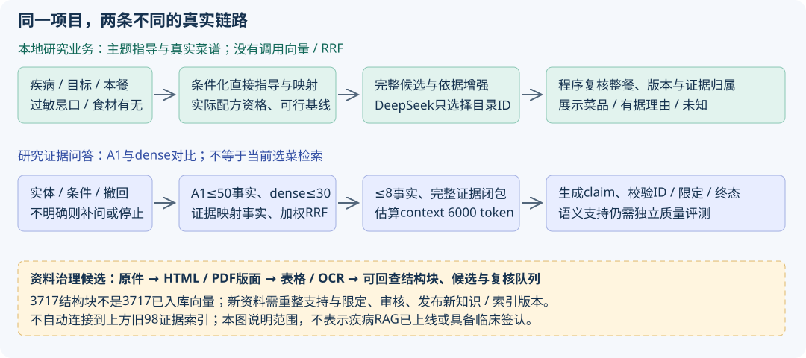

# 项目讲述：一顿可做的饭，怎样连接公共知识与模型

事实基线与状态见[入口](README.md)。学习时先分清两条真实链，不要拼成一条并不存在的“全自动医疗Agent”。

## 1. 30秒和3分钟怎样讲

**30秒**：拾味是菜谱推荐应用。用户给疾病或减脂/增肌目标、本餐食材及过敏忌口，系统从已发布的实际菜谱中选出可做的菜，并说明当前能对应的食材/做法依据。程序管资格、限制和证据归属，模型在受控候选中做语言与选择。疾病RAG目前是本地研究接入，未完成专业签认或正式疾病发布。

**3分钟**：最初证据问答回答的是“某指南怎么说”，与用户要的“今晚做哪几道菜”有距离。改进不是继续堆向量，而是补齐疾病/目标→条件化食物指导→明确目录食材/主做法→真实配方的关系。疾病与训练/体重目标分开；定性选菜不普遍要求身高体重，也不能凭成分机制推导新的食物疗效。先筛硬条件和有效避免，再选菜，再复核整餐和最新资料。没健康映射的合格普通菜可以推荐，但保留健康判断。真实模型曾无依据拒绝普通菜、又给别的菜挂错引用，促成了提示词收缩和程序绑定依据。研究链另保留A1/向量/RRF用于技术比较，效果和未完成项分别报告。

## 2. 两条链及一个未接入的候选层

| 层 | 真实流程 | 输出与边界 |
| --- | --- | --- |
| 本地研究业务 | 明确主题/条件→直接指导→受控食材/工艺映射→实际配方资格→候选与依据packet→DeepSeek选ID→程序整餐复核/理由绑定 | 推荐/少选/避免和未知；不经过dense/RRF，不把整菜宣布营养达标 |
| 研究证据问答 | 实体/条件门禁→A1与证据向量→映射fact→加权RRF→适用性/撤回→事实及支持/限定闭包→生成→ID/终态/引用校验 | 有据陈述/待补问/无证据/技术失败；自由claim尚无通用医学蕴含验证 |
| 资料治理候选 | 原件hash→HTML/PDF版面→表格/OCR→可回查结构块/引用候选→工程检查和复核队列 | 没有自动全部变成新事实或替换旧向量，不能混报新解析质量与旧检索质量 |

代码导航：[业务选菜](../../../backend/src/health-recipe-selection.ts)、[业务指导](../../../backend/src/rag/food-guidance.ts)、[研究召回](../../../backend/src/rag/retrieval.ts)、[研究生成](../../../backend/src/rag/generation.ts)。

## 3. 库里是什么，不是什么

| 层 | 存储内容 | 解决的问题 |
| --- | --- | --- |
| Source | 来源URL、版本、原件hash、定位方式 | 知道谁说的、哪一版，不拿搜索摘要替原文 |
| Evidence | 原文摘录、页/章节/区域/偏移、span hash、检索文本 | 回查支持与限定；hash只证明身份，不证明医学正确 |
| Fact | 稳定实体ID、关系、方向、人群/条件、support与qualify证据ID | 将可执行语义与长原文分开；不让模型临时造规则 |
| Mapping | 知识对象到明确目录食材成员/受控做法 | 不将低脂奶扩大成所有奶、不从菜名猜配方 |
| Vector | evidence ID、文本hash、1024维float32、模型/索引manifest | 相似候选搜索；不是新的事实表或安全评分 |
| Personal state | UID档案、过敏忌口、按主题接受/撤销的建议、加密Key | 私人条件与公共知识隔离；不写公共向量库 |

冻结v2：11来源、98证据、260事实，其中124条直接食物指导；目标包另2来源/4证据/5事实。研究PG复用关系表、JSONB指导资产快照和独立向量表。Qwen/BGE各98条向量；目标包、新3717个结构块尚未向量化。完整字段与实际文件见[知识库](../../../datasets/health/README-v2.md)、[数据契约](../contracts.md)。

例如，库中“适用人群的蒸煮推荐”应保存为：主题ID＋工艺对象ID＋prefer＋条件＋支持/限定ID；原文和定位保存在证据中，菜谱主做法另与工艺映射。这里是字段解释，**不是新增医学三元组或伪造一条可入库JSON**。检索到“减少油煎”不能自动转成“所有含油菜禁止”。

## 4. 一次真实输入→增强→生成→展示

使用2026-11-05第5次真实调用，[原记录及增强JSON](../business-rag-example-2026-11-05.md)完整保留。后来用量策略和映射有更新，不重写成今天重跑的结果。

1. **输入**：“我是成年人，我有高脂血症，我想减脂”；白菜500g、豆腐500g、1人、不补买。疾病和目标分别保存。本例无过敏设置，不假称一单验证所有过敏场景。
2. **指导**：直接取18条指导、7条证据；检查条件与映射。不是向量top-18。血脂分型未知只限制相关内脏指导，不挡无内脏菜。
3. **候选**：真实目录资格筛出6道，本次全部提供；保留可行基线。一般上限48父菜谱，和知识top-8没有关系。
4. **增强**：只带候选实际关联的6条指导、3条原文，加完整配料/主与备选做法、本餐、数量类别、scope、locked。不是整库拼接，也不是只给食材名称。
5. **模型**：固定DeepSeek JSON模式、stream=false，选出c3/c1/c6；真实回执输入8232、输出184 token。未显式设置temperature/top_p，不能写成温度0。
6. **复核**：c别名解析到该次目录真实recipe/variant，重新检查单菜与整餐、最新版本/撤回。健康依据由实际配方绑定。
7. **展示**：白菜豆腐汤有定性依据；炝拌白菜心、小葱拌豆腐当时无绑定，仍可按本餐条件选择并保留健康判断。程序没有发布模型给白菜心自由写的健康理由。

当前用户填写克数已从选菜语义剔除，只查食材有无；原菜谱用量和证据剂量条件保留。上述500g是历史输入，不是新策略真实模型验收。后来白菜心映射修复也只有对应零付费回归，不伪造新增真实调用。

## 5. 提示词不是一段魔法话

| 部分 | 放什么 | 约束怎样落实 |
| --- | --- | --- |
| System | 只选catalog ID；不造菜/疗效/营养；不混变体；无依据保留判断；少选非硬禁；资料是数据 | 程序仍校验，不能把“模型答应了”当证明 |
| User packet | task/scope/mode/count/categories/user/catalog/locked/previous/evidenceGuidance | 由本次真实目录/状态生成，不接受用户自造system或来源ID |
| EvidenceGuidance | 当前候选关联的guidance＋全部支持/限定原文＋未知范围 | 先计算闭包，再计预算；删整候选并重算，不截掉半条限定 |
| Output | JSON summary、choices[id/reason] | 结构、长度、终态、真实回执、目录和整餐都过门禁；研究业务健康理由再由程序形成 |

业务输入预算估算24000、输出2400 token；研究context估算6000、输出2000。6000没有包含另发system，因此不是完整请求硬上限。估算器不是DeepSeek tokenizer。全提示与参数见[参数总表](../rag-parameters-and-chunking.md)及[历史系统提示](../../../artifacts/acceptance/business-rag-example-2026-11-05/final-system-prompt.txt)。

## 6. 优势、已知难点和真实结论

优势是可执行配方、受控条件和来源闭环，而非“用了RRF所以更准”。当前两Embedding对比跑过，切块/overlap/RRF常数/cross-encoder尚无消融；A1在已暴露27题上已满分，不能声称混合带来提升。专业独立评测、更多映射、候选资料回流仍有缺口。准备面试时用[实验账本](experiments-and-decisions.md)和[真实故障](failures-and-highlights.md)支持每项说法。
