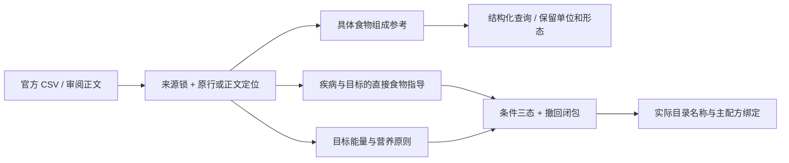

# RAG-009：疾病、营养组成和用户目标扩展

基线为本地 main `05d853fd54e6a0202b698050d1686e0a1492c1ad`。本批是独立分支上的本地研究扩展，已入现有回环 PostgreSQL；合入状态以管理审核为准。未调用真实模型、未部署、未启用线上疾病开关。

新增包 [nutrition-guidance-2026-11-13-v1](../../datasets/health/nutrition-guidance-2026-11-13-v1/README.md) 含 9 来源、36 证据、5 新疾病、6 目标、42 食物指导、5 原则、91 食物、32 指标。2,912 个组成记录中 2,756 个有源报数值，156 个明确缺项；B7 全部缺项。业务组合覆盖原 8 类加 5 新疾病，不表示旧向量问答已覆盖全部新主题。

## 实现选择

1. 新包独立契约与研究表，不改冻结健康 schema 的 mg/100g 限制。能量、宏量营养、维生素、矿物质分别建指标；没有把 kcal 冒充化学成分，也不把历史参考组成一律称为实测。
2. `nutrition-knowledge.ts` 校验矩阵完整性、单位、源报原值/原行 hash、证据来源与字符定位；B12 不误召回 B1，鲜/干同名参考有明确形态，词条检索不承担食物等价证明。
3. `nutrition-guidance-provider.ts` 扩展既有食材指导。新疾病参与 `conditions`、目标参与 `goals`；未知条件仅限制相关规则。GERD 的番茄触发不扩为柑橘触发，乳糖耐受不代替过敏校验。疾病档案不能被当作健康运动者。
4. 实际选菜只传适用的定性原则和直接食物指导，保留证据闭包。组成值有独立查询入口，没有接入全天目标/菜谱克数估算，也不从高蛋白/低热量数值生成健康动作。原 D19-13 的库存有无规则保持。
5. 来源、来源版本/hash、证据、限定证据、主题、对象及扩展包撤回均影响相关判断；组合指纹和既有返回前复核防止旧依据发布。研究库沿用旧全局撤回水位，旧 NCI 隔离记录没有恢复。

## 存储与入口

- [catalog.json](../../datasets/health/catalog.json) 单独登记扩展版本。默认健康包仍为 v3；旧基础/目标包、原件、旧向量不覆盖。
- [005-nutrition-expansion.sql](../../backend/src/health-knowledge/005-nutrition-expansion.sql) 只由本地研究入口执行，不进入产品/云端迁移。`health_kb.nutrition_releases` 存不可变公开快照；`nutrition_composition` 存 2,912 条可按指标/值检索的记录，禁止 UPDATE/DELETE。
- 导入采用专用事务/锁、hash 冲突拒绝与全量读回比较；同一 ID 变更须新版本。现有 `createLocalFoodGuidanceProvider` 自动装配组合指导；本地预览和主入口仍受原研究开关、回环数据库限制。
- CLI 和复现命令见 [数据说明](../../datasets/health/nutrition-guidance-2026-11-13-v1/README.md)。新包不写个人查询、健康档案或历史到公共表。

## 验证与实际覆盖

- `scripts/run.ps1 build` 与 `tsc --noEmit -p tsconfig.acceptance.json` 通过。
- 本地全单元：375 通过、2 跳过。首次检查发现新 worktree 尚无构建输出、系统 Python 为 3.14；构建后改用现有研究 venv 的 3.11 重跑通过，未放宽旧断言。该解释器无旧 PDF 测试依赖，原 Python 子套件按原条件跳过 PDF 一项；本批没有 PDF 解析。
- Python 3.11 离线重建的 `knowledge.json`、`manifest.json`、`composition-provenance.json` 与 3.14 初次产物字节一致。
- 真实本地 PG 导入、幂等及全量读回通过，见 [导入报告](../../artifacts/acceptance/nutrition-expansion-2026-11-13/postgres-import.json)。数值与原始行关联保留，未修改旧 release 或索引。
- 实际目录 341 道菜：10 条新增指导场景、6 个查询和 1 个内存模拟来源撤回通过，见 [实际目录/PG报告](../../artifacts/acceptance/nutrition-expansion-2026-11-13/postgres-gallery/report.json)。对应便秘蔬菜、本人确认番茄触发反流、缺铁食物、运动恢复蛋白来源分别绑定 23/18/79/66 个真实配方变体；这是绑定覆盖，不能当医学有效率。NAFLD 含糖饮料和维持体重全谷物在该目录中绑定为 0，保留缺口。
- 原业务回归使用组合 provider：12 条指导、10 条本餐通过，包括过敏、缺料、少补买、用户填写量等价；构造供应商，真实付费调用为 0，见 [业务报告](../../artifacts/acceptance/nutrition-expansion-2026-11-13/business-gallery/report.json)。
- 桌面/手机本地交互均通过，覆盖增肌建议→实际选菜、再补 GERD→本人确认番茄触发、柑橘仍未知；见[浏览器报告](../../artifacts/acceptance/nutrition-expansion-2026-11-13/browser-verified/browser-results.json)。第一次沙箱启动未完成，终止后在保留公网拦截的本地模式重跑；新增断言首次未按界面设计展开已收起的对话，补齐操作后两端通过，未改产品行为或删除断言。构造回复不计真实生成验收。

全部是项目编写的程序验收案例，已用于开发，不是独立人审 gold 或临床质量评测。NHS 增重来源标为待复核；NIH ODS 是明确标注的公开 web 正文快照，不冒充原 HTML 下载。下一批优先补中国本土可复用组成数据、当前目录中的全谷物/明确乳品形态，以及独立来源审核；不以平均召回率或扩库数量替代资料质量。

验收水位：真实 PG 报告保留其实际运行的源码指纹；最终完整单元与业务回归采用最终源码。末次仅用于更新源码指纹的 PG 重复检查因自动审批复核额度耗尽而未执行，审批未作不安全判断；不能将该次重复标成通过。已成功的导入、读回和实际目录 PG 记录不改写。
