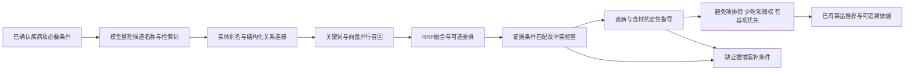

# 疾病—成分—食材—烹调过程 RAG 实施准备

方案日期：2026-10-27（Asia/Shanghai）；进展更新：2026-10-28。当前[研究知识库v2](../../datasets/health/README-v2.md)覆盖8个疾病实体：高血压、成人2型糖尿病、痛风、高尿酸血症、高脂血症、成人肥胖、慢性肾病和成人原发性骨质疏松。11来源、98片证据、260条关系、124条规则草稿，已导入本机共享PGlite并完成A1词法及50题编辑回归；v1记录原样保留。未运行Embedding/重排、未执行云迁移或正式疾病发布。模型暂定DeepSeek，健康目标为定性食材指导和据此推荐菜品，不普遍要求精确用量（D19-03）。本文统一健康知识、数据治理与检索实施说明；普通菜谱规则和当前运行边界见[架构说明](../../docs/architecture/overview.md)。

2026-10-28面经与代码复核后，新增[优化选型及实施路线](../../docs/agent-interview-2026-10-28/03_拾味RAG与Agent优化选型及实施路线.md)，具体化研究与正式发布分层、真实菜谱绑定、A0/A1词法基线、在线query编码、结构摘要、200题分组评测及故障矩阵。后续实施顺序和验收口径以该文的更新为准；本文保留领域建模依据。该更新没有启用向量、正式规则或自主Agent。通用题库与项目讲述见[资料导航](../../docs/agent-interview-2026-10-28/README.md)。

用户后续授权的v2实现已落地A1最长匹配/二元片段、歧义和形态过滤、实体/词法RRF、必需证据包、不可变完整性与缓存及返回前撤回复核；详见[实际优化复核](../optimization/health-rag-optimization-v2.md)。因此旧路线中这些条目的“待实现”描述按其当时状态解释，不再当作当前缺口；SQL全文、向量、200题独立评测和正式发布仍未完成。

## 1. 产品目标与推荐方案

核心目标是建立 **疾病 → 成分的有益/不利影响 → 含该成分的食材 → 烹调后新增或改变的物质 → 食材建议 → 已有菜品推荐**。用户实际投料有偏移，因此以有证据的定性食材选择为主，不追求精确摄入、营养达标、反应产率或每餐剂量优化。

对用户提供四类信息：可优先选择（有益倾向）、建议少吃、应避免（俗称不能吃）、证据不足/条件待确认。说明相关疾病、作用成分、食材/做法、适用条件和出处。不能仅因为有害成分可检出就判整类食物禁止，也不能仅因为含潜在有益成分就判食材有益；需有食物/饮食层面的支持或经核验的关联规则。“可能有益”不等于治疗效果。

**量不是普遍前置条件**：食材组成可只记含有/可能含有，烹调效应可只记可能生成/增加/减少。精确含量、产率、克数、温度分钟数均可选；证据若确实依赖高摄入、特定温度或特定人群，保留该限制，不伪装成无条件结论。单条依赖剂量的结论不能确定时，仅限制该结论，其他有完整定性依据的指导可继续，不因缺一个营养值关闭整条健康流程。

采用 **PostgreSQL 关系事实 + pgvector 公共证据向量 + 中文关键词 + RRF + 条件化规则 + 可替换模型接口**。第一阶段先运行结构化和关键词基线，第二阶段对照混合召回；小库先精确向量距离排序，达到性能瓶颈后才考虑 HNSW。关系链用 SQL 连接完成，初期无需独立图数据库或 LightRAG 自动建图。

这套方案更适合本项目的理由是：已经有上海PG和vector扩展、菜谱发布版本及账户隔离；同一数据库可以事务发布事实/证据清单，并按当前撤回状态复核。增加独立向量服务会增加同步、删除、权限和运维链路。这里是项目适配判断，不是宣称pgvector在任何规模都优于专用向量库。

RAG用于发现疾病—成分的影响方向及证据，并连接食材和烹调过程；运行时基于已核验关系生成食材指导及菜品筛选依据。检索不是仅为既定结果附引用，但模型发现的关系仍是候选，核验后才能驱动建议。最终路径是：

对未覆盖的具体食材/成分/做法标明证据不足或条件待确认，不能把未命中当成有益或安全；只在必要条件影响某项判断时暂停该项。当前已建本地研究库，尚无正式健康知识发布，因此模型准备接口仍返回evidence_required；本地研究资料不自动成为线上疾病推荐资格。普通模式仍按D17-02执行明列食品限制。

## 2. 数据不是一张向量表

| 实体/拟议表 | 最少字段 | 作用 |
| --- | --- | --- |
| `health_diseases`、`health_aliases` | 稳定ID、标准名、别名、歧义候选、版本 | 模型名称只作候选，由受控别名解析；不能只靠词向量合并疾病 |
| `health_components` | 成分ID、名称、类型、标识编码，单位可选 | 区分营养素、过敏相关物质和有条件的加工产物；不同指标不混同 |
| `health_food_component_facts` | 食物ID、成分ID、contains/may_contain/unknown、形态/品牌适用范围、证据；含量/单位/基准可选 | 优先回答食材含哪些成分；没有克数不妨碍已证实的组成关系，未知不等于不含 |
| `health_disease_component_effects` | 疾病ID、成分ID、有益倾向/可能不利/无明确影响/冲突/未知、健康结局、证据类型、适用条件、是否依赖剂量 | 区分人体饮食证据与机制/体外/动物证据；后者不能独立升级成食材摄入建议 |
| `health_food_guidance` | 疾病/组合ID、食材/食品类别/工艺ID、prefer/limit/avoid/insufficient_evidence、依据链、条件、核验状态 | 定性动作单独核验；不从单个成分的正负标签自动推导食材好坏 |
| `health_documents` | 文档ID、版本、URL、发布者、日期、许可范围、原文hash、状态 | 原始证据和不可变版本；只保存允许复用的文本或获准摘要/定位 |
| `health_evidence_chunks` | chunkID、文档版本、父节ID、页码/段落/表格、原始span、检索文本、hash、条件元数据 | 可追溯切片；原文与检索增强文本分开 |
| `health_rule_versions` | 疾病/组合ID、条件、成分/食品/工艺对象、定性动作、证据集合、审核与撤回；仅剂量型规则保留量纲和时间基准 | 可执行规则；与现有`HealthRelease`发布清单适配，不由模型自动生效 |
| `health_cooking_events` | 变体ID、内容版本、独立做法ID、步骤范围、工艺、原料状态/介质/去汤等条件，确有记录时附温度/时长 | 配方里实际发生的烹调过程，未知字段保持未知 |
| `health_cooking_effect_facts` | 输入食物/成分、工艺类别/必要条件、输出成分、可能生成/增加/降低/迁移、证据和适用性；定量值可选 | 记录增加、降低、迁移、浓缩或新生成的条件化事实 |
| `health_fact_evidence` | 事实/规则ID及版本、chunkID、支持/反对/限制、直接性、审核状态 | 一条结论可由多份证据支持或反驳，不把多来源重复视为独立证据 |
| `health_releases`、`health_index_manifests` | 规则/事实/文档/菜谱bundle版本及hash、模型revision、分词/切片版本、状态 | 原子切换一致快照；无需覆盖旧发布或更改旧迁移 |

事实边均有`source_version`、`evidence_id`、`conditions`、`review_state`、`valid_from/withdrawn_at`。关系类型明确区分`alias_of`、`contains`、`may_contain`、`affects_under_conditions`、`supported_by`、`contradicted_by`；缺失关系不能默认`does_not_contain`。

当前线上菜谱主要来自发布bundle，而不是已填充的`catalog_*`规范化行。新增健康关联必须绑定 **bundle ID + bundle hash + recipeId + variantId + methodId**，导入时核对真实ID；不能直接建立指向空目录表的外键。待规范化目录完成，再通过受检映射迁移，保留原绑定。现有`embedding_indexes/recipe_variant_embeddings`只支持菜谱变体，健康证据必须新增独立表，不能把chunk假装成variant塞入。

## 3. 烹饪中间产生的成分如何处理

采用“**原料事实 + 条件化过程事件 + 过程效应证据**”，不使用一个统一烹调损失百分比，也不把菜名映射为确定反应产物。

1. 配料行用于识别食材和调料；组成事实以含有/可能含有/未知为核心，不强制填写量。原配方固定用量仍用于普通库存和做法展示，与健康定性判断分开。
2. 按独立做法提取工艺事件，如煎、炸、蒸、煮、发酵、混合；同时记录步骤定位。可先用可识别的工艺类别关联证据，温度/分钟未知不普遍阻断。
3. 烹调可能新增的物质和已有成分的变化分开记录。仅保留有证据的“在条件C下可能产生X/使X变化”关系，不凭两种食材混合就推断化学反应。
4. 证据只适用于特定高温、长时或介质时，不因原方没写数字就假定满足；标为条件未知，针对该结论给提示或保留判断，而不是捏造产率或普遍禁用食材。
5. 既有定量研究可作证据背景，形成量/浓度/迁移比例不混用；精确数值非必填。定性降低不能证明全部去除，弃汤/喝汤、油是否复用等仍按证据适用条件区分。
6. 同料不同做法分别标记有证据的风险/有益倾向，优先推荐符合既有食材指导的做法。不同疾病建议冲突时说明涉及哪项；明确避免项优先，益处不能抵消禁忌。未知的必要临床条件仅影响相关规则，不假定所有组合均已支持。

例如构造测试可写“食品F，经工艺P，在条件C内产生/减少成分X”。测试只验证条件匹配、证据版本与未知传播，不植入未经核验的具体疾病阈值或真实反应量；必须包含“成分量为空、食材量留空仍可使用有证据的定性关系”的样例。

## 4. 切片：按证据命题和结构切，不机械切字

先解析文档结构，保留章节、页码、表头、脚注和原文span；清理页眉页脚后保留原始文件hash。研究论文区分研究人群、方法、结果、限制；指南按推荐条目及其适用条件切；食品成分表每个记录保留单位、基准与脚注。

| 内容 | 切片策略 | 必须保留 |
| --- | --- | --- |
| 疾病饮食规则证据 | 一条命题及其条件、例外为一单元；小块召回、大父节阅读 | 人群、分期/组合、作用方向、否定、例外；数量/单位/频率只在原证据依赖时保留 |
| 食材组成/测量 | 一条食材—成分关系或测量组，保留来源表头/脚注 | 食材身份、contains/may_contain、形态、组成证据；数值存在时保留其基准，但不强求所有记录都有数值 |
| 烹调变化证据 | 一组输入—工艺条件—输出/结果 | 工艺类别、必要反应条件、可能产物、实验/家庭场景；有温度/时长就保留，不补造 |
| 菜谱变体 | 短配方整条；长步骤按工艺段辅助检索，仍归父变体 | 食材/调料、独立做法和步骤序号，不拼接两种做法；配方用量不成为健康证据切片的必填项 |

实验起点：child目标约300～600个**模型token**，上限800；parent约1000～1800 token；仅跨自然段边界保留约50～80 token上下文，不跨表格记录/证据命题制造大面积重叠。具体长度按所选Embedding tokenizer度量；中文字符数只做离线预估。若“结论+例外”超过上限，拆分时显式互链并回取父节，不能静默截断。长度、重叠均是待评测参数。

`chunk_id = SHA256(doc_id + source_version + original_span + content_hash + chunker_version)`。标题路径/实体名可加在`retrieval_text`中改善召回，但引用只能指向原文span；不把模型生成摘要当原始证据。保留`support/oppose/qualify`标签候选及审核，召回时不把相似句合并成同一方向。

## 5. 向量与关键词技术选择

### 存储与索引

复用pgvector，使用余弦距离；每个索引manifest锁定模型ID、权重revision、维度、归一化、query指令、分词与切片版本。同维度的不同模型仍不能混查。公开证据和菜谱使用独立表/索引；个人查询仅请求内向量化，不落库。

数千到数万切片先测精确扫描作为可复现基线，不能仅凭数量确定索引。若P95超出预算，试HNSW：初始`m=16/ef_construction=64/ef_search=40`后按召回曲线调；IVFFlat保留大规模稳定批量数据方案，需要训练/列表参数，不作为当前默认。pgvector官方说明近似索引过滤发生在索引扫描之后，可能少于k条；0.8起有iterative scan。拟在健康类别和发布状态过滤后扩展/精确回补，仍不足标明搜索未完成。官方亦指出小表可能顺序扫描更快。[pgvector官方说明](https://github.com/pgvector/pgvector)

仓库历史证据是云端0.8.2、本机0.8.7；不代表本轮复查过线上版本，也不自动升级扩展。启用前查询实际版本和托管平台支持能力，不能假定Data API支持每请求`SET LOCAL`或动态向量运算。

### Embedding

建议对照两个中文候选，不指定最终运行供应商：

| 候选 | 适合本项目的点 | 代价/为什么不直接宣布最好 |
| --- | --- | --- |
| BGE-M3（首个质量基线候选） | 官方1024维、最长8192 token、多语言，同时提供dense/sparse/multi-vector能力；公开权重可本机复现 | 本轮只试dense，不同时引入三套表示；实际内存、速度、领域效果未测。MIT权重许可不提供免费计算资源 |
| Qwen3-Embedding-0.6B（资源受限对照） | 小参数候选、官方支持指令与可调维度，适合比较本机批量建库 | 暂以1024维对齐存储实验；query指令需锁定，模型与BGE向量不可混用。未测前不宣称更快或更准确 |
| 未来选定的境内Embedding API | 无需本机常驻推理，利于按需查询 | 需核对型号、保留、计费、版本和硬停；免费期不可当永久免费，当前不接入 |

规格依据：[BGE-M3官方模型卡](https://huggingface.co/BAAI/bge-m3)、[Qwen3-Embedding-0.6B官方模型卡](https://huggingface.co/Qwen/Qwen3-Embedding-0.6B)，核查2026-10-27。本轮不下载权重、不购算力。离线公共建库可以批量运行，但运行时查询仍需相同模型；不能只建文档向量就声称线上向量检索可用。若云函数资源不适合常驻模型，选择经核验的境内端点或先继续关键词。

### 中文关键词

先用受控疾病/成分/食品/工艺别名词典做最长匹配，保留拉丁缩写、化学名称、数字与单位；通用分词候选为jieba离线服务，专名词典版本化。事实字段用ID/B-tree连接，证据文本把预分词token送PG `simple`词典，GIN索引，标题/专名加权，使用`ts_rank_cd`作为起点。SQL参数绑定；不把未转义用户语句拼成`tsquery`。

PG内置全文排名不是BM25。若基线对证据长短敏感，再以冻结数据对照BM25服务/扩展，托管PG不能安装的扩展不成为前置。选择PG全文是减少组件的工程判断，不是假定它有成熟中文分词或效果优于BM25。[PostgreSQL 17全文控制](https://www.postgresql.org/docs/17/textsearch-controls.html)

## 6. 召回、融合、重排与规则执行

1. **预检查**：身份、CSRF、已确认限制、疾病候选歧义、规则适用条件；缺必要条件仅结束受影响的结论。模型输出不改写用户已确认疾病或硬限制。
2. **结构化锚点**：疾病→成分影响方向→食材组成→烹调新增/变化物质→食材指导→对应变体；规则明确引用的证据按ID强制取回，不能被top-k挤掉。多跳先有实证边再做SQL连接。
3. **证据发现**：对疾病的有益/不利方向、食物层面建议、烹调变化与适用限制分别构造最多8条查询；实体精确、关键词、向量并行。每通道初始top30～40、去重后最多80片段，来源/状态/语言/对象等过滤与查询协议一致。
4. **融合**：RRF `sum(1/(60+rank_i))`，同chunk去重、同一父节不累计重复分；60只是对照起点。精确命中的规则证据独立保留，不用相关性分数覆盖业务规则。
5. **重排**：第二轮才试`bge-reranker-v2-m3`，最多40～60对，保留8～12个child再回取必要parent。比较否定句、条件和冲突证据是否保留；未知条件不由reranker补齐。没有收益或超预算就关掉，不引入新的生产模型依赖。
6. **校验**：核对证据/事实/规则/菜谱版本、撤回和必要工艺条件；剂量型结论另核其单位/适用范围；命中不适用人群或未达条件的研究不能用于执行。模型只对核验后的证据包作候选摘要；每个引用ID必须来自本请求证据集合。
7. **推荐**：程序先执行过敏/忌口与适用的avoid规则，再对limit食材/工艺降权并提示，有益倾向仅在无已知冲突的菜品间加分；健康优先级先于家常/少补买的同层比较，具体权重须实验记录。已有库存/补买的整餐核对仍保留，不新增健康克数累计要求。不能“检索前40菜”就宣布所有菜无解；缺少某项证据标明覆盖缺口，不把未覆盖全部食品当全都不能推荐。必要避忌条件无法核验时排除受影响菜品或请求补充。
8. **发布前复查**：身份、操作/本餐版本、内容和撤回水位重验。引用验证失败、规则冲突、网络中断、预算用尽分别返回，未知不自动降为健康通过。

数据规模当前很小，保留“全目录资格检查”作为普通路径；证据top-k和菜谱资格范围是两个不同概念。向量失败但结构化规则证据完整时可走关键词；规则必需证据缺失时应停止健康分支。

## 7. 建库、更新、撤回与回滚

离线流水线：来源登记/复用范围→解析/保原文定位→实体对齐候选→人工核验事实/规则→结构切片→关键词→可选Embedding批次→质量检查→draft索引→冻结manifest→发布指针原子切换。三主题与7份首批来源已建立，接下来补覆盖缺口、审核、真实菜谱绑定与独立评测，不再等待首批疾病选择；不能默认网上能看就允许批量保存全文。既有研究DDL显式限制草稿和pending，正式批准与发布应另建层，不能通过放宽研究表约束把草稿自动转为可执行。

- 文档、事实、模型revision或切片方案变化生成新版本；按内容hash跳过相同文本，删除/变化的切片按差异失效。
- 既有迁移不可改checksum；先新增迁移草稿，在隔离本地PG验证，再按部署授权运行云迁移。本轮未生成或运行新的数据库迁移。
- 不同Embedding版本并行建独立索引，完整后切换；不得在同一索引混入新向量。回滚发布仍应用最新撤回集合，不复活失效来源。
- 文档撤回即时阻止关联规则/健康结果；异步删向量只算清理，不能成为撤回生效前提。每请求权威状态检查防缓存复活。
- 私有规则审核材料不授予anon读取；公开证据只发布获准字段，全文/个人数据分区，不把有医疗含义的查询向量放日志或公共表。

## 8. 与现有模型入口对接

已实现 `HealthModel.prepare` 输出 `HealthPreparation {state:'evidence_required', plan}`，计划仅含逐项原疾病名/候选标准名和检索词。`POST /api/v1/recommendations`在健康模式、登录及基本校验后调用，默认未配置时继续原有未开放行为；普通模式零模型调用。接口细节见 [HEALTH-MODEL-API.md](../generation/health-model-api.md)。

后续内部接口建议分为`resolveEntities`、`retrieveEvidence`、`matchCookingEffects`、`evaluateHealthRules`、`assembleCitedResult`。输入绑定`operationId/mealVersion/contentVersion/healthRelease/indexManifest`；输出应区分`needs_confirmation / unsupported / evidence_conflict / evidence_missing / technical_failure / evaluated`。`evaluated`还需各项规则结果，不使用单一`safe:true`。这些是后续契约草案，尚未实现。定性目标输出另见下节。

当前CloudBase公开内容使用Data API，不能把公开读取当成健康向量SQL已接通。个人Key健康聊天已通过`shiwei_ai_chat_claim`接入共享PG认领和限额，与此处尚未上线的RAG查询准备路径不同。健康检索优先验证有界、最小权限的服务端RPC（向量参数/维度、协议hash、授权、候选上限、超时和撤回水位）；平台能力不满足时再比较最小权限原生PG通道，禁止前端使用管理员密钥或任意SQL。既有授权的健康聊天继续按当前模型API运行，不能由本段重新封闭。

### 定性指导的目标输出（设计契约，尚未接入产品接口）

每项`foodGuidance`包含：`diseaseIds`、`foodId`或`processId`、`action: prefer | limit | avoid | insufficient_evidence`、相关`componentIds`、`effectDirection`、`evidenceIds`、`applicability`、`reason`、`doseDependent`及`coverage`。精确量字段为可选，`null`不改变已核验的定性关系；不输出单一safe布尔值。

- **prefer / 有益倾向**：有适用的饮食/食物层面证据，可作为选择优先级；机制推测单独列出，不自动加推荐分。
- **limit / 建议少吃**：证据支持一般限制或少选，不凭空给克数/频次；仅高剂量实验且没有食物层面限制依据时，不强行归为limit。
- **avoid / 应避免**：有针对该疾病/人群/当前条件的明确避忌依据；不能从“可能不利”直接升级为“任何量都不能吃”。用于实际菜品排除，相关条件随提示展示。
- **insufficient_evidence / 证据不足**：未覆盖、证据冲突或关键条件未知；只描述已核验部分，不冒充中性、无害或有益，也不无条件扩大为所有食材禁用。

菜品结果应提供具体命中的食材/工艺和依据链；相同食材不同做法允许有不同建议。多病种不通过益处抵消避免项。暂不实现个人精确营养摄入/剂量优化，不改变普通模式已有数量和补买规则。

## 9. 为什么暂不选其他方案

| 替代方案 | 当前方案相对收益 | 何时值得替换/引入 |
| --- | --- | --- |
| 纯向量RAG | 精确实体/单位/条件不会只凭相似度；撤回和规则可核验 | 纯向量作为相关性消融，不能替代规则 |
| 固定500字+大重叠 | 条件、否定、表头、不同做法不易被割裂；去重可控 | 固定长度保留为低成本对照，证据很简单时可能足够 |
| Neo4j/独立图数据库 | 初期关系链用PG连接即可，少一套同步/备份权限 | 真实出现复杂可变深度路径、SQL性能瓶颈再比较 |
| LightRAG/自动GraphRAG | 不需要先用模型自动推断全部边，更容易逐边核对证据 | 在研发证据发现上独立实验；自动边始终候选 |
| Qdrant/Milvus等独立向量服务 | 复用已有PG版本事务与权限，无双写恢复链 | 数据/吞吐增长且实测PG瓶颈后做成本/召回对照 |
| 一开始就HNSW+重排+Agent框架 | 小库易复现、无模型多轮额外消耗；未知原因易定位 | 指标证明某层收益后单独加入 |
| 大模型直接生成健康菜谱 | 固定目录、步骤与用量有据，事实/证据/执行可拆开审查 | 不作为当前项目替代方案 |

## 10. 评测、阶段和完成标准

先建200条人工核验的检索问题与证据标注，按来源/主题分开发集与冻结测试集，避免同文切片跨集合泄漏；模型生成问答只能作为候选题，经核验再纳入。覆盖别名/错字、正负方向、机制到食材的过度推断、少吃与避免区分、缺量仍可定性指导、剂量依赖不能绝对化、品牌/生熟差异、组合疾病、同料不同做法、未知温度、证据冲突/撤回和零证据。每题包含必取证据ID、可用/不可用条件及预期状态。

| 阶段 | 交付 | 检验 |
| --- | --- | --- |
| P0：本轮准备 | 接口、可替换适配层、配置/账本测试、AGENTS更新、本设计 | 不真实调用、不写健康事实、不改线上普通推荐 |
| P1：小规模事实/证据闭环 | 三主题研究库已建；后续补专业核验、真实bundle/hash/variant/method绑定与独立评测规范 | 定性关系/动作有据，量为空仍可指导；必要条件未知、撤回、做法差异可复现；不宣称疾病已正式支持 |
| P2：检索对照 | A0当前应用内排序，A1改进实体/中文词法，B在A1上加dense+RRF，C再加rerank；两种Embedding和切片消融 | 稳定证据命题Recall@20、nDCG@10、必需限定覆盖、条件错配率、P50/P95、内存与单查询消耗 |
| P3：集成 | DeepSeek最小权限云接入/调用账本、定性食材指导到菜品排序、内容/规则版本绑定、引用和获授权后的真实API小样本 | 多实例重复操作、断流取消、并发/费用、混合疾病、发布竞态 |
| P4：开放 | 明确疾病/组合范围、逐项审核签认、数据完整性与回退入口 | 专业复核、关键路径验收和可观测性；无依据的绝对安全承诺禁止 |

建议实验门槛（待分组数据集确定后冻结，不是已达标承诺）：冻结集证据命题Recall@20约95%以上；B相对A1有整体提升或关键困难题稳定增益且不降其他关键指标，不再以必须提升5个百分点作硬门槛；引用定位有效率100%；单元/构造集所有影响必要禁忌判断的未知和撤回均正确拦截；规则强制证据与限定完整率100%。构造断言不代表真实世界医疗安全率，小测试集须说明分母和不确定性。切片消融以稳定命题/span映射，不能因chunk数量变化偷换分母。运行时保留现有17秒应用截止并共享剩余deadline，P95目标须在实际云环境联调冻结。

预算原则：离线只处理公共材料；用户Key不建全站索引；Embeddings/rerank无可用免费资源时保持关键词；新资源/收费按授权处理。知识维护、专业审核和质量标注本身有成本，不能把零API账单说成整个项目零成本。

## 11. 下一步可直接执行的任务清单

1. 保留A0及原20题对照和当前A1的50题编辑回归，建立分组的200题候选/标注规范；当前查询在应用内运行，不称SQL全文或BM25已验证。
2. 基于现有8疾病实体和11来源，补真实菜谱bundle/hash/variant/method绑定，并另设计正式审核与发布层；研究schema原有draft/pending限制保留。
3. 在已实现A1词法、必要限定和完整证据包基础上扩展切片消融，验证有界PG全文RPC和真实PG多连接，不拿PGlite代表线上能力。
4. 基于选定硬件跑BGE/Qwen离线编码对照，同时解决同协议在线query编码；未获得可承载且符合费用/资料边界的通道时保留关键词。
5. 完成A1→混合→重排与切片对照，再按收益选型；随后实现会话内token预算/结构摘要和受限只读检索Agent，检验总会话成本、不变量及取消/撤回故障矩阵。详细任务与门槛见[优化路线](../../docs/agent-interview-2026-10-28/03_拾味RAG与Agent优化选型及实施路线.md)。

2026-10-27完成P0技术准备和模型接口。2026-10-28按用户后续授权建立了三主题真实来源研究小库和本地检索/导入闭环；P1专业复核、真实菜谱绑定及P2的200题独立评测、Embedding对照、P3/P4线上集成与正式发布仍未完成。具体实测结果见[本轮建库验收](../../docs/releases/ACCEPTANCE-health-knowledge-2026-10-28.md)。

## 12. 事实、来源与营养维护

以下有效约束从旧数据知识设计收敛到本方案，避免同时维护相互矛盾的文档：

- 公共事实、原文证据、可执行规则与个人资料分域；食材别名、组成、类别、替代不是同一关系。每条事实绑定对象身份/形态、来源版本、原文位置、适用条件与核验状态。
- 原文可保存范围按实际复用条件处理；来源不明时保留引用和定位，不批量复制。菜谱公开发布按D17-02执行，不把健康审核或旧许可审批指纹重新加到普通食品级推荐。
- 来源数值冲突保留各自版本与方法，不简单平均。健康证据冲突需复核，不用模型多数票或机械取最严替代适用条件判断；单病种通过不表示疾病组合自动支持。
- 营养是独立的固定配方投料估算：只汇总身份、可食量和数据完整的营养项，某项缺失则该项整道值不可计算，不能用部分和冒充总量。人数不缩放单道用量，不推算无依据的烹调损失/吸油率或实际摄入。
- 营养数据不完整不普遍阻断定性食材指导；剂量/人群/工艺确为证据条件时，未知只影响对应结论，不能默认为安全。全天建议不能直接除以三形成每餐阈值。
- 来源撤回或严重错误独立停用受影响事实/规则，发布和回滚均要核对撤回水位；旧收藏按当前内容和限制复查。模型抽取只能形成候选，不自动发布事实、阈值或疾病支持。
