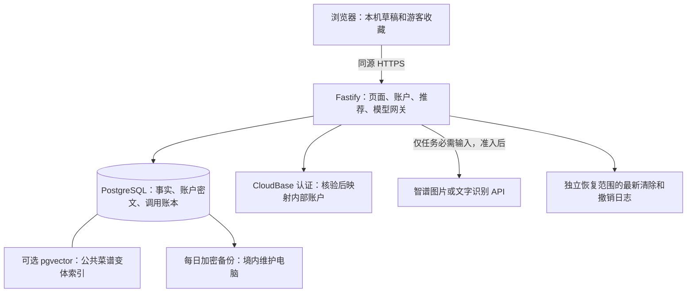

# 拾味：从现有 Demo 到实际落地的选型、配置与部署手册

> 后续结构实现已开始：本文保留选型研究时的代码/配置快照，当前支持的配置和真实操作入口以 [结构操作手册](DEPLOYMENT-RUNBOOK.md) 为准，已完成/未完成见 [实施记录](DEPLOYMENT-STATUS.md)。本轮按用户要求后置数据录入和具体模型，未将云或模型候选自动准入。

核查日期：**2026-10-20，Asia/Shanghai**。适用仓库：`CookDemo/`，代码基线为本次检查时的 `efce23e`。本文交付实施说明及配置模板；未创建资源、安装软件、启动数据库、调用模型或部署网站。

状态说明：**已确认**继承既有决定；**建议**是本次具体实施建议，尚未验证兼容性；**待准入**表示供应商、费用、数据处理或质量条件仍缺证据。本文不把推荐产品写成已经开通的服务，不改变 D3 免费/BYOK、D5 零账单及境内处理约束。

## 1. 先看结论：具体用什么

建议沿用现有技术栈，采用 **PostgreSQL 同时承担业务数据库和可选向量存储；React 页面与 Fastify API 同源部署；智谱作为首家识别 API 候选；CloudBase 上海作为待准入云候选**。先接通正式内容、数据库和账户，再做模型识别，向量增强最后验证。

| 你关心的东西 | 产品/组件名字 | 本项目用途与建议 | 当前状态 |
| --- | --- | --- | --- |
| 本地业务数据库 | **PostgreSQL**；建议本地联调先用 17 系列 | 保存业务资料、收藏、凭证密文、操作预算及公共内容；云端继续 PostgreSQL | 数据库类型已确认；17 是建议联调版本，未做真实服务器验证 |
| 本地数据库运行方式 | **Docker Desktop + Docker Compose**，或原生 PostgreSQL | Windows 推荐容器，方便隔离、迁移和恢复；原生安装也可 | 附本地容器模板，未安装/启动 |
| 向量数据库 | **pgvector**，装在同一 PostgreSQL 内 | 为菜谱变体增加语义召回，不另开独立向量服务 | 推荐具体实现；默认不启用语义增强 |
| 测试嵌入数据库 | **PGlite** | 继续用于测试 SQL、仓储和机制；不是当前线上/本地运行主库 | 已在现有测试中使用 |
| 浏览器本机保存 | **localStorage**，沿用 `src/storage.ts` | 本餐草稿、游客收藏和主动保存的偏好 | 已实现；不具备跨设备同步 |
| 前端 | **React + TypeScript + Vite** | 使用现有 `src/`，输出 `build/web/` | 已实现 |
| 后端 | **Node.js 24 LTS + Fastify** | 同一个服务提供页面、API、规则、模型网关 | 已实现本地部分；生产接线未完成 |
| 云平台 | **腾讯云 CloudBase，上海，PostgreSQL 类型环境** | 云数据库、认证、云托管容器 | 已有设计的首选候选，零账单尚未准入 |
| 真实登录 | **CloudBase 身份认证** | 优先管理员预置用户名密码账号；后端验证身份，映射内部账户 | 已确认方向，尚未实现适配 |
| 图片识别 AI | **智谱 `glm-4v-flash`** | 提取可见食材候选，不判断实际克重或健康适宜性 | 官方列为免费；本项目数据和质量待准入 |
| 混合中文提取 AI | **智谱 `glm-4.7-flash`** | 提取食材、数量、限制等，程序验证后进入对应确认流程 | 官方列为免费文本模型；待接入 |
| 向量模型 Embedding | **BAAI/bge-m3**，本地实验；**text-embedding-v4** 为既有 API 对照候选 | BGE-M3 先测稠密 1024 维；无合格免费算力/API 就保持关闭 | 均未部署/评测；模型与向量库是两个组件 |
| 重排序 | **BAAI/bge-reranker-v2-m3** | 仅在检索对照实验证明有收益后启用 | 既有实验候选，首轮不依赖 |
| 备份 | **PostgreSQL `pg_dump` / `pg_restore` + 境内电脑加密保存** | 每日备份、七天轮换、恢复演练；可用 7-Zip AES-256 做本机归档加密 | 方案已确认；完整生产恢复待实现 |
| 域名与 HTTPS | 自有域名、DNS、CloudBase 域名绑定及证书 | 正式公开网站入口；本地测试无需购买 | 正式公开路线存在费用/备案条件，见第 7 节 |

这里的“本地数据库”有两种含义：**开发电脑上的后端数据库用 PostgreSQL；网页当前设备的草稿保存继续用浏览器存储**。两者职责不同，不能靠把 localStorage 换成服务器数据库自动获得账户同步。

本地联调示例采用 `pgvector/pgvector:0.8.7-pg17`，它在 PostgreSQL 镜像上提供 vector 扩展；该标签来自核查时的[项目官方安装说明](https://github.com/pgvector/pgvector#docker)。这是建议的实验环境，不是已通过本项目兼容测试的生产版本。实际部署记录 PostgreSQL 补丁版本、扩展版本和镜像 digest；若云实例使用其他受支持大版本，先统一测试环境再迁移。

首版继续采用模块化单体，不增加独立 Milvus/Qdrant、图数据库、Redis、消息队列或自主 Agent。当前 17 道构造菜谱没有证据表明需要增加这些服务；pgvector 也不承担过敏、库存、营养或疾病规则判断。

## 2. 现有工程到底到了哪一步

本次检查了 PRD、需求基线、TDD、决策日志、数据/检索/模型/基础设施专题、未决问题、开发与验收文档，并核对下列代码。历史 `dist/` 静态 Demo 与新工程是两套入口；上级目录 `demo/` 不自动同步。

| 实际文件 | 已有能力 | 距离落地还缺什么 |
| --- | --- | --- |
| `server/main.ts` | 读取 `PORT`、`APP_ORIGIN`、`LOCAL_TEST_FEATURES`，固定监听 `127.0.0.1` | 可配置容器监听地址、生产配置验证、依赖启动与退出清理 |
| `server/app.ts` | API、CSRF、本机游客会话、推荐与 NDJSON 进度 | 数据库依赖注入、真实认证/同步/凭证路由、生产会话及共享配额 |
| `shared/catalog.ts` | 17 父菜谱/34 变体的构造目录 | 正式内容包、许可、数据库表、导入与发布机制；当前推荐直接读取代码目录 |
| `server/db.ts` | `pg.Pool` 连接封装，连接数上限 4；`migrate()` 读初始 SQL | 启动入口没有调用它；缺生产 TLS/连接超时策略及真实 PG 集成验证 |
| `server/migrations/001-initial.sql` | 账户、资料、收藏、凭证、操作、额度、删除任务、发布及撤销记录表 | 未建正式食品/菜谱/配料/营养/证据/检索表；没有向量表 |
| `server/repository.ts`、`crypto.ts` | 资料版本更新和 AES-256-GCM 封装 | 真实身份接线、按用途/版本提供密钥、轮换与用户资料 API |
| `server/gateway.ts` | 不可变操作绑定与尝试账本机制 | 没有 HTTP 模型适配器、图片上传处理和完整分层配额 |
| `server/erasure.ts` | 删除任务和失败续办机制 | 独立持久撤销日志、真实认证删除、可信最新水位和全系统恢复演练 |
| `server/health.ts` | 规则发布清单验证机制 | 没有专业签认的正式疾病规则/组合支持与营养来源 |
| `src/storage.ts` | 本机草稿/收藏等隔离 | 真实登录前差异合并、跨设备版本冲突和跨账号本机隔离联调 |
| `.env.example` | 只有本机测试开关示例 | 当前程序不会自动加载 `.env`；没有“填 Key 即接通”的功能 |

**设置 `DATABASE_URL` 或 AI Key，现有程序不会因此自动连接它们。** 第 5、8、10 节的待开发接线必须完成。当前 `/readyz` 明确返回 `local_only`，模型/云/账户/健康门槛为 false；HTTP 200 不能当作生产就绪。

当前行为以决策日志 D7-04～14 为准：食材录入交互已简化，过敏/忌口仍分别确认；人数 1～12、套餐最多 20 道、候选每页最多 6 道不同父菜谱；**人数只影响自动菜数参考，单道用量固定**，库存、补买、营养按固定整道配方累计。部署或导入内容不能恢复旧文档中的人数缩放规则。

## 3. 最终部署结构与数据去向



这是目标结构，不表示连线已经实现。前端与后端随同一个容器发布；数据库独立于可缩容的应用容器。容器本地磁盘不保存数据库、照片或唯一备份。

| 数据 | 放在哪里 | 不放在哪里 |
| --- | --- | --- |
| 公共食物、菜谱、变体、配料、营养和许可版本 | PostgreSQL；可重建的版本化公共内容包 | 不以模型临时回答当事实 |
| 公共菜谱语义向量 | 同库 pgvector，绑定内容/模型/索引版本 | 不建个人健康资料向量库 |
| 默认设置、敏感资料、收藏和保存的用户 Key | 账户归属的业务表；敏感字段/Key 认证加密 | 不写前端构建变量，不提供 Key 明文回读 |
| 本餐草稿、游客本机收藏 | 当前浏览器；继续遵守作用域与跨账号隔离 | 不默认同步完整本餐到云 |
| 原图、个人查询向量、候选与最终推荐 | 原图仅请求内存；其余仅当前请求/会话临时状态 | 不进长期对象存储、公共索引、推荐历史或正文日志 |
| 清除/凭证撤销记录 | 独立于业务旧备份的持久恢复范围 | 不仅存在进程内存，也不能随旧业务备份一起回滚 |

## 4. 本地数据库：怎样安装、配置和初始化

### 4.1 先启动现有应用，不需要数据库或 Key

在仓库根目录运行已有命令：

```powershell
cd 'D:\codex_AI\菜谱推荐\CookDemo'
.\scripts\run.ps1 install
.\scripts\run.ps1 build
.\scripts\run.ps1 start
# 浏览器打开 http://127.0.0.1:4175
```

只有本人测试登录/健康流程时，才在启动前设置 `$env:LOCAL_TEST_FEATURES='1'`。正式云环境必须关闭并阻止该测试身份对外启用；测试健康结果没有执行疾病筛选。

### 4.2 安装本地 PostgreSQL

Windows 推荐安装 Docker Desktop，启用 WSL 2 后端并使用 Linux containers。个人使用适用其免费范围；企业使用按[Docker 官方许可和系统要求](https://docs.docker.com/desktop/setup/install/windows-install/)核对。已有原生 PostgreSQL 的电脑可以直接建独立开发库，省略 Docker 步骤；Windows 原生 pgvector 另需匹配 PostgreSQL 版本的扩展构建，不能仅执行 SQL 就安装二进制。

本次附带[本地数据库 Compose 模板](deployment/compose.local.example.yml)。无需复制到根目录，可直接指定文件。以下命令**供后续实施时执行，本次未运行**：

```powershell
cd 'D:\codex_AI\菜谱推荐\CookDemo'
docker version
docker compose version

# 交互录入本地管理员密码，不把密码写进脚本或命令历史。
$shiweiDbSecret = Read-Host '设置本地 PostgreSQL 管理员密码' -AsSecureString
$env:SHIWEI_DB_ADMIN_PASSWORD = [System.Net.NetworkCredential]::new('', $shiweiDbSecret).Password
docker compose -f docs/deployment/compose.local.example.yml up -d db
docker compose -f docs/deployment/compose.local.example.yml ps
```

模板配置：数据库 `shiwei_dev`；只映射 `127.0.0.1:5432`；数据卷 `shiwei-local_shiwei_pg17`；管理员 `postgres`。密码为 Docker 初始化配置，不是网页登录密码。数据卷已有数据库后修改环境变量不会修改库内密码，后续改密走 `ALTER ROLE`/交互改密。管理员密码在容器配置中仍可被有 Docker 管理权限的人读取，这个模板仅用于本地构造数据联调。

如 5432 已被占用，把模板主机端口改为 `127.0.0.1:5433:5432`，本机连接用 5433，容器内仍用 5432。普通停止使用 `docker compose -f docs/deployment/compose.local.example.yml stop`；不要用删除数据卷来处理连接故障。

### 4.3 创建迁移角色与运行角色

通过管理员进入交互 SQL：

```powershell
docker compose -f docs/deployment/compose.local.example.yml exec db psql -U postgres -d shiwei_dev
```

在 psql 中逐项执行，`\password` 会交互询问密码：

```sql
CREATE ROLE shiwei_owner LOGIN NOSUPERUSER NOCREATEDB NOCREATEROLE;
\password shiwei_owner
ALTER DATABASE shiwei_dev OWNER TO shiwei_owner;
REVOKE CREATE ON SCHEMA public FROM PUBLIC;
GRANT USAGE, CREATE ON SCHEMA public TO shiwei_owner;

CREATE ROLE shiwei_app LOGIN NOSUPERUSER NOCREATEDB NOCREATEROLE;
\password shiwei_app
GRANT CONNECT ON DATABASE shiwei_dev TO shiwei_app;
GRANT USAGE ON SCHEMA public TO shiwei_app;
\q
```

`shiwei_owner` 只用于执行迁移；应用使用 `shiwei_app`，不使用超级管理员。云托管实例的角色创建和 schema 权限可能受平台限制，届时使用实际可用的等效最小权限角色，不照搬系统保留角色名。

### 4.4 应用现有迁移并核对

```powershell
docker compose -f docs/deployment/compose.local.example.yml cp server/migrations/001-initial.sql db:/tmp/001-initial.sql
docker compose -f docs/deployment/compose.local.example.yml exec db psql -W -U shiwei_owner -d shiwei_dev -v ON_ERROR_STOP=1 -f /tmp/001-initial.sql
```

成功后管理员执行下列授权，再退出：

```sql
GRANT SELECT, INSERT, UPDATE, DELETE ON
  accounts, profiles, favorites, credentials, operations, quota, erasures, revocations
TO shiwei_app;
GRANT SELECT ON public_releases TO shiwei_app;
GRANT USAGE, SELECT ON ALL SEQUENCES IN SCHEMA public TO shiwei_app;
SELECT version FROM schema_migrations;
```

应出现迁移版本 `1`。正式内容发布使用单独的发布权限；每次新增迁移都检查运行角色所需权限，不给运行角色永久 DDL/管理员权限。

这个步骤只建好了现有机制表。**网页不会因此从 PostgreSQL 读菜谱或保存账户。** 下一步开发应将 `connectDatabase()` 接到启动入口，传给仓储/网关/路由，关闭服务时关闭连接池；迁移作为独立发布步骤串行执行，不让每个应用实例竞争执行。新迁移需版本管理、失败回滚和真实多连接测试。

本地数据库连接信息为：主机 `127.0.0.1`、端口 `5432`、库 `shiwei_dev`、用户 `shiwei_app`、交互设置的运行密码。待配置加载器实现后可用连接串形式 `postgresql://shiwei_app:<URL编码后的密码>@127.0.0.1:5432/shiwei_dev`；容器访问另一个数据库容器时使用服务名 `db`，不能使用自己的 `127.0.0.1`。

## 5. 向量数据库：何时启用、怎样配置

### 5.1 明确区分三件东西

- **PostgreSQL** 保存可核验业务事实。
- **pgvector** 保存向量、计算相似度；不会自己把中文变成向量。
- **Embedding 模型** 把菜谱表示或查询编码为向量；文档和查询必须用同一模型版本及编码方式。

先保留现有结构化规则基线，增加受控别名和关键词检索。中文不能直接依赖 PostgreSQL 默认英文分词；建议先由 Node 中共享的受控词典生成 token，再用 PostgreSQL `simple` 配置/GIN 索引，或验证云实例的 `pg_jieba` 扩展。PostgreSQL 全文排序不直接称为 BM25，生产分词实现尚未完成。

### 5.2 pgvector 配置示意

在上述本地镜像或确认支持该扩展的云实例中，由具有扩展权限的角色执行：

```sql
CREATE EXTENSION IF NOT EXISTS vector;
SELECT extversion FROM pg_extension WHERE extname = 'vector';
```

下面是**后续迁移的结构示意，未加入现有 `001`，不作为完整生产表设计**：

```sql
CREATE TABLE recipe_variant_embeddings (
  index_version text NOT NULL,
  variant_id text NOT NULL,
  parent_recipe_id text NOT NULL,
  content_version text NOT NULL,
  model_revision text NOT NULL,
  representation_version text NOT NULL,
  text_hash text NOT NULL,
  embedding vector(1024) NOT NULL,
  PRIMARY KEY (index_version, variant_id)
);

-- 服务端参数 $2 必须来自与 index_version 对应的模型；禁止拼接 SQL。
SELECT variant_id, parent_recipe_id, embedding <=> $2::vector AS distance
FROM recipe_variant_embeddings
WHERE index_version = $1
ORDER BY distance
LIMIT 30;
```

使用余弦距离 `<=>`，小库先精确检索，不先建 HNSW。正式迁移还需补上变体/发布清单关联、有效状态、内容权限与撤回检查。向量召回之后按父菜谱归组，再执行既有业务排序与整套累计校验；前 30/60 候选截断不能改变“家常优先、同层少补买”。

### 5.3 Embedding 怎样部署

建议先在境内本机用 **BGE-M3** 做公共内容实验，采用稠密 1024 维；[官方模型卡](https://huggingface.co/BAAI/bge-m3)提供 MIT 许可和 Python 用法。实现步骤：

1. 独立 Python 虚拟环境安装经验证并锁定的 PyTorch、sentence-transformers 或 FlagEmbedding；下载模型并记录固定 revision。当前项目没有这些 Python 依赖，本次未安装。
2. 每个受控口味变体生成一条检索表示：菜名/别名、主辅料、口味、做法特点和内容版本，不机械切碎成独立菜谱。
3. 离线编码已准入公共内容，批量写入候选索引版本，完成完整性检查再切换生效索引。
4. 在线查询必须有可达的同版本编码器。本机编码器可供本地实验；把文档向量一次传到云，并不能让云端自动处理新查询。不要为此把家用电脑端口暴露公网。
5. 若要云端全天语义检索，另需获准的境内 Embedding API 或已核实免费算力；在该条件缺失时，云端保持结构化/关键词推荐，保留向量需求和实验。

最小本地编码示意：

```python
from sentence_transformers import SentenceTransformer

# 目录应事先下载并锁定 revision；不是未固定版本的线上下载路径。
model = SentenceTransformer(r"D:\shiwei-models\bge-m3", device="cpu")
vectors = model.encode(
    ["番茄炒蛋；番茄、鸡蛋；清淡；家常快炒"],
    normalize_embeddings=True,
)
assert vectors.shape[1] == 1024
```

这里使用 CPU 仅为实验可执行方向，未承诺内存、速度或适配本机硬件。部署与响应时间要测量；开源权重不包含免费服务器。既有 `text-embedding-v4` API 对照及硅基流动免费候选继续待费用/集成/数据准入，本次没有把它们批准为生产供给。

启用前按既有 RAG 设计比较结构化、关键词、向量、混合召回；200 条人工核对查询只是实验起点。模型/维度变化新建索引版本；不混用向量、不持久保存个人查询向量、不用用户 Key 为全站建索引。没有可靠增益就继续基线，重排序保持关闭。

## 6. 云端用哪个：CloudBase 上海，但目前有两个明确停止点

### 6.1 免费环境不等于完整链路已可免费上线

当前[资源点价格页](https://cloud.tencent.com/document/product/876/127357)列出免费体验环境每月 3000 点，免费环境不能开启按量；上海 PostgreSQL 类型环境列有 PostgreSQL、认证和云托管支持。与此同时，[云托管限制页](https://docs.cloudbase.net/run/limitation)仍写明需开启超限按量，否则停服。**两份官方材料尚不足以证明当前账号可不开按量运行完整容器链路。**

所以 CloudBase 仍是待准入首选，不写成已选定且可执行的免费生产资源。不能通过启用付费套餐、固定 IP、付费镜像仓库或额外 NAT 来“解决”本轮零账单约束。

第二个停止点是正式公开入口：腾讯云[ICP 备案说明](https://cloud.tencent.com/document/product/876/128405)要求作为备案资源的 CloudBase 环境达到个人版及以上、剩余有效期超过六个月且开启固定 IP，免费体验环境不支持。这是另一项费用冲突，即使容器免费问题解决，也不能直接承诺免费公开运营。

| 使用阶段 | 当前可做的事 | 进入下一阶段需要什么 |
| --- | --- | --- |
| 本人本地测试 | 现有应用；构造数据数据库与模型接线开发 | 本地 PG/真实适配验证 |
| 境内受邀云测试 | 仅在免费环境、容器及全部依赖准入后部署 | 默认域名测试限制、账号实际权限、费用硬停及恢复证据 |
| 正式公开服务 | 本次不能给出已满足零账单的可用承诺 | 域名/接入备案资格、主体要求、实际运行预算和各能力开放门槛；若需要付费，先形成新的用户决定 |

这不要求你重新选择已确认架构。现阶段先把本地真正接通；云及公开入口的材料作为上线前外部依赖继续跟踪。已有 Cloudflare Pages 保留历史静态 Demo，不接真实健康/过敏资料，也不作为新 Fastify 后端的直接替代。

### 6.2 创建资源前的登记表

后续实施人员需保存控制台截图/官方工单答复、核查日期和适用环境，逐项填实值；文档公开信息不能证明账号已具备资格。

| 项目 | 目标配置/要核验的结果 |
| --- | --- |
| 环境 | 上海，数据库类型 PostgreSQL，独立试用环境 ID；不是默认文档型数据库 |
| 费用 | 固定费 0、按量关闭；耗尽停服范围覆盖容器、数据库、网关、认证、网络、日志和仓库 |
| 数据库 | 实际 PG 大版本、可用 vector 扩展版本、连接地址/端口/TLS、最小权限、导出恢复权限 |
| 容器运行 | Node 24 可运行；支持所需镜像架构、同源 HTTPS、NDJSON、取消和超时 |
| 镜像/构建 | 本地构建；镜像存放、拉取、扫描/保留策略及网络没有独立付费前提 |
| 访问链路 | 容器到 PG 的内网连通，容器到准入模型的 HTTPS 出站，不另开未核验收费网络资源 |
| 域名 | 测试域名期限/访问限制；公开服务另核验自有域名及备案接入条件 |
| 认证 | 用户名密码建号、初次改密、登录、校验、退出撤销、删号和找回路径 |
| 恢复 | 每日导出、独立撤销日志、密钥独立保管、隔离恢复及删除不复活 |

CloudBase 官方已有[PostgreSQL/pgvector 接入示例](https://docs.cloudbase.net/recipes/add-rag-with-pgvector-cloudbase)和[pgvector 能力说明](https://docs.cloudbase.net/en/database/postgresql/pgvector)，支持核查直连与扩展方向；仍以目标实例权限和实际 SQL 验证为准。不要照搬通用 RAG 教程中的境外模型、1536 维向量或“检索后生成健康答案”。

## 7. 云部署操作顺序与容器配置

**以下步骤只在第 6 节外部条件满足、代码补齐并获得对应部署授权后执行。** 当前请求是生成文档，本次不操作云控制台。

### 7.1 先完成容器需要的代码

1. `server/main.ts` 支持 `HOST`：本地默认 `127.0.0.1`，容器显式 `0.0.0.0`；拒绝在非本机入口启用 `LOCAL_TEST_FEATURES`。只把开关设 0 不代替防误开校验。
2. 启动时读取并验证数据库、身份、主密钥、同源地址与功能准入配置；缺敏感配置不启用对应能力。关闭服务释放连接池，停止新任务并传播取消。
3. 把仓储和供应商适配器接到真实路由；将公共目录读取改为版本化内容仓储；未准入能力返回明确不可用。
4. 使用稳定的会话/CSRF 秘密及可撤销身份机制。当前随机进程 secret 和 Map 只适合本地临时状态；重启/缩容不能让费用账本、账户撤销失效。
5. `/healthz` 只表示进程存活；`/readyz` 核对当前开放功能的必要依赖。普通模式不必依赖关闭的模型/向量/健康能力，但不能永远返回假定就绪。

CloudBase [部署故障说明](https://docs.cloudbase.net/en/run/faq/deploy)明确指出只监听 `127.0.0.1` 会导致云容器探测失败。**附带 Dockerfile 设置 `HOST` 仍不会改变当前代码的硬编码监听，必须先完成第一项。**

### 7.2 构建、验证、部署

附[Dockerfile 模板](deployment/Dockerfile.example)及[对应构建忽略文件](deployment/Dockerfile.example.dockerignore)，构建上下文为仓库根目录。模板保留 `tsx` 等运行所需依赖；当前 `npm start` 运行 TypeScript，不能直接 `npm ci --omit=dev`。后续若编译后端 JS，另改构建/启动流程再裁剪依赖。

```powershell
# 先完成 7.1 的代码与测试；下列命令本次未执行。
cd 'D:\codex_AI\菜谱推荐\CookDemo'
.\scripts\run.ps1 check
docker build --platform linux/amd64 -f docs/deployment/Dockerfile.example -t shiwei:staging .
```

生产镜像还要固定经验证的 Node 24 镜像 digest、记录代码/内容版本、做依赖检查，确认无凭证与个人数据；模板不是已验收的生产镜像。

后续控制台顺序：

1. 准入证据通过后创建/选择上海 PostgreSQL 体验环境，记录环境 ID，确认全链路按量关闭。不要把现有其他业务环境改成试验环境。
2. 创建符合平台权限的迁移与运行账号；使用实际内网地址、TLS/证书和网络策略。顺序执行版本化迁移，再导入已核验公共内容。若实际 PG 版本不同先复跑兼容测试。
3. 配置 CloudBase 用户名密码认证和允许域名，只预置受邀测试账户。后端鉴权与内部账户映射接通后再启用资料路由。
4. 使用准入的镜像仓库推送本地镜像，在云托管创建一个服务，配置端口 8080、启动 `npm start`、`APP_ORIGIN` 为实际 HTTPS 站点。
5. 按第 9 节将秘密放到运行时受控配置，禁止构建参数/镜像层注入；平台模型、BYOK、向量和正式健康默认关闭，逐项准入后启用。
6. 起点采用最小实例 0、最大 1、0.25 vCPU/0.5 GiB、模型并发 1；这是既有估算参数，先测内存峰值/冷启动。该小规格不承载本地 BGE/视觉模型。
7. 检查页面、存活/就绪、数据库、会话/CSRF、重启、超额硬停及进度流。NDJSON 不被代理缓存/攒齐；45 秒内部总预算小于所有链路最短超时，排队和重试共用它。
8. 使用受控测试入口验证。确认所有必要门槛后才切换受邀流量；正式公开再进入下述域名步骤。

[云托管限制页](https://docs.cloudbase.net/run/limitation)当前列请求超时 60 秒和包体 20M，但应用当前 JSON 上限仅 **64 KiB**、没有图片 multipart 实现。既有 5 MiB 图片/45 秒是拟测起点：需核对解码像素、压缩、Base64 膨胀、网关及供应商各层上限，不能只把 `bodyLimit` 全局调大。

### 7.3 正式公开入口

费用和主体条件落实后，使用已有或新注册的域名，在接入商完成适用的备案/接入流程；不要为了继续步骤擅自购买套餐。CloudBase 默认域名用于开发测试，正式入口按[HTTP 访问服务说明](https://cloud.tencent.com/document/product/876/130728)配置已备案域名。

配置顺序：云托管服务绑定域名/根路径 → 按控制台实际值添加 CNAME → 配置有效 HTTPS 证书及续期 → 将精确站点地址加入认证安全域名并写入 `APP_ORIGIN` → 验证页面和 `/api/v1` 同源、Secure Cookie、来源/CSRF、证书和 DNS。API/认证响应不进公共 CDN 缓存；如后续增加 CDN，只针对适合缓存的公共静态资源并核验费用。

ICP备案、公安联网备案及本项目生成式 AI/健康相关服务的具体主体与开放范围要求，应在确定运营主体/功能后按官方口径专项核验；本次没有完成法律适用结论。账号能调用一个模型 API，不等于本站公开服务全部条件已满足。

## 8. AI 接入：使用哪家、怎样配置和联调

### 8.1 首家候选与费用模式

建议继续按现有研究采用智谱：图片 `glm-4v-flash`、文字 `glm-4.7-flash`。核查时[官方模型总表](https://docs.bigmodel.cn/cn/guide/start/model-overview)把两者列为免费模型；[视觉模型页](https://docs.bigmodel.cn/cn/guide/models/free/glm-4v-flash)说明图片能力，[文本模型页](https://docs.bigmodel.cn/cn/guide/models/free/glm-4.7-flash)提供调用方式。具体账号可调用性、并发、图片和输出规格仍要实测。

本次还查到官方总表已把 `glm-4.6v-flash` 列为免费视觉模型，补充了旧模型设计中未核实的公开信息；但它尚未在本项目验证，**不自动替换主候选**。同名近似的 FlashX/Pro 不进入免费白名单。

平台免费与 BYOK 分开：平台只调用获准免费型号，免费不可用时让用户主动重试/人工录入/选择自己的 Key；保存用户 Key 不代表授权自动消耗。平台原调用加补救最多 2 次，BYOK 每次用户操作最多 1 次，结果未知不自动重发，SDK 禁止叠加自动重试。

### 8.2 开通与准入顺序

1. 在智谱开放平台注册/核验账号，创建项目专用 API Key，确认模型列表与当前免费/限流条件。Key 只放后端运行配置，不粘贴到前端或 Git。
2. 登记具体模型、接口、处理地域、推理链路、原图/请求/日志留存时限、训练或匿名化使用、删除例外和自有产品集成许可。免费资格与敏感数据准入分别签认。
3. 先用人工构造文字和获准公共图片联调。真实照片、含过敏/疾病的混合文字，只有在上述条件落实后才发送；不能先上传再判断是否敏感。
4. 先实现单供应商适配器与契约；准入质量集通过后启用。备用厂商未通过同等验证就保持关闭。

[智谱隐私政策](https://docs.bigmodel.cn/cn/terms/privacy-policy)和[用户协议](https://docs.bigmodel.cn/cn/terms/user-agreement)是准入材料入口，不能仅由“境内存储”推导出 API 零留存、绝不训练或所有处理环节均已核验。核查需要针对本项目具体提取用途。

阿里百炼/火山方舟继续作为既有备选/BYOK 候选，不在首轮同时接入。若后续用百炼，按[北京地域的服务部署范围](https://help.aliyun.com/en/model-studio/beijing-access-information)核对具体型号：该页区分中国内地与中国弹性区，后者可能在内地以外推理；仅使用北京域名不能证明全链路境内。

### 8.3 后端怎样接线

建议新增 `server/providers/bigmodel.ts`，实现图片/文字两个受控任务；这是待开发路径，目前文件不存在。由已有网关先验证任务、身份、费用选择、凭证版本和操作指纹，预留预算后才发 HTTP 请求。

固定接入点由服务端配置/校验，基础地址为 `https://open.bigmodel.cn/api/paas/v4`，任务路径 `/chat/completions`，鉴权 `Authorization: Bearer <API_KEY>`。不允许前端传任意兼容 URL 或重定向到名单外地址。调用方式依据[官方文本接口示例](https://docs.bigmodel.cn/cn/guide/models/free/glm-4.7-flash)。

下面是**文字请求体示意，不是现有项目配置，也没有发起请求**：

```json
{
  "model": "glm-4.7-flash",
  "messages": [
    {
      "role": "system",
      "content": "只提取输入明确出现的信息。仅输出JSON对象，含ingredients、restrictions、unresolved数组；各项保留sourceText，未知数量为null，不猜测或撤销限制。"
    },
    {
      "role": "user",
      "content": "有番茄和两个鸡蛋，想吃清淡一点"
    }
  ],
  "thinking": { "type": "disabled" },
  "max_tokens": 1024,
  "stream": false
}
```

实际字段需要定义专用运行时 JSON Schema；这不是已有 `shared/schema.ts` 的可直接返回格式。`max_tokens`、思考开关和结构化参数按具体型号验证，不能把文字参数原样复制到视觉模型。对截断、拒绝、HTTP 错误、类型/语义不合格分别处理；合法 JSON 不代表信息提取正确。

文字链路：当前 `recognitions/text` 使用本地 `extractText`，接入后由服务端按输入场景选择已准入提取；原文、未知和冲突项返回 UI，不让模型直接写默认资料。图片链路：新增受限 multipart、类型/解码尺寸核验、去除非必要 EXIF、内存处理，再按型号实际支持的私有图片传输方式调用；不要把图片传到公开图床或长期云存储。任务任何终态均清理应用内图片引用。

返回候选先做 Schema → 原文依据 → 标准食材映射 → 冲突/未知限制检查，再进入当前确认交互。程序执行推荐、营养、变体及健康规则；换菜/翻页/人数修改不重新调用识别模型。模型不可用时保留输入和人工录入，不填固定示例假装识别完成。

## 9. 配置清单：哪些已经可用，哪些要开发后才生效

### 9.1 当前代码已读取

| 配置名 | 本地示例/用途 | 云端注意事项 |
| --- | --- | --- |
| `PORT` | 默认 `4175` | 计划容器 `8080`，和服务暴露端口一致 |
| `APP_ORIGIN` | `http://127.0.0.1:4175`，允许的精确来源 | 实际 `https://站点域名`，不含路径，不用 `*` |
| `LOCAL_TEST_FEATURES` | 仅值 `1` 打开本机测试身份 | 必须 `0`/不设置，并增加防误开校验 |

`.env.example` 不会自动被 `npm start` 加载。当前 PowerShell 用 `$env:变量名='值'`；后续可实现统一配置加载，或者显式通过 Node `--env-file` 启动所需入口，但必须实际修改并验证启动命令，不能只新建 `.env`。

### 9.2 建议新增的运行时配置契约（目前均未接线）

下表命名是待开发配置建议，**不是现有程序已经支持的变量**。实现时建立 Schema、默认值、权限和 fail-closed 行为；文档与加载器同步。

| 配置名 | 建议值/内容 | 秘密或前置条件 |
| --- | --- | --- |
| `HOST` | 本地 `127.0.0.1`；容器 `0.0.0.0` | 非秘密；需改 `main.ts` |
| `DATABASE_URL` | 运行角色连接串，按实际 TLS 策略 | 秘密；保留证书校验，不设 `rejectUnauthorized:false` |
| `DB_POOL_MAX` | 初始 `4`，对应当前代码硬编码 | 不等于平台额度；多副本连接总数和发布峰值另算 |
| `DB_CONNECT_TIMEOUT_MS` | 根据数据库冷启动与请求预算实测 | 缺必要依赖时不假装 ready |
| `CLOUDBASE_ENV_ID` / `AUTH_ISSUER` | 实际环境与可信签发方 | ID 可公开；管理凭证单独受控注入 |
| `SESSION_SECRET` / `CSRF_SECRET` | 独立生成的高熵秘密 | 不随实例随机重建；支持撤销和轮换 |
| `PROFILE_KEY_V1_B64` | 32 随机字节的 Base64 | 资料加密用途，密钥版本固定 |
| `CREDENTIAL_KEY_V1_B64` | 另一个独立 32 字节密钥 | BYOK 加密用途，与资料密钥分开 |
| `OPERATION_HMAC_KEY_B64` | 独立指纹密钥 | 与现有网关机制接线，非模型 Key |
| `MODEL_PROVIDER` | `bigmodel` | 固定供应商适配器，不接受任意 URL |
| `BIGMODEL_API_KEY` | 平台项目 Key | 秘密；不用于未经选择的付费型号 |
| `VISION_MODEL` / `TEXT_MODEL` | `glm-4v-flash` / `glm-4.7-flash` | 实际型号必须同时在能力/费用/数据白名单 |
| `MODEL_ADMITTED` | 初始 `false` | 证据通过才设 true，不是绕过验证的管理员按钮 |
| `MODEL_MAX_ATTEMPTS_FREE` / `MODEL_MAX_ATTEMPTS_BYOK` | `2` / `1` | 跨请求/故障共享预算，非 SDK 额外重试 |
| `MODEL_CONCURRENCY` | 测试起点 `1` | 实例并发不代替账户全局槽位 |
| `MODEL_QUEUE_MAX` / `MODEL_QUEUE_TIMEOUT_MS` | 按实际额度及延迟确定 | 有限队列；等待结束后清理临时 Key 引用 |
| `FREE_USER_DAILY_LIMIT` / `FREE_GUEST_DAILY_LIMIT` / `FREE_PLATFORM_LIMIT` | 按免费资格及实测确定 | 未配置/无法核验时不启用平台路线，不用“无限”默认值 |
| `REQUEST_DEADLINE_MS` | 测试起点 `45000` | 排队、调用、补救、最终检查共享总预算 |
| `IMAGE_MAX_BYTES` | 测试起点 `5242880` | 还需类型/解码像素和上游限制；不是当前 JSON 上限 |
| `SEMANTIC_SEARCH_ENABLED` | 初始 `false` | 需要完整 Embedding 在线供给、质量与费用证据 |
| `EMBEDDING_MODEL_REVISION` / `EMBEDDING_DIM` | 固定 revision / `1024` | 必须与发布索引吻合；不接受模型临时漂移 |
| `HEALTH_ENABLED` | `false` | 必须独立审核支持范围后开放；测试开关不代替 |
| `REVOCATION_JOURNAL_*` | 实际独立持久日志位置/访问凭证 | 最新水位可验证；配置缺失不开放真实长期资料 |
| `RUN_LOG_RETENTION_DAYS` | `7` | 必要安全日志按单独类别治理，不混留健康正文 |
| `BACKUP_RETENTION_DAYS` | `7` | 另落实任务执行、失败告警、加密及轮换 |

主密钥应独立于数据库、源码、镜像、数据库备份保存；初期可用运行时受控秘密配置加离线恢复材料，检查平台权限/备份覆盖。免费准入未核实前不默认购买 KMS。生成密钥必须使用密码学随机源；不要把示例字符串、口令或模型 API Key 当 AES 密钥。

迁移账号、平台管理凭证、模型 Key 和数据加密密钥不放任何 `VITE_*` 变量，Vite 变量会进入浏览器产物。BYOK 游客仅临时使用，账户保存需主动选择，数据库仅保存密文/掩码/版本，不以“保存时测试一下”隐式发计费请求。

## 10. 真实账户、内容与备份还需要哪些东西

### 10.1 CloudBase 认证适配

按[CloudBase 身份认证](https://docs.cloudbase.net/authentication-v2/auth/introduce)及[PG 模式认证](https://docs.cloudbase.net/authentication-v2/auth/auth-pg)核验当前环境接口；不要混用传统模式与 PG 模式的 token 验证或角色假设。采用平台支持的管理建号/登录/改密流程，不自建明文密码库。

接线步骤：管理员预置用户 → 首次设密/改密 → 服务端核验 token 的签名/签发方/受众/期限及撤销状态 → `(issuer, external_subject)` 映射 `accounts.id` → 应用签发可撤销 HttpOnly/Secure/SameSite 会话 → 每次业务请求做用户归属校验。外部主体 ID 不能假定是 UUID；当前 `accounts.external_subject` 为 text，内部 ID 为独立 UUID，继续保留该边界。

平台 `service_role`/管理凭证不发前端。即使平台提供表 REST 接口，也应禁止浏览器绕过 Fastify 直读 `profiles`、`credentials`、`operations` 等业务内部表；明确撤销 `anon`/`authenticated` 等不需要的直接表访问，并验证 GRANT/RLS。RLS 不能补救后端使用特权凭证后的所属权缺失。

用户体验接通：登录前显示本机与云资料差异，主动选择合并；持续更新携带预期版本，冲突返回 409 并保留双方内容；退出/换账号清理账户缓存，不清空本餐普通输入。无邮箱账号找回按可信邀请渠道人工核验，不承诺尚未验证的原生自助恢复。

### 10.2 正式内容是数据库之外的必要投入

| 必需内容 | 来源/名字 | 实施要求 |
| --- | --- | --- |
| 食物、别名、类别与复合配料事实 | 人工治理标准表及合法可用标签/来源 | 稳定内部 ID；形态、生熟、品牌、单位和计量基准分开；配料不明不能判断过敏通过 |
| 菜谱和受控口味变体 | 自编或明确授权的内容包 | 每变体有固定完整投料、步骤、来源/授权、父菜谱；不按人数缩放，不用旧 Demo 构造值冒充正式事实 |
| 营养候选 | **USDA FoodData Central** 的匹配记录 | [官方 API 指南](https://fdc.nal.usda.gov/api-guide/)列 CC0；按需下载/导入公共记录，保留 FDC ID、数据类型和版本；不发送个人资料给 USDA |
| 中国食物成分/指南 | 既有专题列举的国内权威来源 | 免费查询不代表批量复用许可；无明确授权不复制整库或全文 |
| 健康规则和证据 | 许可允许的指南定位、专业审核签认 | 规则完整发布清单、撤回状态、病种/组合支持与必要输入均须落实；向量与生成模型不能代审核 |

正式导入建立独立迁移和导入脚本，先候选内容包→许可/映射/完整性检查→回归→版本发布，再切换服务读取。营养某项缺值不补零，不阻断普通推荐；依赖该项的健康规则则不能判适宜。Open Food Facts 沿用现有首版不导入决定。

### 10.3 备份、删除与恢复

使用 `pg_dump` 自定义归档和 `pg_restore`；[PostgreSQL 官方备份说明](https://www.postgresql.org/docs/17/backup-dump.html)区分数据导出与恢复工具。云端使用与服务端版本兼容的客户端，托管认证 schema、角色和平台对象不能假定能完整导出/直接还原。

仅供**本地构造库**的归档示例，避免 PowerShell 文本管道损坏二进制：

```powershell
cd 'D:\codex_AI\菜谱推荐\CookDemo'
New-Item -ItemType Directory -Force -Path '.local-backups' | Out-Null
docker compose -f docs/deployment/compose.local.example.yml exec db pg_dump -U postgres -d shiwei_dev -Fc --no-owner -n public -f /tmp/shiwei-dev.dump
docker compose -f docs/deployment/compose.local.example.yml cp db:/tmp/shiwei-dev.dump .local-backups/shiwei-dev.dump
docker compose -f docs/deployment/compose.local.example.yml exec db pg_restore --list /tmp/shiwei-dev.dump
```

这只是业务 schema 的导出示例，未加密、未包含认证/密钥/独立撤销日志，也未验证恢复。真实资料不能沿用未加密落盘方式；`.local-backups/` 不提交 Git，不进入镜像，实际使用前增加本地忽略并限制文件访问。

真实备份落在维护者境内电脑的受控目录，使用外层加密；Windows 可使用[7-Zip 的 AES-256 加密](https://www.7-zip.org/)及加密文件名，并将口令放在与备份不同的恢复材料中。优先在加密工作区完成临时导出和归档，避免先把真实明文备份写到普通工作目录。

每日任务须有实际执行器（例如境内维护电脑的 Windows 任务计划程序），仅开机在线且网络/导出权限可用时才可能成功；记录成功时间、校验值、内容/迁移/密钥版本，保留最近七个每日副本，重大变更备份也设到期，不无限累积。不能依赖已缩容容器中的定时器。失败或超过一天未成功，提示维护并暂停扩大试用。

独立撤销日志建议使用与业务恢复范围隔离的持久控制库/日志，记录最少的账户/凭证标识、范围、单调水位及确认回执；具体产品/第二逻辑库权限和费用需在目标环境验证。当前业务库的 `revocations` 表本身不足以证明独立性；只保存在同一份旧 dump 或离线电脑每天一份的记录也不足以证明最新撤销。该接入未完成前，不开放真实资料/Key 长期保存。

恢复顺序：隔离新库 → 核对并导入业务备份 → 恢复/核验托管身份与内部映射 → 提供独立密钥材料 → 获取可证明最新的清除/撤销记录并重放 → 检查禁用账号/凭证与撤回内容 → 回归并计时 → 恢复流量。无法验证最新水位时保持隔离。试用 RPO/RTO 各 24 小时是目标，尚未演练达标。

## 11. 从现在到上线的实施清单

这是一份后续工作拆分，不表示本次已经开发或上线。按依赖顺序推进；模型/健康未准入可明确关闭，但正式首版需求继续保留。

| 顺序 | 要完成的交付 | 主要代码/材料 | 能说明完成的证据 |
| --- | --- | --- | --- |
| 1 | 固定代码与实际配置契约 | 启动配置、秘密注入、`HOST`、生产防误开 | 缺配置拒绝敏感功能；本地及容器入口正确 |
| 2 | 真实 PostgreSQL 联调 | `db.ts` 启动接线、独立迁移入口、测试库 | 真实 PG 多连接下 CAS、预算并发、删除续办通过；PGlite 结果单列 |
| 3 | 正式内容与仓储 | 食物/菜谱/配方/营养/来源迁移和导入 | 来源许可清单、版本化内容、数量/限制回归；关闭 G-01 对应缺口 |
| 4 | 真实认证与账户资料 | CloudBase 适配、profile/defaults/favorites/sync | 身份不可伪造，跨用户隔离、409 合并与换账号缓存验证 |
| 5 | 凭证与恢复闭环 | credentials、加密配置、独立撤销日志、清除任务 | Key 不回读；撤销即时阻断；认证/数据库/密钥联合恢复，关闭 G-04 对应缺口 |
| 6 | 一家模型提取接入 | 智谱适配、图片处理、配额、待确认响应 | 免费/BYOK 分开、共享尝试预算、断流不重发、处理条款和独立样本质量；对应 G-02/G-05 |
| 7 | 免费云运行验证 | CloudBase 账号证据、镜像、网络、日志、同源服务 | 按量未启用仍可工作、超额确实硬停、重启/冷启动/NDJSON/备份通过；对应 G-03 |
| 8 | 可选向量实验 | pgvector、词典/关键词、Embedding 供给/索引发布 | 固定查询/内容的检索质量、规则违规、完整延迟和费用对照；不阻塞结构化基线 |
| 9 | 健康正式支持 | 专业审核、可执行规则、病种组合支持、发布撤回 | 缺依赖停止，旧发布不能复活撤回规则；对应 G-06 |
| 10 | 受邀验收与公开接入 | 真实手机、压力/故障、日志与域名/主体材料 | 第 12 节清单通过；公开费用/备案冲突已获明确解决 |

旧的初始估算为 10 名测试者、月 1000 次推荐/200 次图片、2692 资源点，它包含假设的活跃时长/数据库计算/出口；不是实际账单、容量或长期免费保证。需要逐项看实际资源消耗，尤其数据库/容器空闲时间、网关、认证、日志、备份出口、镜像及模型调用。预算告警和应用限流都不能替代禁止计费能力。

## 12. 发布前实际要验证什么

- [ ] 内容来源/配料/固定投料量可追溯，库存未知不当成足量，套餐累计及人数仅影响菜数符合 D7-14。
- [ ] 本地与云环境分离；非本机入口拒绝测试登录，正式健康保持审核门禁。
- [ ] 真实 PostgreSQL 上完成多连接竞争、权限、连接中断、迁移失败及服务重启测试。
- [ ] 用户 A 不能读取/引用用户 B 资料、收藏和 Key；登录合并、版本冲突、退出与换账号缓存可复现。
- [ ] 模型免费名单、费用硬停、平台/用户/游客总限额、至多两次尝试及 BYOK 单次尝试正确。
- [ ] 真实图片和含敏感文字的整个调用链已获准；日志/镜像/浏览器持久存储/备份无原图或明文 Key。
- [ ] 慢请求、排队、取消、断流和旧结果晚到都保留正确状态，不自动重新发送模型请求。
- [ ] 已知硬限制贯穿候选、单换、重推、口味和收藏；向量/关键词失效可以退基线，必要事实缺失停止相应推荐。
- [ ] 受邀入口页面/API 同源、HTTPS/Cookie/CSRF 正确，手机端拍照/选图实际可用。
- [ ] 费用/网络/镜像/日志/认证等所有必要项有免费硬停证据；实际账号可用性已验证。
- [ ] 七天备份轮换、独立最新撤销记录、认证/密钥恢复及删除不复活已演练；RPO/RTO 有实际计时。
- [ ] 正式公开域名、备案/接入和运营主体适用条件已落实；健康对外范围有专业审核。

## 13. 本次资料依据与交付边界

项目依据：[PRD](PRD.md)、[需求基线](technical/requirements-baseline.md)、[统一 TDD](technical/TDD-v0.1.md)、[决策日志 D1～D7](technical/decision-log.md)、[数据知识](technical/data-knowledge-design.md)、[RAG](technical/rag-design.md)、[模型服务](technical/model-service-design.md)、[基础设施](technical/infrastructure-design.md)、[未决问题](technical/open-questions.md)、[实现范围](technical/implementation-v0.1.md)、[开发说明](DEVELOPMENT.md)及[固定配方验收](ACCEPTANCE-fixed-recipe.md)。架构审查 AR-M03～06 对应的真实账户隔离、完整规则发布、模型调用绑定和删除恢复仍须实际验证。

本次仅增加本文与三个配置示例，并在 README/TDD/未决问题中增加文档入口和本轮核查记录。PostgreSQL/pgvector 的具体本地版本是建议；CloudBase 和智谱保持候选/待准入；既有批准决定未改写。配置模板只有静态核对，未运行 Docker 构建、数据库迁移、模型实验、恢复演练或云验收，不能视为可直接公开上线的交付。

实际文档检查：4 份涉及的 Markdown 中 51 个本地链接有效，代码围栏完整；JSON 示例可解析、Python 示例可编译为语法树、6 段 PowerShell 示例语法通过；Compose YAML 可解析且数据库仅绑定 loopback、初始化密码必填；Dockerfile 的 9 个 COPY 源存在；`git diff --check` 无空白错误。本机未检测到 Docker 命令，因此未做镜像构建/数据库启动验证；本次纯文档工作未重跑业务测试。
