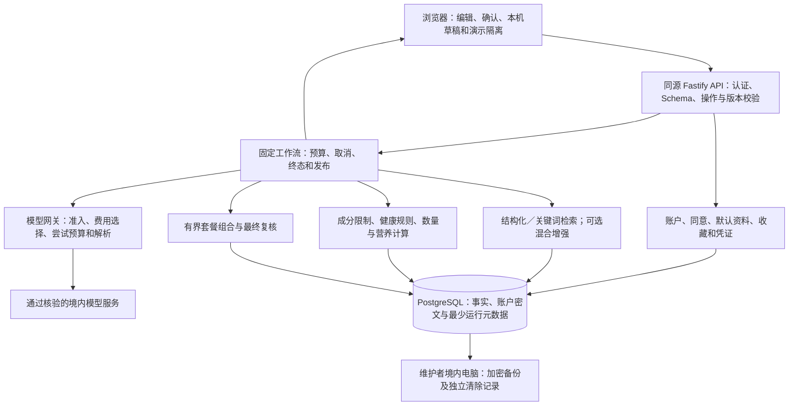

# 拾味 AI 菜谱推荐网站：统一技术设计 v0.1

> 2026-10-19 开发补充：本文件保留阶段6A设计语境；本轮实现范围、审查项状态及新确认的一荤两素/排序决定见 [implementation-v0.1.md](implementation-v0.1.md)、决策日志 D7 和 [验收报告](../ACCEPTANCE-v0.1.md)。不将下文历史“尚未实现”推定为当前所有模块状态，也不将本地通过推定为 G-01～06 开放通过。

日期：2026-10-19  
阶段：6A，整合设计与一致性检查  
状态：设计文档基线；尚未实现、部署或完成原型验收

## 1. 结论、来源与使用规则

现有产品范围有明确的技术实现路径，采用 **React／TypeScript／Vite＋Node.js 24 LTS／Fastify＋PostgreSQL 的模块化单体**。结构化事实和规则负责约束，固定工作流负责执行，模型主要负责真实输入提取。向量检索、重排序及备用供应商均按证据启用，不是首版运行前提。

未发现必须削减 PRD 功能的已证实技术不可行项。发现的是跨模块契约缺口，以及内容、供应商、免费部署和验收证据不足；它们分别阻塞相关分支定稿或对外开放，不阻塞整体设计。当前不提出 PRD 变更，不修改原 PRD。

### 1.1 资料索引

| 材料 | 本文引用职责 |
| --- | --- |
| [PRD v1.0](../PRD.md) | FR-01～FR-12、BR-01～BR-30、AC-01～AC-32、Bug 和产品边界 |
| [需求基线](requirements-baseline.md) | 需求状态、D0 补充及 Demo 验证边界 |
| [数据知识架构](data-knowledge-design.md) | 事实、标准化、营养、规则、证据与审核 |
| [检索架构](rag-design.md) | A／B／C 比较、候选单位、召回实验与版本管理 |
| [模型服务设计](model-service-design.md) | 免费优先、BYOK、供应商准入、调用预算和输出校验 |
| [推荐工作流](agent-workflow-design.md) | 固定流程、局部重算、套餐搜索、状态及恢复 |
| [基础设施设计](infrastructure-design.md) | 技术栈、API 分组、部署、加密、删除和备份 |
| [技术决策日志](decision-log.md) | DR、D0～D5 的来源及理由；D6A 为本轮整合记录 |
| [未决问题](open-questions.md) | 产品未定项、原型验证与开放门槛 |
| [UI 体验评审](../../UI_DEMO_REVIEW.md)、[Demo 说明](../../README.md) | 原型事实、UI 问题及证据边界，不代替正式需求 |

本轮核对的 PRD SHA-256：`54C26CABF13DD61F7D215FCBFE236F88ADA6DCD49DA540E92A5458AF44F92E30`。

明确确认的后续决定在其范围内补充 PRD；其余继承 PRD。历史文档的“未定”不能撤销后来已确认的决定。TDD 汇总系统边界与跨模块约定，专题细节仍以所引文档为依据；发现真实冲突须登记，不能借解释优先级静默改需求。候选、建议、测试参数均不自动升级为确认决定或实测事实。

### 1.2 冲突与缺失清单

| 编号 | 发现及来源 | 本轮整合处理 | 剩余影响 |
| --- | --- | --- | --- |
| INT-01 | D5 零账单要求与免费容器准入证据不齐 | 保留 CloudBase 候选身份，不把 2692 点估算当保证 | 阻塞云试用；对应 D5-OQ-01，不等于产品不可行 |
| INT-02 | D4 会话内复用与 D5 缩容／重启丢内存 | 复用是可丢失的优化；缺失时按当前输入重检索和重算 | 原型验证跨请求／重启，不新增持久个人候选库 |
| INT-03 | D4 旧任务失效未区分浏览器编辑与服务端已知版本 | 浏览器负责未提交编辑的最终接收判断；服务端负责已知版本及权限 | 冻结版本契约，验证晚到结果与资料更新竞态 |
| INT-04 | D3 尝试预算、D4 去重与 D5 断流尚未形成闭环 | 最少调用准入记录跨请求去重；结果未知不自动重发 BYOK | 验证请求中断、重启和 SDK 隐式重试；期限仍待确定 |
| INT-05 | D5 请求期任务与健康补问／人工确认等待跨度不同 | 需确认时结束当前请求；用户补充后提交新操作 | 不让 HTTP 请求或模型调用跨越人工等待 |
| INT-06 | D4 进度流、完整发布及超限小套餐易混为部分输出 | 只流真实进度；小套餐也须整套通过检查，另标目标未达成 | 验证断流与预算不足；不能发布半成品 |
| INT-07 | 保留输入与 D5 原图终态清理的边界易误读 | 保留可编辑文字；浏览器当前文件可供主动重传，刷新不恢复原图 | 失败不等于服务端保留原图，需恢复 UI 测试 |
| INT-08 | D1 营养参考缺项与健康定量判断可能误共用“通过” | 营养展示与库存核对、健康规则依赖分开判定 | 补齐每条健康规则依赖；普通推荐不被营养缺项阻断 |
| INT-09 | 七天普通备份、六个月必要安全日志、在线清除口径不同 | 分离数据目的、保留类别及清除记录；旧备份不能覆盖最新撤销 | 实现保留清单；最新清除记录不可验证时恢复环境不开放 |
| INT-10 | PostgreSQL 备份不能证明托管认证和密钥也可恢复 | 恢复范围包含身份映射、认证可用性、内容版本和独立密钥材料 | 完整 RPO／RTO 未验证；不能只用数据库恢复宣称达标 |
| INT-11 | D2 混合检索实验与 D3／D5 零费用运行限制 | 结构化／关键词是可运行基线；增强须同时满足质量、许可和费用准入 | BGE 等候选未部署，生产分词实现亦待验证 |
| INT-12 | FR 路径明确，但逐字段接口、共享状态和事务边界未冻结 | 本文给出最小逻辑契约、模块所有者和验证入口 | 后续契约阶段完成 Schema／OpenAPI，不视为已实现 API |
| INT-13 | 默认配比、自定义留空及排序权衡仍未定 | 保留配置接口与显式未定状态，不从 Demo／遍历顺序填默认值 | 阻塞相应规则及验收预期定稿，对应 D4-OQ-01 |
| INT-14 | Node 单服务内搜索、模型等待、最终复核共享时限 | 分层预算，搜索可让出执行并响应取消；外部等待不持有长事务 | 原型测量事件循环、取消、最终复核余量及数据库占用 |

INT-02～08、11～12、14 是既有决定的衔接约束，并非已验证修复。INT-01、09～10、13 的相关门槛仍需材料或确认。当前没有必须再次询问才能完成 TDD 的产品问题。

## 2. 方案状态及保留理由

| 状态 | 内容及来源 | 选择理由／启用边界 |
| --- | --- | --- |
| 已确定 | 模块化单体、同源前后端、PostgreSQL；D5-02 | 一套主语言，减少个人维护服务数；并不证明免费云可运行 |
| 已确定 | 结构化事实＋规则＋版本文档；D1-05、D1-08 | 精确约束可复核，同时保留证据上下文 |
| 已确定 | 固定工作流，不引入自主 Agent；D4-01 | 产品路径已明确，减少规划调用、循环和终止风险 |
| 已确定 | VLM 提取候选、标准库归一、用户确认；D3-01～02 | 降低专用视觉训练成本；供应商和型号尚未准入 |
| 已确定 | 平台免费优先、用户主动 BYOK、硬预算；D3-03～09、D5-01 | 避免平台意外付费；免费能力不足时允许等待或人工录入 |
| 已确定 | 本餐本机、长期资料与收藏同步、无推荐历史；D0-04～05、D5-04 | 遵守资料范围并减少个人中间结果保留 |
| 暂定候选 | CloudBase 上海免费数据层、认证与容器；D5-03、D5-11 | 减少自管运维；身份能力与零账单机制须逐项核验 |
| 待原型 | 中文词典、缓存失效、流式链路、搜索预算、认证恢复 | 方向已有决定，实际库、协议细节和资源能力未验收 |
| 待对照实验 | 向量＋关键词、RRF、Embedding 维度、重排序；D2 | 只有质量收益且运行条件合格才启用，A 基线始终保留 |
| 暂不需要 | 自主／多 Agent、独立图库、微服务、Redis、消息队列、持久个人结果缓存 | 尚无足够收益证据；不是删除产品功能 |
| 尚未确认 | 套餐配比／留空、业务排序权衡、真实质量及上线指标 | 按原问题收口，不由技术默认值替代产品决定 |

免费数据、免费模型 API 与零云账单是三个独立核查项。开放模型也需要算力；用户 Key 可产生用户自担费用，但必须由用户主动选择，不扩大平台付费授权。本文不重新核价或确认供应商实时能力，既有官方资料及核查边界见专题文档；实际接入前重新核验。

## 3. 整体架构与职责

上述为同一后端内的逻辑模块，不意味着独立服务、队列或图数据库。前端静态构建随服务发布；现有 Demo 的托管位置不自动成为真实敏感资料链路。

| 所有者 | 负责的事实与判断 | 禁止越界 |
| --- | --- | --- |
| 内容／知识模块 | 菜谱、变体、成分、营养来源、规则和证据版本 | 模型文本不直接成为已发布事实；未知成分不当作不含 |
| 资料／身份模块 | 账户归属、同意、默认、收藏、凭证及删除版本 | 不把工作台临时变化自动保存为默认 |
| 模型网关 | 已准入模型调用、预算、凭证引用、候选输出校验 | 不判定菜谱安全，不自动用保存 Key 扣费 |
| 检索模块 | 合法内容范围内发现、排名、归组与扩展状态 | 相似度不覆盖限制，不生成目录外菜谱 |
| 规则模块 | 硬限制、适用条件、单位、库存、健康依赖和营养计算 | 不用参考营养值或缺失记录作安全证明 |
| 工作流／组合模块 | 操作语义、有界搜索、局部重算、完整结果和终态 | 不因不足自动补买、降级健康模式或丢弃单换保留菜 |
| 浏览器 | 原文编辑、确认、当地草稿版本、结果接收及交互反馈 | 客户端数据不是可信规则结论，不能自行声明账户归属 |

## 4. 跨模块数据与接口约定

本节给出后续实现必须保留的逻辑语义；名称是契约设计用语，不是已冻结的字段、表结构或 SDK。实际 Schema、OpenAPI、大小限制和兼容版本由后续契约任务交付。

### 4.1 核心数据与存放位置

| 数据组 | 核心关系 | 存放与生命周期 |
| --- | --- | --- |
| 食物与菜谱 | 稳定食物 ID→形态／别名／成分；菜谱→变体→版本→配料行／步骤 | 公共结构化主库；角色属于配料行，生熟及品牌不凭同名合并 |
| 营养与单位 | 形态＋来源版本＋计量基准→营养观测；配方输入版本→计算结果 | 公共事实／派生结果；缺失、零、痕量、检测限及不可换算分开 |
| 健康知识 | 疾病→规则及条件→证据版本→审核→支持范围 | 公共治理数据，组合支持独立；全文保留服从许可 |
| 个人长期数据 | 内部用户 ID→本人／一份附加限制、确认条件、默认、收藏 | 按用户隔离，敏感字段密文；写入需主动保存和版本检查 |
| 本餐上下文 | 食材与原文、数量状态、人数、当前限制、口味覆盖、补买选择 | 浏览器草稿；请求处理时临时传递，不建立云端餐次历史 |
| 个人临时状态 | 候选、已选变体、查询向量、结果、临时 Key | 当前请求／会话，丢失可重算；不持久保存完整个人上下文 |
| 最少运行记录 | 请求／操作标识、主体范围、准入状态、尝试次数、凭证版本引用、期限 | 用于预算和去重，不保存原文、照片、Key、候选或推荐正文；权限与期限待收口 |
| 清除与恢复元数据 | 删除／撤销版本、作用范围、完成状态、备份覆盖范围 | 独立于待恢复旧备份维护；最少记录与保留目的须登记 |

内部用户 ID 与外部认证的发行方／主体标识分开；用户名不能作为恢复归属的唯一凭据。客户端保存的食材确认不等于服务端可相信客户端传来的规则通过结论。

### 4.2 最小逻辑契约

| 契约 | 生产者 → 消费者 | 必须表达的内容 |
| --- | --- | --- |
| 提取候选 | 网关 → 浏览器确认区 | 原文定位、候选类别／标准 ID、数量原词、歧义和待确认项；非健康结论 |
| 已确认操作快照 | 浏览器 → 工作流 | 操作类型与 ID、本餐版本、人数／模式、已确认条件及未决项、单菜覆盖和已选菜、费用选择、资料基版本 |
| 调用准入 | 身份／预算 → 网关 | 用户／游客范围、获准任务及供应商、平台免费或显式 BYOK、凭证引用与版本、共享尝试预算和截止时间 |
| 候选批次 | 检索 → 组合 | 变体／父菜谱及内容版本、召回来源／排名、过滤范围、已扩展范围和是否穷尽；不附虚构安全标记 |
| 规则判断 | 规则 → 工作流／展示 | 允许、排除、需补条件、无法核验；数量状态、缺项／差额、适用范围、规则与证据版本 |
| 最终结果封套 | 工作流 → 浏览器 | 请求／操作／本餐及内容版本、当前终态、菜谱或整套、实际／目标数量、数量未核实、搜索完成性、依据与降级说明 |
| 同步／清除 | 浏览器／账户 → 资料模块 | 所属权、预期版本、明确变更或清除范围；冲突双方内容，禁止客户端自行覆盖新版本 |

任务状态至少区分：运行、需用户确认、完成、在已验证范围内无结果、搜索未完成、失败、取消、被新操作取代、结果未知／中断。规则状态、数量状态和任务终态是不同维度，不能压缩成一个 `success` 或 `safe` 布尔值。

“范围内无结果”须附可证明的搜索范围。候选池耗尽不等于套餐组合穷举完成，超时更不等于不存在可行菜谱。

### 4.3 版本、重试和流协议

1. 浏览器维护本机本餐编辑版本与当前操作标识；任一相关修改后，旧结果不得再标为符合当前条件。服务端只知道已提交的版本，不能保证发现浏览器尚未提交的编辑；浏览器必须在应用结果前再次比对。
2. 服务端校验账户资料基版本、凭证版本、内容／规则有效状态；内容版本、索引版本、模型／提示／Schema 版本分别记录。资料变化可能需要重新确认，不能用服务端新默认静默抹去用户本餐选择。
3. 缓存只复用仍有效的事实表示或候选。候选不足、条件变化或缓存丢失时重检索，最终判断始终重做。请求需带足够的当前条件及所选菜 ID，不能依赖上一请求落在同一进程。
4. 使用短事务做配额预留、操作准入和条件更新；不在模型等待或组合搜索期间持有数据库长事务。发送结果前复核必要版本；若依赖已变，重新核验或返回待重试／过期状态。
5. 免费模型原始尝试加自动补救最多两次，修复和免费备用共用预算；BYOK 只由用户主动重试。网络库、SDK、网关和前端不能各自叠加自动重试。
6. 去重记录用于拦截重复调用，不承诺供应商只计费一次。断连／进程终止后无法确认的上游结果标为未知，不自动重发。若只保留元数据而无结果正文，重复请求可能只能返回状态及主动重算入口，不能声称可重放原结果。
7. 长任务使用同一 POST 的真实进度和唯一终态结果，不把容器响应后的后台执行作为恢复机制。EOF 不是成功；失败使用明确终止事件。前端不自动重连并重发费用请求。
8. 断连和取消尽力传递，但供应商可能已经消耗额度。旧操作不得因新凭证保存而换用新 Key，凭证删除／更换后的排队任务需重新准入。

接口延续 `/api/v1` 的账户会话、目录、资料／默认、合并、收藏、凭证、识别、推荐及隐私清除分组，详见基础设施文档。写入使用运行时 Schema、鉴权／所属权、CSRF／来源检查和版本冲突响应；流开始前可用 HTTP 状态，开始后必须有终态事件。此处没有新增已可调用 API。

## 5. 统一执行流程与变更影响

普通流程为：输入提取 → 用户核对及冲突处理 → 读取当前有效事实 → 前置规则过滤 → 检索／归组 → 单菜或套餐有界求解 → 整体与版本复核 → 结构化原因和完整结果发布。已确认输入通常不再调用生成模型撰写推荐或解释。

健康分支增加登录、必要同意、支持范围和审核状态检查。某条规则需条件时，只补问已审核的最少信息并允许“不清楚”；当前请求以需确认结束，回答后新操作继续。疾病名称不自动启用健康模式，不以“未查到风险”显示绝对安全。必要规则无法核验时停止依赖它的健康推荐，由用户主动修改或返回普通模式。

所有步骤都执行已确认的过敏和明确忌口。疑似食材保留但不参与；未知限制阻断。未知数量允许推荐且标未核实。库存检查与标准投料营养计算互不冒充：营养某项缺数据则该项整菜值不可计算，不阻断普通推荐；健康所需关键数据缺失另行阻断相关判断。

| 操作 | 可复用内容 | 必须重新执行 |
| --- | --- | --- |
| 改人数 | 有效公共配方、检索候选 | 份量、可比较库存、整套累计、营养与数量相关健康条件；必要时扩展候选 |
| 改单菜口味 | 其他菜、仍有效候选 | 变体成分／用量／步骤、限制、差额、营养及全套累计；不能只换标题 |
| 改全局口味 | 单菜手选覆盖、有效公共表示 | 未覆盖菜的变体选择及检查；原候选可能不覆盖新口味，需补检索 |
| 改限制／健康条件 | 仅仍有效的公共内容和候选线索 | 全部相关资格及最终检查；旧通过结论失效 |
| 单换／重推／翻页 | 本餐确认条件及有效目录 | 单换固定其余菜；重推实际探索替代；翻页父菜谱去重及当前限制复核 |
| 收藏重开 | 菜谱＋口味标识 | 当前版本、人数、限制、营养及失效提示，不沿用旧适用结论 |
| 刷新／容器重启 | 已规定的本机文字草稿与公共数据 | 状态核验、检索和组合；不自动重发图片或模型请求 |

套餐按整套累计库存；已接受补买时整套至少复用一种现有主料，候选模式每道至少一种。盐油不充数。不检查调味料库存仍检查其中过敏／忌口成分。算法不能用逐菜贪心顺序替代业务排序，也不能放宽硬限制凑三道。

有界搜索应记录候选扩展、已访问组合及预算，防止无进展循环。超限时可发布已完成全部检查的小套餐，标明实际／目标菜数与搜索未完成；继续查找由用户主动触发。没有可核验结果或必要规则失败时停止发布，不能以小套餐绕过规则。

## 6. 安全、运行和恢复约束

### 6.1 信任与保留边界

照片、疾病、过敏及凭证不能因使用 BYOK 豁免境内处理或供应商条款核验。提取请求只发送任务必需信息；已经结构化的限制无需为撰写解释再次传给模型。模型输出是待核对数据，合法 JSON 仍需 Schema、枚举、语义及实体校验，不能执行其中 URL、SQL、指令或工具调用。

照片按鉴权、类型、大小、解码尺寸检查后在内存处理，终态清理；浏览器本次仍持有文件时可供用户主动重传，但不保证刷新恢复照片。演示使用独立上下文，不触达真实资料写入、真实 Key 或模型费用链路。手机与桌面共用业务约束，错误反馈应保留编辑内容与焦点，键盘及弹层质量纳入 UI 验证。

密钥与敏感字段继承 AES-256-GCM、独立随机 nonce、用户／用途／版本绑定及独立主密钥。Cookie、会话撤销、CSRF、最小权限和参数化查询按基础设施设计落实。临时 Key 不持久化，账户保存必须主动选择，不返回明文；保存不自动发起可能计费的模型验证。

| 数据类别 | 继承的保留／清除边界 | 整合验证要求 |
| --- | --- | --- |
| 本餐与演示 | 本机草稿与确认状态；演示独立，退出／刷新恢复进入前真实草稿 | 清理本机、开始新餐和清空 Demo 的作用范围不同；未提交疾病文本不新增跨刷新保留 |
| 账户资料与 Key | 主动保存；注销即时禁用会话／凭证，在线清除目标 24 小时 | 未完成显示处理中，不能承诺已删所有第三方副本或离线草稿 |
| 普通恢复备份 | 境内电脑每日加密，最近七个每日点，超过七天普通副本清除 | 重大变更副本也纳入保留清单，不能成为无限保留例外 |
| 运行／安全日志 | 运行日志七天，必要网络安全日志按 D5-13 独立保留不少于六个月 | 日志分类、权限和脱敏分开；不保留健康正文、照片、Key 或模型正文 |
| 去重／撤销元数据 | 只保留用途必需内容 | 逐项定义保留期限、所属权和删除影响；撤销有效期覆盖仍可恢复的旧副本 |

### 6.2 恢复的完整性

恢复顺序为：隔离环境核验备份及版本 → 恢复数据库与公共内容 → 检查独立密钥可用性 → 重放最新清除／撤销记录 → 核对当前托管认证及内部身份映射 → 验证权限、凭证失效和规则有效状态 → 演练通过后才允许访问。

不能把旧备份中的 Key 密文恢复等同于允许继续调用；注销身份和凭证始终保持撤销。若最新清除记录不可验证，恢复实例保持隔离。认证服务另有生命周期，PostgreSQL 导出不等于导出了认证目录；缺失身份只能通过验证归属的恢复流程处理，不能凭相同用户名自动认领旧数据。RPO／RTO 各 24 小时仍是全系统待演练目标。

### 6.3 性能、费用与可观测性

依赖步骤串行，独立只读操作受限并行；不并发多个识别模型抢响应。单服务配置不保证部署切换期间无并发请求，额度预留、版本检查和去重应由共享数据约束，不能仅依赖进程内变量。

搜索、队列、模型、最终核验及序列化共用总期限，搜索必须可中断并给最终检查留余量；必要时采用分批让出执行的实现，是否需进一步隔离 CPU 工作以原型测量判断，本轮不新增服务或线程框架选型。

继承的测试起点是 10 名受邀者、月 1000 次推荐／200 次图片，最小 0 最大 1 实例、模型并发 1、图片 5 MiB、请求预算 45 秒；实际以已核验链路较小限制为准。D2 的 30→60、RRF 常数 60、1024／512 维及 200 条查询同样都是实验起点。2692 点是情景估算，不是已测成本或零账单证明。

观测记录必要的版本、阶段耗时、候选／扩展数量、错误、降级、尝试和预算；不借排错持久保存个人推荐。测完整有效结果 P50／P95、冷／热启动、数据库占用、事件循环、取消及费用；首 Token 或进度到达不替代有效结果指标。

## 7. PRD 对应关系与覆盖边界

下表表示存在设计路径，**不表示代码完成或 AC 已通过**。专题文档提供细节；M 编号见第 8 节，V 编号见第 9 节。

| PRD 功能 | 技术实现路径／对应模块 | 关键约束与专题依据 | 验收追踪 |
| --- | --- | --- | --- |
| FR-01 图片／拍照 | M08 上传确认 → M05 VLM → M02 归一 | 真识别、原图临时、输出可纠错；模型／基础设施设计 | AC-01、AC-31、AC-32；V-03、V-07 |
| FR-02 连续中文／混合输入 | M05 分类提取 → M08 确认 → M03 冲突规则 | 原文保留、否定及已有硬限制不静默撤销 | AC-02、AC-03、AC-07、AC-31、AC-32；V-03、V-04 |
| FR-03 确认／追加 | M08 编辑状态＋M01 契约＋M03 归一核对 | 默认合并，同名数量冲突不相加，疑似项不参与 | AC-04、AC-05、AC-32；V-01、V-04、V-07 |
| FR-04 本人／附加限制 | M04 资料 → M03 规则 → M07 最终检查 | 默认本人、一份主动附加并集、未知限制阻断 | AC-03、AC-06、AC-07、AC-08、AC-12、AC-28；V-02、V-04、V-05 |
| FR-05 数量／单位 | M02 单位依据＋M03 精确计算＋M07 累计 | 选填、未知可推荐、已知不足按补买、标准营养不当库存 | AC-09、AC-10、AC-14、AC-15、AC-20；V-02、V-04 |
| FR-06 调味料 | M04 默认＋M03 有无／成分检查 | 默认不查库存，必要缺项排除，过敏持续检查 | AC-11、AC-12；V-02、V-04 |
| FR-07 套餐／候选 | M06 检索归组＋M07 有界组合／换菜 | 人数整数1–12、套餐1–6、默认三道、页六菜、复用与累计分模式 | AC-08、AC-10、AC-12、AC-13、AC-14、AC-16、AC-17、AC-18；V-04、V-06 |
| FR-08 口味变体 | M02 受控变体＋M07 局部重算＋M08 覆盖 | 主料不变、单菜手选优先、成分及整套复查 | AC-19、AC-20；V-02、V-04、V-07 |
| FR-09 详情／收藏 | M02 详情＋M04 收藏＋M07 当前条件复核 | 保存菜谱及口味，非旧餐快照；缺营养不伪造 | AC-15、AC-21、AC-30；V-02、V-05、V-07 |
| FR-10 真实账户同步 | M04 认证会话／版本合并＋M08 本机数据 | 游客普通路径、本机收藏／默认；主动合并、不同步餐次 | AC-22、AC-23、AC-27；D0-04～05；V-05、V-08 |
| FR-11 健康／营养／依据 | M03 规则依赖＋M02 证据／支持＋M04 登录同意 | 主动开启，条件性补问，未审核不开放，不承诺治疗／绝对安全 | AC-03、AC-27、AC-28、AC-29、AC-30；V-02、V-03、V-04 |
| FR-12 草稿／默认／演示 | M08 本机隔离＋M04 主动保存＋M01 版本 | 新一餐、Demo 清空与云端清除不同；刷新不重发模型 | AC-23、AC-24、AC-25、AC-26、AC-28、AC-32；V-05、V-07 |

| 规则覆盖 | 核心责任 | 不可丢失的差异 |
| --- | --- | --- |
| BR-01、BR-02、BR-03、BR-04、BR-05、BR-06、BR-07、BR-08 | M03／M04／M05／M08 | 食材疑似可跳过，限制未知不可跳过；类别、作用范围和成分分开 |
| BR-09、BR-10、BR-11、BR-12、BR-13、BR-14 | M02／M03／M07 | 空量不为零；单菜与套餐累计；两种推荐模式的主料复用下限不同 |
| BR-15、BR-16、BR-17 | M03／M04 | 调味料库存策略不关闭过敏／忌口核验 |
| BR-18、BR-19、BR-20、BR-21 | M06／M07／M08 | 人数与菜数、分类及换菜保留规则；配比未定不自行补定 |
| BR-22、BR-23、BR-24 | M02／M03／M04／M07 | 手选覆盖、变体成分变化及收藏重新适用检查 |
| BR-25、BR-26、BR-27 | M04／M08 | 游客／账户、默认／本餐／演示及不同重置范围 |
| BR-28、BR-29、BR-30 | M02／M03／M04 | 健康支持和依据与营养参考分离，退出健康需用户主动 |

既有 Bug 纳入回归：B01→限制确认与实际执行（V-04）；B02→演示隔离（V-07）；B03→不可比数量未核实（V-02／04）；B04→整数人数与纠错（V-01／07）；B05→疾病编辑文字及焦点（V-07）；B06→已知缺量／整套差额（V-02／04）。本轮没有修复或重新浏览器验证这些 Bug。

UI 约束继续继承手机优先、桌面兼容、弹层／焦点／键盘可操作、无关键遮挡和横向溢出、失败保留输入。Demo 24 道菜、模拟健康与登录、手机浏览器模拟证据均不是正式覆盖承诺。

## 8. 后续开发模块与依赖计划

以下是未来开发边界与交付顺序，不是本轮开工、建资源或付费实验授权。模块是逻辑责任，暂不创建实际目录或迁移。

| 模块 | 未来交付 | 依赖／完成条件 |
| --- | --- | --- |
| M01 契约与验证样本 | 运行时 Schema、OpenAPI、状态／版本／错误协议、独立测试预期 | 以 PRD 与第 4 节为输入；产品未定项显式隔离 |
| M02 内容与知识治理 | 来源许可清单、标准食物／菜谱／变体版本、证据／审核支持数据 | 依赖 M01；正式发布需真实内容，开发可用明确构造样本 |
| M03 规则、计量与营养 | 限制、单位、库存、参考营养、健康依赖与失效检查 | 依赖 M01／M02；专业审核可并行，不阻塞测试能力开发 |
| M04 账户、隐私与凭证 | 身份／会话、版本合并、收藏、同意、加密、删除及撤销 | 依赖 M01；真实环境须验证认证、密钥及恢复条件 |
| M05 模型网关 | 供应商适配、准入、费用选择、尝试记录、输出验证 | 依赖 M01／M04，归一使用 M02；无准入供应商时只做模拟契约验证 |
| M06 检索 | 结构化／关键词基线、变体归组、扩展状态 | 依赖 M01／M02／M03；混合增强独立实验，不阻塞基线 |
| M07 推荐执行 | 预算／取消、局部重算、有界套餐、最终复核与完整发布 | 依赖 M01／M03／M06，需身份和准入时接 M04／M05；不让已确认输入强依赖模型 |
| M08 产品交互与同步 | 分类核对、草稿隔离、口味变更、完整结果状态和登录合并 | 从 M01 可做契约联调，整体验收依赖 M04～M07；对照 UI 约束 |
| M09 运行与验证 | 配置／日志、零账单准入、备份恢复、基准与发布检查 | 从 M01 起贯穿；云环境依赖外部准入，全系统恢复依赖 M02／M04 |

主依赖链为 **M01 → M02 → M03 → M06 → M07 → M08**；M04、M05 和 M09 按接口并行推进。先用构造内容验证规则与工作流，再接入经过核验的真实数据和模型；不以云资源未准入拖住纯本地契约与规则设计，也不以本地可运行宣称云试用已满足条件。

## 9. 原型与验收计划

全部为待执行计划。本轮只核对文档和引用，没有运行下表实验。每项报告须记录数据／代码／规则／模型版本、样本边界、预期、结果、失败及剩余风险。

| 编号 | 验证目标与方法 | 通过证据／阻塞对象 |
| --- | --- | --- |
| V-01 契约一致性 | Schema 正反例、非法整数／枚举、未知状态、版本冲突和流终态 | 所有模块消费同一语义；逐字段冻结后才定稿 API |
| V-02 数据与计算 | 可追溯食物匹配、许可、单位、生熟、缺值、配方营养及变体主料检查 | 不缺项当零、不非法换算，普通营养缺项不阻断；正式内容逐项准入 |
| V-03 模型与费用 | 构造／许可样本测提取、否定、错误 JSON、超时、免费上限、BYOK 主动重试 | 独立识别评估及准入报告；未经选择付费和超预算尝试在回归中为零 |
| V-04 工作流正确性 | 局部复用对完整重算、小型独立穷举、累计库存、补买复用、规则撤回、缓存丢失 | 约束及状态一致，合法多解可不同；B01／B03／B06 回归；未完成不报无解 |
| V-05 身份与生命周期 | 越权、登录差异、并发写入、撤销、旧设备回写、Key 更换和删除 | 所属权与版本不绕过，硬限制不静默删除，凭证不复活 |
| V-06 检索对照 | A 基线、200 条人工核对起点、独立约束回归；B 启用前做同集对照 | Recall@30／60、nDCG@6、错误无结果、延迟／成本及分类结果；样本不足不选型 |
| V-07 交互与竞态 | 手机／桌面、键盘／焦点、草稿、Demo 隔离、晚到结果、断流、刷新及重传 | AC 与 B02／B04／B05；旧版本不覆盖，未校验结果不展示为有效 |
| V-08 运行与恢复 | 断连、缩容、重启、未知调用、配额并发、数据库／认证／密钥恢复、清除重放 | 共享预算不突破，认证归属不混淆；RPO／RTO 用全系统演练计时 |
| V-09 安全与最小化 | 非法图片／解码上限、注入、CSRF、会话撤销、日志泄露、加密／轮换 | 无敏感正文落日志／备份，第三方地域和处理条款有证据，不因 BYOK 绕过 |
| V-10 性能与零账单 | 冷热启动、事件循环、阶段及有效结果 P50／P95、搜索超限、平台全部计费项 | 先报告实测再定上线阈值；余额告警不能替代平台禁止计费机制 |

固定回归集要求约束违规、伪造依据、未经选择的收费调用为零；有限样本通过不证明绝对安全。健康风险规则的专业审核不能由回归、模型评分或常规代码评审替代。

## 10. 开放门槛、剩余问题与 PRD 变更路径

| 门槛 | 当前状态与必须取得的证据 | 阻塞范围／追踪 |
| --- | --- | --- |
| G-01 内容与规则语义 | 内容包、授权、食物映射及已确定规则尚未形成正式验收证据；配比／留空／排序仍未定 | 对应正式内容／业务分支；OQ-01、D1-OQ、D4-OQ-01 |
| G-02 模型敏感处理 | 主供应商型号、免费资格／硬停、境内处理、保留／删除及集成条款未准入 | 真实照片／敏感模型调用；D3-OQ-01～05 |
| G-03 云端零账单 | 免费容器说明冲突、全部计费项及应用链路能力未证实 | 免费PG空结构已落地；云应用未部署，整体准入仍待D5-OQ-01～02 |
| G-04 账户与恢复 | 认证、加密、在线清除、日志、最新撤销及完整恢复尚未演练 | 真实账户长期资料试用；D5-OQ-02～04、D6A-OQ-03 |
| G-05 质量与容量 | 识别、检索、规则回归、完整结果延迟及预算缺实测 | 相应能力质量结论与扩大试用；OQ-05～06、D2-OQ、D4-OQ、D5-OQ-05 |
| G-06 健康公开支持 | 审核资源、规则及组合名录、条件阈值和依据展示／失效细则未落实 | 正式健康能力开放；OQ-07～08、D1-OQ；不阻塞设计与明确标识的测试 |

本阶段可完成统一设计及验证计划；未来构造数据开发、真实资料试用、健康公开支持分别受不同门槛约束。未过健康门槛不能把模拟或测试状态显示成正式支持；未过云门槛保持未部署，不擅自启用付费或境外敏感数据链路。

剩余跨模块问题集中登记在 [open-questions.md](open-questions.md) 的阶段 6A 条目。先收口逻辑契约与状态，再验证准入和原型，最后依据证据冻结运行参数；不重复已经确认的架构投票。

若后续验证证实既有需求不可行或不合理，应单独提交 PRD 变更建议，列出原 FR／BR／AC、证据、影响、保留原需求的代价和至少可行替代方案，等待用户确认。当前的外部条件未核实和实验未运行不足以认定需求不可行。本轮 PRD、业务代码、迁移及部署均保持原样。

## 11. 后续开发变更索引（2026-10-20）

上述设计阶段状态保留历史语境。用户已明确授权正式开发；当前实现见 [implementation-v0.1.md](implementation-v0.1.md)。D7-10～13 经用户直接要求，更新 FR-07/BR-18/AC-14/16 对应的菜数规则：自动按人数/食材调整而非固定三道，自定义合计1～20道，取消后不再受残留数量限制，自定义补买生成整套餐。共享 Schema、运行时校验、搜索、单换及浏览器交互均继承此增量，原 PRD 快照未改写。

严格数量核验与用于搭配的保守估算分别处理，不把未知重量基准升格为净量；补买不越过过敏/忌口或内容目录。搜索仍有有限预算，完整大套餐与优化分支通过构造反例验证；详见 [本次验收](../ACCEPTANCE-meal-planning.md)。既有正式内容、模型、账户和健康开放门槛继续有效。

后续明确变更 D7-14：人数只用于自动菜数参考，所有单道配料、库存/补买核对及营养采用该变体的固定整道标准量，不按人数或标准份数放缩；整套餐逐道累计。做法/收藏不显示人数，收藏复查与人数编辑状态解耦，过敏/忌口仍生效。对应替代 FR-05/07/09/10、BR-18/30、AC-10/14/16/19/21 的旧人数缩放/标记描述；原 PRD 快照保留。见 [本次验收](../ACCEPTANCE-fixed-recipe.md)。

## 12. 落地配置文档索引（2026-10-20）

用户要求汇总现有 Demo 到实际落地所需的数据库、向量库、云端、AI 名称及配置/部署方式，交付见 [部署手册](../DEPLOYMENT-GUIDE.md)。本次核对当前代码入口，区分已读取配置与待开发配置，附本地 PostgreSQL/pgvector Compose 及应用容器示例；PostgreSQL 17/pgvector 0.8.7 为建议的本地实验组合，未完成真实兼容性验证，不新增已批准技术决定。

本轮官方核查仍未关闭 CloudBase 免费云托管计费冲突，并补充免费环境不能作为备案资源的公开入口限制；对应未决项继续见 D5-OQ-01～02 和 open-questions.md 本轮增量。智谱免费型号公开信息更新不等于敏感数据/质量准入。未修改 PRD、业务代码或既有迁移，未创建资源、调用模型或实际部署，G-01～06 不因本手册交付自动通过。

## 13. 上线结构实施增量（D8-01）

用户随后授权实际解决上线结构并逐项记录，正式数据/具体模型后置。当前代码已增加local/staging/production配置、秘密文件、稳定会话签名、TLS/有界连接与数据库启动依赖；独立迁移通过专用连接事务锁、文件checksum和版本记录执行，保留001原文。002建立公共内容/来源/配方/关键词及账户支持空表，003可选vector及按模型版本/维度约束的空存储；不安装模型、不生成向量或健康规则。

结构探针 `/deploymentz` 与产品就绪 `/readyz` 分开；预发布内容pending时关闭依赖内容的业务路由，不回退构造菜谱。根目录Dockerfile、deploy配置、本地初始化/授权、显式env加载和真实PG专用测试已落地。当前账户/模型/语义/正式健康开关只接受关闭；当前不宣称构造词典/规则已支持数据库正式内容。

2026-10-21后续运维增量见实施记录R22～R24：只读实例API已返回tenant/jnsgw网关及未就绪的public条目；SSL/账号/备份计划API被当前授权拒绝，原生安全连接与最小账号继续未落实。新增Capabilities任务，未知状态不升格为能力缺失或成功。

新增本机AES-256-GCM结构归档，密钥与归档分目录/ACL/Git忽略，元数据与源checksum作为AAD；schema-only导出不包含业务行，恢复先认证再导入随机隔离库，账本从认证元数据及源文件核对后重建。新备份和已有归档恢复均通过26表/3版本，3项归档负例测试纳入常规回归，本轮共62项通过。该路径不恢复角色/ACL，不覆盖云业务/托管身份/最新撤销、每日调度/七天轮换或独立介质保管，G-04/RPO-RTO仍未完成。操作见 [手册8.1](../DEPLOYMENT-RUNBOOK.md#81-当前推荐加密结构归档)。

逐项执行情况与验证边界见 [实施记录](../DEPLOYMENT-STATUS.md)；具体运行配置以 [操作手册](../DEPLOYMENT-RUNBOOK.md) 为准，替代前轮研究快照中“配置尚未接线”的部分。真实PG/容器/云是否运行以记录为准；D5外部准入、AR-M03～06真实环境停止点及G-01～06继续有效。

2026-10-21增量：用户确认Docker就绪，本地真实PostgreSQL17.11/pgvector0.8.7建库/空表、多连接约束、容器运行、空结构恢复及重建持久化已验证；镜像摘要固定，结果见实施记录R05～R08。此证据补足本地结构验证，不代表云TLS/计费、真实账户/完整恢复、正式内容或模型准入完成。

同日账号选项增量：用户核验创建页可选上海PostgreSQL免费体验，¥0.00/月、6个月、3000资源点且不支持超限按量；兑换码尚未领取，环境尚未创建，见实施记录R09。已核实官方公众号领取兑换码方式，当前待用户领取及取得该免费套餐能否运行自有容器的官方说明；G-03继续未通过，操作见 [CloudBase清单](../../deploy/CLOUDBASE-CHECKLIST.md)。

同日后续状态（R10）：用户已创建免费环境 `shiwei-d2gmiun66b7dc6a4f`，替代上一段未创建状态；实际地域/PG能力、TLS和账号默认授权等待只读检查，云端迁移与应用未执行。CloudBase public Data API的权限需在建表前核实并针对项目对象封闭，不能照搬本地全public授权；原生事务、checksum与角色分离要求保持。容器零账单和公开入口准入未因环境创建而关闭。

R12补充：用户已在概览确认上海/PostgreSQL/免费体验，public界面暂无表，并有SQL编辑器/扩展/角色等入口；未看到明确外部连接入口。只读检查SQL本地真实PG已执行通过（R11），云端版本/vector/授权结果待用户执行反馈，不将控制台可见入口当作迁移已执行。

R16～R20后续增量：用户要求实施人员直接操作并在Edge完成官方CLI设备码授权；已用CLI3.8.7核验上海baas_trial、按量/自动续费关闭，并实际部署云端26张表、应用账本001～003与vector0.8.2/extensions。两条CloudBase迁移把原SQL/校验账本和权限防护包装为单条原子DO，保留事务级锁，不用多个HTTP请求模拟事务。云平台历史、实际表/原checksum、RLS与客户端表/序列/default授权、错误/正确向量维度及构造回滚均已核对，证据见 [云端验收](../../acceptance/cloudbase-structure-2026-10-21/verification.json)。

此结果替代前段“等待云SQL反馈/未建表”的状态；管理角色BYPASSRLS且不能建角色，尚未用于应用运行。Node原生连接/CA/最小运行角色、云容器零账单及公开入口、云端完整备份/认证恢复仍待落实；G-03/G-04与内容/模型/健康等门槛未因空结构部署自动通过。原始001～003及已应用CloudBase文件不再改写；变更须新建迁移。

## 14. 本地数据库业务实施（D9-01，2026-10-21）

用户要求先完善本地真实业务，暂停云部署、空结构及备份扩展。当前通过ContentSnapshot/请求级ContentContext把数据库食材、别名、类别范围、菜谱/变体、配料/步骤及营养接入现有引擎与React。推荐规则继承D7-01～14；人数不缩放固定单道用量，家常/少补买排序不变。

复用既有表，public_releases.manifest只承载格式、类别确认与显示元数据；不新增迁移。ContentRepository单连接事务导入草稿、回读hash与发布；可重复读快照后在事务外计算，返回前再检查发布/来源/撤回状态。显式CONTENT_RELEASE_ID选择版本，失效503/版本过期409且不回退源码内容。数据库构造模式只允许本机，正式内容/身份/模型/健康仍关闭。

独立shiwei_business_local仅复用001/002与现有角色，25食材/18菜谱/36变体；原库/卷保留。常规66、真实PG7（含父项，6业务子项）、数据库浏览器8及原回归32通过。完整实际范围、失败修复和剩余缺口见 [业务验收报告](../ACCEPTANCE-local-business.md)，不将PGlite/构造营养或浏览器故障注入称作正式能力。

## 2026-10-22～23 本地UI及内容联动增量

依据D11-01：空食材且允许补买时，推荐采用默认选菜和补买清单；其他场景沿用主料复用和硬限制。口味契约由固定三值改为受长度限制的字符串，再由当前内容上下文验证可选集合；全局/单菜UI读取相同数据库变体。调料基于实际食物记录分组，复合配料未知保持保守拦截。

`/recipes`为独立同源页面，精确路由返回现有React入口，详情通过查询参数恢复，不将API的404泛化为页面。图鉴按现有资料筛选及分页，候选不混入已发布推荐内容。按菜绑定的可选imageUrl复用现有manifest及hash校验，数据库表结构不变。

当前本机新增可回退构造版本local-business-ui-v2（47食物/18菜/34变体），旧版本和139条候选保留。完整验证和未完成项见[验收报告](../ACCEPTANCE-ui-revision-2026-10-22.md)。

## 2026-10-23 本地来源与图鉴可靠性增量

图鉴食材分栏按候选主料及辅料共同读取；打开卡片沿用该卡片当前筛选命中的口味，详情可在该菜数据库真实口味间切换，返回仍保留列表筛选。分类修订只存在本地候选辅助表，正式目录不被候选纠错改写。

来源适配复用既有表，以manifest区分构造格式与来源核过的社区格式；后者保留固定提交、原文ID及来源证据，读回时核对证据和hash，营养缺项保持为空。“source-and-structure”只代表来源及结构核查，不表示专业审核、试做或健康适用。3道包与PGlite测试已实现，真实PG导入／发布待明确授权，生产数据库读取仍关闭；无新迁移。

图鉴单独启动，不依赖推荐目录或会话；查询参数保存搜索、筛选、页码、菜名与口味，详情／返回焦点恢复，异常状态可恢复。候选读取有8秒上限及手动重试；图片优先WebP，失败后同菜PNG，两者失效显示缺图。147条候选分原139条与增补8条两个指定批次，与正式推荐隔离；持续图片数量见配图进度。独立本地候选辅助表保存9条hash绑定修订，原卡片保留。该表只授应用SELECT，数据库故障503脱敏，真实候选测试使用应用账号。同味做法可保存为method_options，公共准备步骤与二选一参考分开；参考差异可能是工具或原方路线，不作为正式变体发布。新增候选review_notes明确原料／用量待核问题。具体测试及阻塞见[持续验收](../ACCEPTANCE-continuous-2026-10-23.md)。

## 2026-10-23 中断续接：图鉴与本机推荐（D13）

server/gallery-content.ts为显式local-business-gallery-v1读取视图：使用现有只读应用账号读取候选、hash绑定修订、按菜图片，并合并local-business-community-v1。145道归为父菜谱，同名原ID保留；推荐前后重新读取版本指纹，变更返回409；数据库故障不回退构造目录。此视图只允许既有local数据库模式，不修改旧迁移、候选review_state或catalog发布版本。

源文本保留在ingredientNotes/sourceText，适量、范围、部位及未核定换算不造数；Line.amount及QuantityCheck.needed允许null，未知项累计保持未知，营养缺项不补值；规范发布仓储继续拒绝null用量与候选运行视图。候选未完成成分核对时，遇硬限制保守排除，不复用“通过”结论。词典仅识别本地原方字面食材，不批准别名/部位等价或关联成分。

D13-05为用户明确补充的通用“猪肉”匹配，允许召回特定猪肉部位菜谱并满足主料复用条件，但库存数量与具体部位保持未核实。D13-06按用户后续反馈扩展到一组明确词典大类：肉类切块、鱼虾、土豆/小土豆及粉条/粉丝；本机输入识别的“粉条”是成分未知、形态未指定的临时记录，Meal schema接受其显式未指定形态，运行时只用于召回。不同食材ID的大类匹配不得折算用量；具体排除项及图鉴实例见[食材大类匹配验收](../ACCEPTANCE-ingredient-family-match-2026-10-23.md)。

文字识别返回的`unresolved`片段只表示当前识别端未能归一，不代表过敏或忌口；浏览器须再用当前目录复核，能识别的转为食材，仍未知的保留为待识别食材且不参与推荐。只有提取契约明确给出的限制进入过敏/忌口流程；未知或待确认限制仍按D0-01阻断。候选模式按命中的必需主料数、覆盖率、精确匹配数排序，只调整先后，不裁剪其他合格候选。收藏反馈与未知用量文案按[前序专项验收](../ACCEPTANCE-ingredient-match-favorites-2026-10-23.md)执行。

D13-07进一步把匹配集中到共享解析器：优先标准ID/别名，其次显式食材类别，再对两字及以上输入执行有制品/动物排除规则的方向性名称包含；文字、手动、草稿、API及库存调用同一实现。无精确目录ID的输入采用可由服务端重建核验的运行时标识，数量保持未核实且不得作为过敏/忌口事实。历史误造的未分类食材可按完整程序特征恢复，真实限制保留。必需食材不存在与原方用量未知分别判断；前者仍受主动补买规则约束。实例、完整验证和运行服务状态见[简名食材匹配验收](../ACCEPTANCE-simple-ingredient-input-2026-10-23.md)。

主导航复用SiteHeader；/favorites精确返回React入口，原食材草稿与收藏键保持，独立页面往返恢复最近合法草稿。PhotoInput只使用内存File/object URL，替换、移除和卸载释放；JPG/PNG/WebP及5MiB为本机入口限制，非正式供应商准入指标。识别接口继续关闭。验证与边界见[续接验收](../ACCEPTANCE-resume-2026-10-23.md)。

D13-08按用户本轮要求把库存判定与购物呈现分开：引擎保留未知/短缺及累计库存状态，UI仅以原方文字/原方量列未选择的必需食材，不再提示已有食材缺量；调料不限时不列调料。`shared/pantry.ts`维护可解释调料范围、水及葱姜蒜切法库存键；图鉴映射修正主料栏中的调料、调料栏中的普通食材，并避免从操作和计量说明提取鱼/豆腐/生蚝。水不参与任何库存检查，原方仍可查看。映射版本进入内容指纹，旧游标不可继续使用。随机变化只打破原评分等价方案，候选同轮种子签入游标保持分页稳定；原方默认口味、硬限制和局部换菜保留规则不改变。成功结果去掉内部策略说明和未知时间/营养占位，真实未完成状态保留简洁反馈。见[本轮验收](../ACCEPTANCE-recommendation-polish-2026-10-23.md)。

D14-01按用户选择新增普通HTTP云函数预览入口：Node24/Fastify监听9000，同源HTTPS网关承载页面/API；图片独立放既有静态托管。通过`CloudBaseGalleryRepository`从上海PG Data API读取单个公开菜谱发布包，anon发布键配合强制RLS仅可SELECT已发布payload，固定包SHA验证及输出前复读保留撤回/一致性门禁。发布包只复制公开菜谱与原方，不含个人表；原26表及001～003保持。独立preview入口不放开正式staging/production构造内容，测试登录/模型/账户/健康继续关闭。默认域名确认页在浏览器按普通访客流程确认；不能把测试域名写成已备案正式域名。详情见[免费HTTP部署验收](../ACCEPTANCE-cloudbase-http-2026-10-23.md)和[操作手册](../DEPLOYMENT-CLOUDBASE-HTTP.md)。
# 2026-10-24 实现增量索引

新增真实受邀账户、加密跨设备默认偏好/收藏同步、版本冲突确认，以及全量配料原文/候选关联盘点。此增量在D14免费HTTP函数中落地，保持正式健康、全系统删除恢复与未核验成分门禁；详见 [账户与配料专项验收](../ACCEPTANCE-account-ingredients-2026-10-24.md) 和D15-01。历史状态保留，不将公开候选事实或受邀账户测试当作全部正式准入。

D15-02用户已批准逐方核验分批开放。新增不可变公开成分核验发布行，146变体逐项记录本批状态，首批仅清蒸南瓜/糖拌番茄两份证据完整。服务端校验白名单、完整配方和相关食物/关联指纹；撤回或读取失败关闭，输出前复查。其他候选和未知复合调料保持拦截；不改全局成分完备性，不开放健康。见D15-02及账户配料专项验收。

D16-01补充：用户明确要求所有用户可自行注册和登录，受邀入口限制已替换为邮箱验证注册；既有账号/密钥/RLS/CAS及草稿隔离保持。详见[自助注册验收](../ACCEPTANCE-public-registration-2026-10-24.md)。该入口开放不改变健康、成分审核或恢复准入。

D16-02覆盖旧12位起策略：注册及改密8～32位，四类字符要求保持。失败保留组件内输入，不持久存密码；错误聚焦滚动可见，确认真实账户会话后显示明确成功结果。来源及验证见[修复验收](../ACCEPTANCE-password-feedback-2026-10-24.md)。

D16-03按用户直接指示替代手动“常用偏好”保存和常规登录合并面板：登录自动恢复并保存个人口味、本人过敏/忌口、调料，游客不得写账户，人数及本餐数据不参与。旧信封兼容读取，新保存载荷仅四类字段；版本CAS和硬限制并集/冲突保持。会话携带一次设置读取结果，登录不重载菜谱，启动并行读取，令牌内省和撤销检查都保留且并行执行。详见[个人设置验收](../ACCEPTANCE-personal-settings-2026-10-24.md)。

D16-04登录交互增量：单一登录提交按钮，底部切换注册/返回；在busy渲染前从FormData捕获可见输入，兼容未触发React事件的浏览器填充，失败保留内容并阻止重复提交。不改变任何后端认证准入，见[常规登录验收](../ACCEPTANCE-conventional-login-2026-10-24.md)。

2026-10-24 D15-02续接：补核9份固定提交原方（累计11份），修正6份配方、补17条鱼/玉米正向成分关联；显式保留淀粉及通用食用油来源不明拦截。核验指纹覆盖修正后配方、相关食物、关系及未明成分；可省项仅实际省略时不参与。空结果原因只取与现有主料有关项。完整状态、证据及未完成全量范围见[本轮验收](../ACCEPTANCE-composition-v2-2026-10-24.md)。

2026-10-26 D17-02：普通过敏/忌口统一使用版本化明列食品矩阵；新增食品名称与菜谱食品关联表并采用公开发布RLS。旧成分审批包保留历史，食品级发布不依赖其指纹。健康成分事实、菜谱推导值、烹调额外成分独立建模且暂不开放；详见[食品级数据发布](listed-food-release-v27.md)。

2026-10-26 D18-02：图鉴路由在浏览器历史记录中保存列表滚动位置；详情提交后、绘制前立即回顶，返回时恢复列表位置与点选焦点，口味切换保留历史状态。来源署名只显示文字，固定配方公式在公共展示层展开，内部原文保留。详见[七项界面修复](../ACCEPTANCE-recipe-ui-2026-10-26.md)。

2026-10-26 D18-03：公共推荐理由只输出结果/下一步，内部checkDish排除明细不拼接到理由。variant操作按已选列表直接复核并保持顺序；前端先核对成功再提交口味覆盖，仅替换目标Dish对象，失败不改变本餐和列表。食材分类为输入导航，不改变食品、限制或库存语义。详见[工作台交互修复](../ACCEPTANCE-workspace-ui-2026-10-26.md)。

2026-10-26 D18-04：分页完成后由useLayoutEffect消费一次定位标记，聚焦时preventScroll、窗口以instant定位到菜卡首行；仅分页触发，不改变详情返回的历史位置恢复。候选匹配和菜谱随机排名在单次请求内复用计算值，跨请求仍完整重算并复查发布状态。见[分页修复](../ACCEPTANCE-pagination-ui-2026-10-26.md)。
