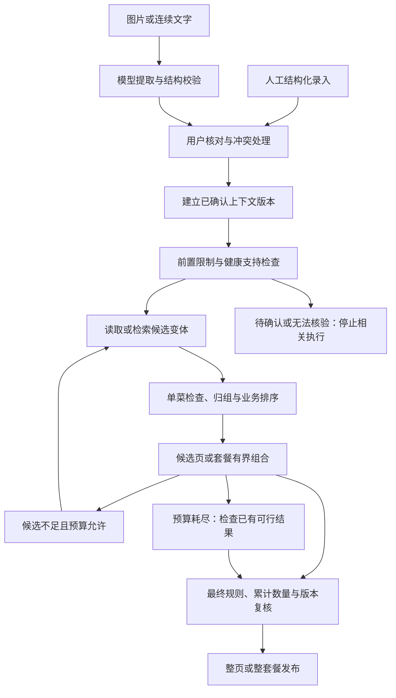

# Agent 和推荐工作流设计

> 2026-10-19 实现补充：本地完整重算、有界组合、取消/唯一终态及 UI 竞态已开发验证，见 [implementation-v0.1.md](implementation-v0.1.md)。默认目标一荤两素按食材量调整、家常优先同层少补买已经本轮用户确认，见 D7-01～02；自定义留空不推定值。

日期：2026-10-19  
状态：阶段 4 Q1～Q9 已确认；本文件为架构与验证计划，尚未实现或执行性能实验。

## 1. 结论与继承边界

首版采用**固定工作流＋局部模型识别**。普通程序控制状态、调用顺序、检索扩展、组合搜索及终止；模型负责图片／连续文字的候选提取，不能自主规划推荐步骤。暂不引入自主单 Agent、多 Agent 或专用 Agent 框架。使用多个模型、并行读取或流程状态机本身不等于自主 Agent。

依据：[PRD](../PRD.md)、[需求基线](requirements-baseline.md)、[数据知识架构](data-knowledge-design.md)、[RAG 设计](rag-design.md)、[模型服务设计](model-service-design.md)和[决策日志](decision-log.md)。本阶段决定编号为 D4-01～09。

必须继承：

- 推荐范围为已发布且可核对的菜谱与变体；不生成目录外新菜，不补编营养、成分或健康证据。
- 未知过敏、未知明确忌口及无法分类限制暂停推荐；数量未知仍可推荐并标未核实。成分无记录不等于不含。
- 单菜与整套餐累计用量分别核对；补买须用户主动接受。套餐整体主料复用与候选单菜主料复用要求不同。
- 单菜手动口味优先；变体主料不变，辅料、调料、用量及步骤变化须重新核验。
- 普通推荐可游客使用；健康模式主动开启且需登录，疾病及组合支持和审核状态单独核验。健康审核不阻塞研发，正式开放门槛保留。
- 营养按标准配方投料估算，仅供参考；缺项不阻断普通推荐。健康规则所需数据另行检查，不将展示估算自动当作安全阈值。
- 平台免费优先；用户 Key 显式选择。免费最多一次自动补救，用户 Key 不自动重试；工作流不得增加隐藏的规划、修复或审查模型调用。
- 无合格免费检索增强时使用结构化／关键词路径；D2 混合检索实验继续保留。
- 本餐草稿、默认资料及演示隔离；个人候选与最终结果不持久缓存。真实照片及健康／过敏资料境内处理。

## 2. 三种方案与引入 Agent 的条件

| 方案 | 正确性与适用性 | 延迟与 Token | 开发及稳定性 | 决定 |
| --- | --- | --- | --- | --- |
| 固定工作流＋局部模型 | 固定规则易追踪与回归；识别仍可能出错，必须校验及确认 | 无模型规划循环；已确认条件下的基础推荐无需生成调用 | 分支需编码，但预算、权限和失败路径明确 | 首版采用 |
| 单 Agent＋强制规则校验 | 适合步骤难预知的开放任务；错误选工具和累积推断不能依靠提示词解决 | 增加规划、工具结果上下文和可能重复的调用 | 需工具权限、循环检测、预算及额外评测 | 当前无已证明的必要任务 |
| 多 Agent＋强制规则校验 | 适合独立且复杂的子任务；模型共识不能替代事实或专业审核 | 可能并行，但增加协调、上下文及汇总；整体未必更快 | 状态、失败和冲突合并更复杂 | 首版不引入 |

上述为结合本项目的工程判断，不是实测性能排名。[Anthropic《Building effective agents》](https://www.anthropic.com/engineering/building-effective-agents)将预定义程序路径与模型自主选择步骤区分，并建议复杂度须有可验证收益。本项目的确认、规则、检索与套餐组合均有明确边界，尚无必须交给模型自主控制的步骤。

未来只有出现固定流程难以表达的真实需求，且同一测试集证明任务成功率的增益足以承担额外延迟、Token 和运维成本，才重新比较 Agent。即使引入，也只能调用受限工具；硬限制、审核门槛、费用选择和最终检查仍由程序强制执行。当前不预选框架或新增相关服务。

## 3. 组件与工具职责

| 组件 | 输入与职责 | 输出及权限边界 |
| --- | --- | --- |
| 输入与模型网关 | 图片／文字按 D3 准入、路由、额度及尝试预算处理 | 待确认提取项；模型没有数据库写入、联网搜索或执行脚本权限 |
| 确认与合并 | 标准名称候选、用户修改、数量及新旧限制冲突 | 已确认本餐快照；保留原有限制和未决状态，不静默覆盖 |
| 工作流控制器 | 操作类型、上下文版本、依赖、总期限及预算 | 决定可执行步骤、等待、取消和终止；不通过模型规划下一步 |
| 数据访问 | 按受控 ID 读取已发布菜谱、变体、成分、单位、营养及证据版本 | 公共事实及有效状态；参数化查询，不执行模型生成 SQL |
| 规则模块 | 当前限制、支持状态、适用条件及事实 | 通过、排除、需补信息、无法核验及具体原因；首版可为后端函数＋规则表，无需独立规则引擎产品 |
| 检索模块 | 当前查询、允许范围、索引版本、候选数量及游标 | 有来源与版本的变体候选、覆盖范围和完成状态；不判断健康安全 |
| 推荐与组合 | 候选、人数、库存、补买选择、模式和已确定业务规则 | 有界组合、去重、用量及缺量；不改写用户条件 |
| 营养与依据 | 实际变体、标准份量、营养及已执行规则版本 | 参考值、缺失状态和直接关联的证据定位；无需生成模型 |
| 发布与展示 | 完成检查的结果及当前版本 | 结构化卡片和真实进度；仅匹配当前版本的任务可提交 |

这些是逻辑职责，可先在同一后端内组织，不要求一组件一微服务。工具调用由程序白名单控制，模型文本不能指定供应商、URL、Key、查询语句或跳过某个检查。收藏、保存默认及凭证变更属于独立的用户操作，不是推荐流程自动执行的副作用。

## 4. 从输入到卡片的执行流程

1. 进入或刷新恢复既定本机文字草稿和确认状态。未确认项不会因恢复变成已应用。
2. 图片／连续文字经模型提取、格式与语义校验后进入确认；人工清单直接进入确认。图片和文字可以是不同输入任务，不强制再用一个模型统一重写。
3. 用户确认后建立不可变的执行快照，包括本餐版本、当前模式、人数、限制作用范围、库存和主动补买选择。服务器重新校验，不信任客户端传入的“已通过”。
4. 检查可用食材、未知限制、登录及健康支持等前置条件。缺少已审规则确需的个人条件时，返回最少补问；允许“不清楚”，不能无限重复追问或猜测。
5. 读取公共事实，执行可前置的可靠过滤，进行结构化／关键词检索。混合检索只有满足 D2／D3 启用条件后才参与。
6. 对实际变体核对成分、可比较数量及调味料；按父菜谱归组，不让多个变体占满六张卡。检索相关性不覆盖既有业务规则。
7. 候选模式检查每道菜；套餐模式搜索组合，核对累计用量、总数、分类及整体主料复用。单换锁定其余菜，按剩余可用库存寻找替代。
8. 按实际配方读取或计算参考营养与缺量，定位实际执行规则的证据。普通营养缺项显示对应状态；必要健康依赖缺失则不判通过。
9. 发布前复核当前个人条件及内容、规则有效状态。版本不匹配或证据已撤回时，不能提交旧的通过结论。
10. 套餐整体、候选整页完成检查后发布；进度只显示实际阶段，不显示虚构百分比或未经校验的模型片段。

基础推荐不需要生成模型撰写解释。数量未知时继续显示未核实，不能为了让流程完成而补 0、猜克重或强制填量。

## 5. 状态、版本与恢复

### 5.1 状态边界

用户编辑状态与服务器一次执行任务分开。等待用户确认时不保持运行锁、占用模型并发槽或无限延长执行任务；确认后按最新输入开启一次执行。状态名称是内部契约示意，不冻结对外 API。

| 状态 | 含义与出口 |
| --- | --- |
| 编辑／待确认 | 可修改及处理冲突；需要时触发输入提取，条件齐备后开始推荐 |
| 排队／提取 | 按 D3 执行模型任务；成功也只产生候选，失败保留输入 |
| 预检／检索／组合／最终校验 | 当前任务占用有限预算；检查取消、版本及期限 |
| 已完成 | 当前版本结果已完整检查；目标是否达成与搜索是否穷尽另行表示 |
| 需补信息 | 返回具体待确认项，结束本次执行；用户补充后重新发起 |
| 搜索未完成 | 达到预算，可能已有合格小套餐；不等于无可行方案 |
| 已证明范围内无结果 | 仅在必要事实完整、对应候选与组合确已穷尽时成立，并注明证明范围 |
| 失败／中断／取消／已被新版本替代 | 不提交该任务结果；保留合法草稿和可用操作出口 |

终态任务不能因晚到回调重新变成成功。检索已穷尽不自动代表套餐组合已穷尽，规则无法核验也不是“已证明无解”。

### 5.2 版本及竞态

每次执行绑定用户／游客会话、本餐标识、本餐版本、操作标识、数据／规则版本、检索版本及预算。内容版本与已知撤回状态分开：固定旧版本不能绕过撤回。

- 修改人数、口味、库存或限制后本餐版本递增；旧任务尽力取消，前端和服务端提交检查均拒绝其覆盖新状态。
- 同一版本的不同操作也要有顺序或当前操作标识。例如连续两次“换一道”即使输入未变，较早响应也不能覆盖较晚操作。
- 重复点击同一操作合并为同一任务；用户明确发起的新一轮继续／重试有新操作标识，仍受用户和平台总额度约束。
- 发布使用的版本检查和状态提交须形成一致边界，避免检查通过后输入已变而仍提交；具体事务或并发控制方式留给后端专题。
- 若全局内容或必要规则改变，按受影响依赖重检；持续变化导致无法稳定提交时结束并提示重试，不自动形成无限重算循环。
- 已显示结果不是永久通过证明；再次换菜、改口味、打开收藏或发起操作时复查当前条件。实时推送撤回通知不是本阶段新增承诺。

旧结果若保留供查看，必须标为待重新检查，不能继续显示符合新条件的状态。取消不保证撤回已发到供应商的调用，也不保证无用量；用户 Key 不因取消、刷新或版本变动自动重发。

### 5.3 刷新与服务重启

首版恢复既定本机草稿及确认状态，然后重新检查和检索，不建设持久化个人候选／完整执行上下文的服务端检查点。会话内中间结果可以临时复用；刷新、服务重启、会话结束或失效后重新计算。

未完成模型任务标为中断或执行状态待确认；如能通过最少运行记录确认在途状态，可展示该状态，但不能据此自动重发。临时 Key 重新提供；主动保存的账户 Key 仍遵循所属权、版本及显式费用选择。必要运行记录不携带原始照片、个人条件、候选列表或明文 Key，保留期限待后端数据生命周期设计确定。

## 6. 口味变更、候选复用与局部重算

复用的是仍有效的事实和候选，不是旧的安全通过结论。个人候选保留在当前会话的受控临时状态，不能进入公共缓存或持久个人结果库。公共菜谱、营养基础记录和检索表示仍可按版本缓存。

| 变化 | 可复用 | 必须重做或补充 |
| --- | --- | --- |
| 单菜口味 | 其余菜谱、有效公共事实及同菜已知变体 | 读取实际新变体；核对辅料／调料、限制、库存，重算相关营养及整套累计缺量；最终复核整套 |
| 全局口味 | 有效候选及单菜手动选择 | 重选未手动覆盖的适用变体，重排及组合；旧候选若受旧口味过滤或不足以覆盖新偏好，补检索 |
| 人数 | 标准配方和仍有效的食材候选 | 建议用量、单菜与套餐数量、缺量及依赖份量的规则；可能需要替换或扩展候选 |
| 食材／数量／调料库存／补买变化 | 未受影响的公共数据 | 候选资格和相关累计计算；限制放宽或新增食材时须考虑此前未召回的候选 |
| 过敏／忌口／健康条件变化 | 仍有效公共事实 | 立即使旧通过状态失效，重新预检与检查；未知限制阻断；必要时重检索 |
| 单换／翻页／重推 | 有效候选及本餐条件 | 按操作排除已有结果或已展示项，补候选；单换保持其余菜，不能为找到替代而偷偷改其他菜 |
| 内容／规则撤回或版本变化 | 经依赖检查确认无影响的公共记录 | 受影响结果失效并重检；禁止回滚复活撤回内容 |

即使旧池已有六道菜，也不表示它覆盖新口味；复用是否足够由原查询范围、过滤条件及覆盖信息判断。局部重算后必须通过统一最终检查。没有符合条件的口味变体时明确不可用，不生成新配方、不自动接受补买。

每次操作不重新识别原图片或重新解析未变文字。对于模型识别仍在运行期间用户已手动编辑的字段，迟到提取结果不得直接覆盖，必须重新进入合并／确认流程。

## 7. 套餐搜索、调用预算与防空转

### 7.1 组合算法

采用普通程序的有界搜索、剪枝与回退。将候选按已确定的业务规则和稳定的同分顺序排列，尝试加入套餐；维护已选父菜谱、分类计数、累计主料用量、复用情况及其他经审核的组合约束。遇到可证明该分支不可能满足的条件时剪枝，并回退尝试其他候选。

只有有效的下界或明确冲突才能剪枝。未知数量不是不足，不能据此剪枝；不检查调味料库存时不按缺库存剪枝，但仍检查过敏及忌口。单个候选暂未复用现有主料，不代表整套餐分支不可行，不能误用候选模式的逐菜复用规则。

组合去重采用父菜谱／变体的规范化标识，避免同一套餐的不同排列反复搜索。单换固定其他菜并计入其累计用量。不得用搜索算法替产品决定默认荤素汤配比、自定义留空语义或业务排序权衡；这些保留为 OQ-09 和 D2-OQ-04。

贪心作为低成本对照，可能因前一道消耗关键食材漏掉可行组合；通用约束求解器作为规模和约束复杂度上升后的替代。当前先验证有界搜索，既不保证找到全局最优，也不保证在有限预算内找齐所有可行结果。

### 7.2 预算分层

| 预算 | 当前规则／参数状态 | 原因及代价 |
| --- | --- | --- |
| 基础推荐生成调用 | 已确认输入后为 0；结构化解释不调用生成模型 | 减少 Token 与外部依赖；流程及解释模板需维护 |
| 输入提取模型尝试 | 继承 D3：平台免费原始＋自动补救合计最多 2 次；用户 Key 一次，失败由用户主动重试 | 修复、备用、重发共预算；SDK 和外层工作流不得叠加重试 |
| 输入任务数量与总量 | 每个明确输入任务独立标识，批量输入和用户／平台总额度同时限制；具体上限待测 | 不能将一份输入拆为大量子任务来绕过尝试预算 |
| 候选扩展 | D2 每路 30→60 是混合检索实验起点，再按需扩展结构化范围；未启用向量时不执行其调用 | 候选覆盖上升也增加检查和组合成本；不是上线固定参数 |
| 检索轮次与搜索节点 | 有限、可配置，数值按真实规模和测试确定 | 防止组合爆炸；预算耗尽不能冒充无解 |
| 单步骤与整次执行期限 | 有限、可配置；重试、扩展和回退不重置总期限 | 可控制尾延迟；需预留最终校验与响应时间，必要检查不得因超时省略 |
| 并发与队列 | 用户／平台／供应商分别设上限，具体值沿用 D3-OQ-03 待测 | 防止局部并行耗尽连接、算力或免费量 |
| 用户继续查找 | 明确操作开启新一轮有限预算，记录已搜索范围，继续受总配额限制 | 避免自动无限运行；会话丢失后可重算但须说明进度不能接续 |

非模型只读调用的瞬时故障可在总期限及有限重试策略内处理；具体次数待后端验证，不能无界重试。核心事实或规则不可读时停止依赖它的推荐。模型预算只能由网关统一扣减，不能被组合模块或错误处理器重置。

### 7.3 防空转与终止

每次检索记录规范化请求、过滤范围、内容／索引版本、数量或游标，以及返回的去重候选范围。相同条件和范围下没有新数据，不重复发相同检索；仅提高数量却没有新增候选时，依据覆盖状态决定转向更大结构化范围或停止，不能凭“无新增”直接断言全库无解。

组合模块记录已访问组合或等效状态，使用确定的扩展策略；不调用模型反复解释失败或改写查询碰碰运气。工具结果为空、错误、缺字段与确实无结果分别处理。

满足本次输出条件可结束搜索并返回已验证可行结果；不需为证明最优而持续计算。其余终止条件包括：必要信息缺失、权限／数据准入失败、必要规则不可核验、候选和组合在指定范围内穷尽、预算耗尽、用户取消、本餐／操作失效。每种终止原因必须有稳定状态和恢复出口。

### 7.4 超限时的小套餐

D4-08 已确认：目标三道尚未找到、预算已耗尽，但已有完成全部检查的两道套餐时，可以展示这套两道并明确“本次搜索未完成三道组合”，提供用户主动继续查找的入口。

这是**目标未达成但当前结果可用**，不是未校验的半成品，也不是证明只能做两道。展示实际菜数、分类及目标差异；不能把未满足的用户指定配比标为满足。只发布满足不可放宽条件、已核验的小套餐；无法形成合格小套餐则返回本次未完成。

最终校验所需事实不可读或必要健康规则无法核验时，不能用旧的小套餐继续发布。单换不适用自动缩减其他菜的处理，仍须保持其余菜。用户继续查找不自动开启付费调用、放宽限制或切换健康模式。

## 8. 并行、异步与首屏响应

采用依赖步骤串行、独立步骤受限并行。确认、前置资格、组合以及最终发布之间有依赖，不能为抢首屏跳过；同一快照下独立公共事实读取、不同候选的检查可并行。未来已批准的关键词与向量召回可并行，但受同一总期限和容量限制。

并行只能减少独立工作相加的等待，整体仍受最慢分支、队列及最终检查影响。禁止为抢速度同时发多个识别模型请求；这会增加用量，并可能突破 D3 的补救政策。并行分支失败时，依据其必要性决定降级或停止，不把缺失检查当通过。

异步执行用于让页面保持可编辑、可取消，不表示后台无限运行或服务重启后承诺续跑。首版可以使用最简单的异步请求与状态通知；SSE、WebSocket 或轮询的具体协议由后端与前端专题选择，不先引入复杂消息系统。

等待时可显示排队、识别、检索、组合、校验等真实状态。套餐在整套校验后一起发布；候选本页完成归组、排序与校验后发布，最多六道不同菜谱。不逐 Token 展示可用食材，不逐卡发布尚会参与套餐累计的结果。

分别测量提交到进度反馈、到可核对提取结果、确认到首套／首个完整候选页，以及完整任务耗时。用户阅读确认的时间单列，不计为服务器推理耗时；模型首 Token 不能替代完整有效结果延迟。具体 P50／P95 和上线阈值待实测。

## 9. 健康校验、错误与降级

| 检查位置／情况 | 执行规则 |
| --- | --- |
| 输入执行前 | 未知限制、冲突、身份和数据准入先处理；疑似食材仅不参与，数量未知不阻断 |
| 召回前可判定的条件 | 读取当前有效内容与支持范围，按已核验成分及限制过滤；不依据向量相似度或模型置信度作安全判断 |
| 实际变体检查 | 按选中版本的完整主辅料与调料核对；通用品名不能代表品牌完整配方，限制相关成分未知不能判通过 |
| 套餐检查 | 已知累计数量、缺量、复用、分类及经审核的组合规则；单病种通过不推出组合支持 |
| 发布前 | 当前本餐及操作一致，规则、证据和菜谱仍有效；所有必要检查完成 |
| 健康必要条件未知 | 最少补问，允许不清楚；停止依赖该条件的判断，无可核实方案时停止健康推荐，保留主动返回普通模式出口 |
| 普通营养缺项 | 仅受影响营养素整菜值不可计算；不阻断普通菜谱，不用部分和冒充完整值 |

| 故障 | 恢复方式 |
| --- | --- |
| 图片／文字格式不合格、截断 | 按 D3 校验、有限补救或用户重试；保持待确认，不臆造信息 |
| 免费识别拥挤或额度用完 | 有限排队后提供重试／自带 Key／人工录入；不自动调用平台付费或账户已存 Key |
| 向量或重排不可用 | 按 D2／D3 降级到可用召回或结构化路径，必要检查继续 |
| 内容主数据或规则不可读取 | 停止相关推荐，保留输入；缓存中的旧通过结论不能代替当前检查 |
| 搜索预算耗尽 | 按第 7.4 节返回合格小套餐或本次未完成，不能假称无解 |
| 内容／证据撤回 | 拦截受影响结果；旧索引命中和旧缓存不豁免 |
| 用户修改、取消或刷新 | 旧任务不再提交；恢复草稿，模型不自动重发，已发请求可能仍有用量 |

输出描述实际已检查范围和不确定性，不承诺疾病治疗、食补效果或绝对安全。所有失败都不得自动移除限制、接受补买、保存默认、切换健康模式或新增支持疾病。

## 10. 结构化输出、缓存与观测

输出契约至少包含以下语义，不在本阶段冻结字段名或对外协议：

- 请求／操作标识、本餐版本、模式及结果类型；目标菜数与实际菜数。
- 目标是否达成、候选覆盖、组合搜索是否完成和终止原因；这些维度分开，不能只有一个 success。
- 菜谱／变体／内容版本、人数与标准用量、当前口味及是否手动覆盖。
- 限制检查状态、库存未核实状态、已知缺量及补买前提；过敏与健康敏感详情仅在当前用户权限范围内展示。
- 营养参考口径及缺值，实际执行规则及证据定位，必要的用户下一步操作。
- 降级状态和“本次未完成”等真实解释；进度信息与最终可用结果区分。

公共缓存以内容和计算方法版本为依据；个人会话状态有所属权、生命周期和失效条件。缓存命中不免除最终有效性检查，不将个人候选或查询向量写入持久公共缓存，不新增跨设备本餐同步。

通用日志记录随机请求标识、流程版本、各阶段耗时、候选数、扩展次数、搜索节点数、预算消耗、模型尝试数、复用／降级和终止类型。避免记录原文、照片、Key、疾病或过敏清单、个人候选列表，以及可反推这些信息的详细规则 ID／排除原因。用户实时解释与通用日志分别处理；敏感排查材料须另行满足权限和保留边界。

请求去重、少量运行状态和配额核算不等于持久执行检查点；具体最少字段、保存时间、访问与删除机制由后端专题收口。流程、规则、内容及模型版本分别记录，方便在公共构造样本上复现问题。

## 11. 质量评价与性能基准

### 11.1 对照方法

D4-09 确定三层验证：固定约束回归；同一条件变更分别运行会话复用／局部重算和从当前权威数据完整重算；小型构造菜谱集穷举验证可行组合。

完整重算不重复调用模型识别，而使用同一份已确认输入。它是优化路径的对照，不自动成为正确性真值；小样本穷举、独立预期和人工核对用于发现双方共享的规则错误。比较硬限制、累计数量、变体状态、缺量和完成语义；多个合法套餐不要求菜名完全一致，排序及召回覆盖单独评估。

复用导致遗漏新口味候选或错误无结果同样是失败，不能只证明“返回的菜没有违规”。穷举仅用于受控小样本，避免把验证工具扩为生产无限计算。

### 11.2 必须覆盖的回归场景

| 场景 | 预期与追踪 |
| --- | --- |
| 未知过敏／忌口与数量未知同时存在 | 前者暂停，后者不作为暂停理由；D0-01、BR-03～11 |
| 两道菜分别够量但累计不足 | 套餐不得通过；主动补买后只计算可核实差额；BR-12～14 |
| 前一道贪心选择占用关键食材 | 回退可找到已知替代组合；预算不足时准确返回未完成；D4-07 |
| 单菜变体新增辅料或调料 | 复查限制、库存、累计与营养；普通营养缺项不阻断；BR-22～23、D1-04 |
| 全局口味变化且旧池已有六道 | 保留单菜手选，检查新口味覆盖，必要时补检索；D4-02 |
| 单换需要挪动其他菜才可行 | 不偷偷修改其余菜，明确本次未找到符合单换要求的替代；BR-21 |
| 前 30 个候选不够，扩大后可行 | 扩展不放宽限制，不把初次截断报告成全库无解；D2-11 |
| 目标三道超限、已有合法两道 | 整套检查后展示实际两道及搜索未完成，不伪造食材不足原因；D4-08 |
| 单病种已支持而组合未支持 | 停止相应组合健康推荐；D1-09 |
| 证据在检索后撤回 | 最终检查拦截，旧索引和缓存不能放行；D2-15 |
| 编辑人数／限制后旧请求晚到 | 无法覆盖当前版本；同一版本连续换菜也保持操作顺序；D4-04 |
| 免费补救失败、用户 Key 超时 | 前者不再调用，后者不自动重试；刷新不重置尝试预算；D3-08 |
| 取消后任务或并行分支完成 | 结果不可提交；不因此触发新模型任务；D4-04／06 |
| 刷新或服务重启 | 草稿保留确认状态；无持久个人候选恢复；未完成模型请求不自动重发；D4-05 |
| 重复检索返回相同集合或组合排列 | 不无界循环；按范围和预算推进或终止，终止原因真实；D4-07 |
| 规则读取失败但缓存有已通过套餐 | 停止依赖它的推荐；不能把工具错误变成健康通过；D2-16 |

继承 PRD AC-01～32 及既有 B01～B06 回归，上表是新增覆盖而非替代。固定回归中约束违规、伪造依据和未经选择的收费调用要求为零；通过有限样本不等于证明绝对安全。

### 11.3 性能与成本

在相同内容、规则、输入与资源条件下比较：完整重算与局部重算、串行与受限并行、有界搜索与贪心对照。覆盖小内容集和后续真实规模、不同限制密度、1–6 道、1–12 人、无结果、冷／热缓存及故障负载。Demo 的 24 道模拟菜只适合流程检查，不证明真实规模表现。

记录完整有效结果 P50／P95、目标达成率、错误无结果率、超限率、候选扩展、搜索节点、公共缓存与会话复用命中、数据库读取、取消后仍运行的工作量，以及模型调用数／Token／实际费用。候选模式继承 D2 的 Recall@30／60 和 nDCG@6；不得以纯检索指标代替整套可行性。

先使用构造工具响应验证取消、竞态、重试及预算；真实模型和负载实验另按已准入条件及费用授权执行。当前没有运行上述实验，不承诺毫秒数、并发容量或固定提速比例。上线前须填写有限预算配置并验证不会绕过必要检查。

## 12. 待落实事项与文档边界

- 首批内容包、版本及人工对照集仍待 D1-OQ-01、D2-OQ-01 落实。
- 默认三道配比、自定义留空以及业务排序权衡保留未定；本阶段算法不能代为决定。
- 搜索节点、扩展轮次、并发、等待及执行期限、会话临时状态与最少运行记录保留参数待实测及后端设计确定。
- 继续查找、目标未达成、旧结果待重检等交互需按本阶段已定语义细化；显示可用小套餐不等于达成原目标。
- 正式健康审核、具体供应商准入、敏感处理与删除边界继续沿用阶段 1～3 未决事项。

本文件与 D4 决定补充工作流设计，不修改 PRD、既有数据／RAG／模型服务文档，不新增业务代码、数据库迁移或服务部署。发现上述继承约束无法同时满足时，先记录冲突和变更建议，不能以框架或实现习惯覆盖产品决定。
