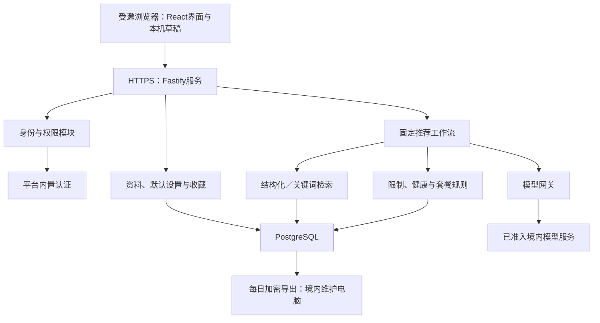

# 系统基础设施与后端设计

> 2026-10-19 实现补充：本地 React/Fastify、PostgreSQL 迁移与机制测试已新增，真实认证、云、独立撤销日志/恢复及全部计费项未准入，见 [implementation-v0.1.md](implementation-v0.1.md)。不得将本轮本机运行当作云试用上线。

日期：2026-10-19  
阶段：技术设计阶段 5  
状态：交付方案已批准；设计已落盘，免费云候选尚未准入，未创建资源或部署。

## 1. 已确定的架构与边界

本文件继承 [PRD](../PRD.md)、[需求基线](requirements-baseline.md)、[数据知识架构](data-knowledge-design.md)、[RAG 设计](rag-design.md)、[模型服务设计](model-service-design.md)、[Agent 和推荐工作流设计](agent-workflow-design.md)及[决策日志](decision-log.md)。阶段 5 的决定见 D5-01～D5-13，接入与验收材料见 [open-questions.md](open-questions.md)。

已确认约束：

- 基础设施固定费和按量费均为零；不开通收费资源，不以预算告警代替禁止计费。模型继续按 D3 免费优先及用户主动自带 Key 的边界处理。
- 优先受邀小范围云端试用，受邀者仍可按游客流程使用普通推荐；正式产品的普通游客能力不因此改成强制注册。
- 不新增推荐历史；本餐草稿留本机，账户同步长期资料和收藏。
- 图片仅作任务临时输入，任务终止后清理，必要时重新提交。
- 跨设备修改采用版本检查，冲突时保留双方内容并由用户确认。
- 每天备份到维护者的境内电脑，保留最近七个每日备份；恢复目标需演练验证。

技术栈采用 **React＋TypeScript＋Vite、Node.js 24 LTS＋Fastify、PostgreSQL**。具体依赖锁定兼容版本，不追随未验证的自动升级。[Node.js 发布状态](https://nodejs.org/en/about/previous-releases)

| 方案 | 收益 | 代价 | 结论 |
| --- | --- | --- | --- |
| React＋Fastify＋PostgreSQL | 统一语言，API 与规则边界清楚，便于独立测试 | 维护前后端两个模块 | **采用，构建后可作为一个服务部署** |
| Next.js＋PostgreSQL | 页面和服务端入口集中 | 当前无需服务端渲染，增加框架运行约束 | 保留替代 |
| React＋FastAPI＋PostgreSQL | 方便使用 Python 数据工具 | 两套语言、契约与依赖 | Python 仅用于必要的数据实验 |

首版采用模块化单体。账户、资料、内容访问、规则、模型网关、推荐工作流属于同一后端中的模块；暂不引入 Redis、消息队列、独立检索服务、图数据库或自主 Agent。此选择不取消 D2 的混合检索实验，也不代表需要自部署模型。

既有功能约束继续执行：有限菜谱与变体、未知限制阻断、用量选填、整套餐累计、主动补买、单菜口味覆盖、营养参考及健康审核门槛。默认套餐配比和排序权衡等未决产品规则不由基础设施补定。

## 2. 系统组件、数据与接口

### 2.1 执行与部署结构

前端静态产物随 Fastify 服务发布，使用同源接口，减少跨域、Cookie 和额外托管配置。现有 Cloudflare Demo 保持演示用途，不自动连接真实资料后端。手机优先、桌面兼容、键盘与焦点、弹层可操作性及草稿恢复继承 PRD 和 UI 评审。

模型和推荐长任务在当前 HTTP 请求结束前完成或明确终止。使用 POST 请求上的流式响应报告真实进度，最后仅发送一个完成校验的结果；不采用“返回已受理后，在容器内存中继续运行”的后台任务。容器缩容可能销毁内存和临时文件，不能依赖实例常驻。[云托管开发说明](https://docs.cloudbase.net/run/develop/developing-guide)

执行顺序为：输入提取 → 用户确认与冲突处理 → 当前上下文版本预检 → 检索与变体核验 → 候选归组或套餐有界搜索 → 累计数量及最终规则复核 → 完整结果发布。普通推荐基础路径不新增生成模型调用。流式进度不提前展示尚未完成检查的菜谱卡片。

会话内候选可复用，丢失时按当前条件重新检索；工作流及模型任务不建立持久个人检查点。并行只用于同一版本下独立的读取与检查。旧操作失效、取消和总期限传递到下游；请求关闭或容器重启不自动重发用户 Key 请求。

### 2.2 数据存储

| 数据 | 存放及规则 |
| --- | --- |
| 菜谱、变体、食材、单位、营养、规则、证据版本 | PostgreSQL，继承阶段 1；公共内容包可重建 |
| 账户映射、同意记录、资料版本 | PostgreSQL，稳定内部用户 ID 与认证供应商 ID 分开 |
| 本人／附加限制、疾病条件、默认调味料与偏好 | 按用户隔离；健康及过敏等敏感字段应用层加密 |
| 收藏 | 用户＋菜谱＋变体，重新打开仍复查当前条件 |
| API Key | 密文、所属用户、供应商、版本及有效状态；不提供明文回读 |
| 会话、配额预留、请求去重 | 最少必要元数据；不保存完整输入或推荐结果 |
| 本餐草稿 | 当前浏览器；未提交疾病文本不新增跨刷新保存 |
| 候选、查询向量、最终推荐结果 | 当前请求或会话内临时状态，不建立持久历史库 |
| 原始照片 | 请求内存，不写长期对象存储、数据库、日志或备份 |

数据库禁止浏览器直接使用管理凭证访问。采用最小权限角色、参数化查询、事务和版本条件更新。数量使用精确十进制表达，空值、约量及不可比较状态分别保存。

库存未知与菜谱标准用量、营养缺失与健康必要数据缺失分别表达；收藏不保存固定旧人数的完整本餐快照。用户 ID、内容版本及关系约束用于归属和关联，不能仅凭客户端提供的标识读取其他用户资料。

### 2.3 账户与同步默认方案

优先使用 CloudBase 内置认证，试用账号由管理员预置，使用用户名和密码，不强制收集邮箱、手机号或真实姓名。该路径有明确的管理端建号、改密和删号接口依据，但仍需按实际环境验证。[官方用户管理](https://docs.cloudbase.net/api-reference/manager/node/user)

- 新账号首次进入须完成密码设置或修改。
- 暂不承诺无邮箱账号具备原生自助找回；按既有可信邀请渠道核验后人工处理，不能仅凭用户名重置。
- 后端验证认证身份，并使用应用侧可撤销会话；身份标识不接受客户端自行声明。具体身份校验参考[服务端 token 验证](https://docs.cloudbase.net/http-api/auth/auth-token-introspect)。
- 会话 Cookie 使用 `Secure`、`HttpOnly`、`SameSite`，写操作校验来源和 CSRF。
- 登录合并先展示本机与账户差异；持续同步使用版本检查，冲突返回差异，不自动覆盖硬限制。
- 认证删除与业务数据删除由后端协调，不能假设删认证账号就清除了资料和 Key。

受邀资格和个人账户分开；普通游客不因试用入口控制而自动建立个人健康档案。游客临时 Key 不持久保存，登录不会自动保存或自动消耗账户已有 Key。邀请建号是本次受控试用的方案，不将其写成正式产品永远不支持自助注册。

### 2.4 主要 API 契约

统一 `/api/v1` 前缀，JSON 为普通接口格式，图片使用受限 multipart；运行时采用 JSON Schema 校验，并生成 OpenAPI。TypeScript 类型不能替代输入校验。Schema 由应用维护，不接收用户或模型提供的可执行 Schema。[Fastify 校验说明](https://fastify.dev/docs/latest/Reference/Validation-and-Serialization/)

| 接口组 | 行为 |
| --- | --- |
| `auth/session` | 登录、当前身份、退出及重新验证 |
| `catalog/recipes` | 目录、详情、可用变体及来源版本 |
| `profile`、`defaults` | 读取及带版本保存本人／附加资料、默认设置 |
| `sync/merge` | 登录差异确认与冲突后重新提交 |
| `favorites` | 收藏、取消及版本化同步 |
| `credentials` | 主动保存、列出掩码、更换、删除 Key |
| `recognitions` | 图片／文字提取，返回待确认项 |
| `recommendations` | 生成、换菜、重推、翻页和口味变更 |
| `privacy/export`、`privacy/erase`、`account` | 资料导出、分项清除和注销 |
| `healthz`、`readyz` | 存活及必要依赖状态，不暴露秘密配置 |

本表为接口分组和语义设计，不表示已实现路由或生成 OpenAPI。普通读写使用 HTTP 对应语义，资料更新携带预期版本；长任务进度与最终结果沿同一请求返回。

运行请求携带操作标识、本餐版本和费用选择。结果区分完成、需确认、搜索未完成、范围内无结果、失败、取消及已失效；数量未核实与目标菜数未达成单独表达。每个实际输出绑定菜谱、变体及相关事实／规则版本。

错误统一包含稳定错误码、请求标识、可重试性和安全的用户提示。使用 400／401／403／409／429／503／504 等状态；流式响应开始后用明确终止事件报告错误，连接关闭不视为成功。相同请求标识去重不代表供应商保证仅计费一次。

客户端不得因流中断自动重新提交模型 POST。重试、格式修复和已准入免费备用共用 D3 预算；用户 Key 请求由用户主动重试。未知限制等正常待确认分支，不伪装成技术成功或空菜谱结果。

## 3. 安全、删除、备份与观测

### 3.1 图片与敏感数据

图片经鉴权、真实类型、大小及解码尺寸检查后在内存中处理，去除非必要元数据。成功、失败、取消和超时均执行清理，不建立私人图片库。应用释放引用不等于保证供应商同步删除，第三方保留政策须独立准入。

本轮采用请求内存路径，避免额外对象存储及其上传权限、临时链接和孤立文件清理成本。若后续确需私有短期对象存储，须另行确认保留与费用边界，不能因工程便利自动启用。静态菜谱素材属于公共内容包，与个人上传图片分开。

疾病、过敏资料按必要目的单独告知和同意；保存长期资料、开启健康模式和传给模型分别说明。识别与必要规则不满足时停止相应能力，不能以同意取代正确性检查。真实照片和健康／过敏资料处理链路仍须境内，用户自带 Key 不豁免。[个人信息保护法](https://www.cac.gov.cn/2021-08/20/c_1631050028355286.htm)

API Key 和敏感资料使用 **AES-256-GCM**，每次加密使用独立随机 nonce，并绑定用户、字段用途和版本。主密钥通过受控运行配置提供，独立于业务库、代码、镜像及数据库备份。不同用途使用不同密钥；记录版本，支持轮换，缩短明文存活范围。应用需要解密以执行用户请求，因此不宣称端到端加密或维护者技术上绝对无法接触明文。

### 3.2 清除与注销

明确三个入口：

1. 本机清理：只影响当前设备选择的数据。
2. 云端分项清除：按资料、健康信息、收藏、凭证等明确范围操作。
3. 账户注销：重新验证后立即禁用账户、会话及凭证，启动认证和业务数据清除。

不设置默认可撤销冷静期。在线清除目标为 24 小时内完成；未完成时显示处理中并进入维护清单，不宣称已删除。备份中的旧副本按七天轮换退出；供应商另有保留义务或限制时必须如实记录，不能承诺已物理清除全部第三方副本。

删除和撤回记录独立于待恢复的旧备份维护；恢复时先应用最新清除记录，禁止复活已删除账号、资料或 Key。本站删除 Key 不等于供应商撤销。云端删除也不能保证清除离线设备上的本机草稿。

删除操作不能通过旧版本同步请求悄悄撤销；涉及被删除资料的迟到写入须重新处理版本和确认关系。“开始新一餐”“清空 Demo”不扩展为云端资料清除或账户注销。

### 3.3 备份与恢复

- 每日导出账户业务数据、配置版本和清除记录，在境内电脑加密保存；公共内容按版本化内容包重建。
- 保留最近七个每日备份，超过七天的普通恢复副本清除；重大变更前另做备份。
- 解密材料另行保管，不与数据库备份打包。
- 试用恢复目标：RPO 24 小时、RTO 24 小时；必须完成空库恢复和删除防复活演练后才宣称达标。
- 备份失败或超过一天未成功，提示维护并暂停扩大真实资料试用。

恢复流程为：核对备份与内容版本 → 隔离环境恢复 → 应用最新清除／撤回记录 → 检查用户归属、密钥版本及必要规则 → 执行回归 → 再恢复访问。不得直接让旧备份对用户提供服务。

免费 PostgreSQL 的导出权限、连接方式和恢复能力须按当前账号验证，不能将付费数据库的数据回档权益当作免费环境承诺。本轮不购买云备份；境内电脑、现有磁盘、电力及维护时间属于既有资源投入，不称为系统总体零成本。

### 3.4 日志、监控与环境配置

运行日志保留七天，只记录版本、耗时、数量、错误类型和预算等必要信息。网络安全日志独立设计，按不少于六个月的要求保留必要内容；不因此记录照片、完整输入、健康清单、Key 或模型正文。依法需要保留的信息限于必要用途并采取访问保护，不与普通调试记录混用。[现行网络安全法第二十三条](https://www.cac.gov.cn/2025-12/29/c_1768735112911946.htm)

不采购独立监控平台。先采用结构化日志、平台指标和维护检查表，关注免费点数、失败率、完整结果延迟、备份状态及异常调用。平台默认日志保留期不能代替应用七天运行日志与必要网络安全日志的设计；所需存储计入免费预算核算。

环境配置包括：数据库连接与角色、认证环境、会话与 CSRF 秘密、资料／凭证加密密钥版本、供应商与地域白名单、费用模式、配额、模型尝试预算、请求期限、上传限制、日志和备份设置。秘密不提交 Git，不写前端构建变量或镜像层；公开配置与秘密分开。

本地使用独立测试数据库和构造资料，受邀环境独立配置；不为环境隔离额外开通收费实例。启动时检查必要配置，缺少加密或权限配置时不启用对应敏感能力。发布前完成本地构建与检查，记录镜像、内容及配置版本；更新前备份，回退不得复活撤回规则、已删除用户或旧 Key。

## 4. 免费部署候选与成本核算

### 4.1 部署比较与固定准入规则

| 路线 | 收益 | 主要限制 | 处理 |
| --- | --- | --- | --- |
| CloudBase 上海免费 PostgreSQL＋认证＋容器 | 单平台、关系库、减少自管运维 | 免费容器计费说明存在冲突，额度和测试域名受限 | **首选待准入候选** |
| 境内轻量服务器＋自管数据库 | 运行时间及部署较可控 | 固定费用，数据库和系统维护由个人承担 | 不符合本轮零费用约束 |
| 其他免费函数＋CloudBase 数据层 | 可能获得更长执行时间 | 多平台运维；超额可能按量收费 | 未证明零账单前不采用 |

资料核查日期为 2026-10-19，不表示当前账号已开通或服务已验证。CloudBase 资源点页列免费环境每月 3000 点、上海 PostgreSQL 和云托管能力；另一篇云托管说明仍要求开启超限按量。不能擅自选择较有利的解释作为免费保证。[资源点说明](https://cloud.tencent.com/document/product/876/127357)、[云托管限制](https://docs.cloudbase.net/run/limitation)

部署准入顺序固定为：

1. 确认上海免费 PostgreSQL 环境资格和适用条款。
2. 确认容器可在不开按量时运行，点数耗尽停服覆盖全部使用资源。
3. 确认本地构建、镜像仓库、拉取、日志及网络没有独立收费要求。
4. 验证测试域名、请求时限、包体、认证、数据库权限及导出恢复。
5. 核验模型地域、免费硬停和第三方处理条件。
6. 先构造数据验证，再开放符合条件的受邀真实资料测试。

任何必需项无法证实，**保持云端未部署状态**，继续本地验证和记录缺口；不升级套餐、不开按量、不改用境外敏感数据后端，也不削减正式功能。本文不是创建免费环境或其他正式资源的执行指令。

免费测试域名和受邀试用不等于正式公开接入资格。正式公开部署另需核验自定义域名、备案及实际主体适用条件；不把小程序规则直接套用为 Web 结论。

### 4.2 试用配置与估算

起始规模按 10 名受邀测试者、每月 1000 次推荐、200 次图片识别估算。软件初始测试配置为：单服务最小实例 0、最大实例 1；模型调用并发 1；图片上限 5 MiB；整次请求预算 45 秒。实际可用上限取该配置与已核验链路限制中的较小值。这些是验证起点，不是正式性能承诺。

并发 1 与单实例降低初期配额透支和状态管理复杂度，代价是需要排队及明确繁忙反馈。45 秒预算包含排队、执行、补救和最终校验，不能每次重试重置；若实际链路不足以完成必要检查，结束任务或保留未准入状态，不能省略校验。上传大小不证明图片识别质量或兼容性已经通过。

按官方上海计量系数举例：

| 假设项 | 月资源点估算 |
| --- | ---: |
| 容器 0.25 核／0.5 GiB，含空闲计费共运行 60 小时 | 1785 |
| PostgreSQL 存储 0.1 GB，按 720 小时 | 36 |
| PostgreSQL 计算共 0.5 CU·小时 | 171 |
| 模型图片传输 0.2 GB＋每日 10 MB 备份共 0.3 GB 的出口 | 400 |
| 其他调用、日志及前端流量的估算预留 | 300 |
| **合计** | **2692 点** |

算式：容器 `0.25 × 60 × 55 + 0.5 × 60 × 32 = 1785`；数据库存储 `0.1 × 720 × 0.5 = 36`；数据库计算 `0.5 × 342 = 171`；出口 `(0.2 + 0.3) × 800 = 400`；合计 `1785 + 36 + 171 + 400 + 300 = 2692`。备份按 30 天、十进制 MB／GB 估算，5 MiB 上传上限与平均图片大小不是同一参数。

300 点是项目估算预留，不是供应商固定收费项。数据库计算时间、备份大小和容器计费活跃时间均为假设，不由请求次数自动推得；模型调用费不包含在该基础设施点数示例中，继续执行 D3 的平台免费／用户主动自带 Key 政策。

这仅说明一种假设可能落在 3000 点内，不能证明实际容量。若容器运行时间翻倍，仅容器就超过免费总量；备份大小、冷启动和访问分散程度也会改变结果。点数统计存在延迟，因此必须依靠已核验的平台禁止计费机制，不能只看余额或应用限流。额度耗尽停止服务与恢复保障同时纳入测试，不能承诺免费环境持续可用。

## 5. 验证、交付与决策维护

文档包含以下验证计划，当前不执行云端资源或付费实验：

- **规则正确性**：继承 AC-01～32、B01～B06及阶段 4 重算对照，覆盖数量未知、整套累计、变体、证据撤回和搜索未完成。
- **账户与同步**：受邀游客、真实登录、首次改密、会话撤销、跨用户访问、登录合并、并发修改、删除后旧设备写入。
- **调用与运行**：免费最多一次补救、用户 Key 不自动重试、重复点击、旧请求晚到、取消、断连、缩容、重启和额度耗尽。
- **数据安全**：非法图片、超大解码尺寸、输入注入、CSRF、越权、日志脱敏、加密认证失败、密钥轮换和明文泄露检查。
- **删除与恢复**：分项清除、注销中断、认证与业务数据不一致、备份恢复、清除记录重放及凭证不复活。
- **性能与费用**：冷／热启动、完整有效结果 P50／P95、搜索预算、实际点数及备份流量；上线指标仍按实测确认。

后续自动化分为：规则／状态纯函数测试、PostgreSQL 事务与版本冲突集成测试、模拟供应商的网关及流式接口测试、浏览器主路径回归，以及人工可复现的恢复和免费准入检查。日常自动化不隐式访问收费模型；真实服务测试须符合已批准数据和费用边界。

本阶段落盘仅涉及：

- [infrastructure-design.md](infrastructure-design.md)：本设计、比较、接口、成本和验证方案。
- [decision-log.md](decision-log.md)：追加 D5，区分用户明确确认与按授权确定、随后经完整方案批准的技术默认值。
- [open-questions.md](open-questions.md)：关闭已收口的历史、同步、图片及备份方向；保留免费云资格、供应商处理条件、专业审核和实际性能证据。

PRD 及阶段 1～4 的设计保持原样。文档核查验证链接、决定追踪、成本算式和继承一致性；不把候选能力、测试配置或恢复目标写成已验收结论。本阶段未写业务代码、创建迁移、开通云资源、购买服务、调用模型或部署。

## 6. 上线结构实施补充（2026-10-20）

继承D8-01，本轮已将运行配置/DB连接/有限超时/TLS接到启动路径，采用独立迁移任务，不由应用实例自动改库；真实pg迁移绑定单个连接和事务级advisory lock，避免连接池中跨连接事务。实现依据包括 [PostgreSQL锁说明](https://www.postgresql.org/docs/17/explicit-locking.html)与 [node-postgres SSL参数说明](https://node-postgres.com/features/ssl#usage-with-connectionstring)。

本地Compose使用独立角色、仅loopback端口、命名数据卷和文件型secrets；本机秘密文件单独设置Windows ACL，未提交Git。Docker secrets传递方式参见 [官方说明](https://docs.docker.com/compose/how-tos/use-secrets/)，不将本地文件挂载称为托管加密服务。部署文件、实际运行/未完成情况见 [结构操作手册](../DEPLOYMENT-RUNBOOK.md)与 [实施记录](../DEPLOYMENT-STATUS.md)。

本轮结构部署与完整产品开放分开；不依赖正式内容和具体模型进行空库验证，账户、模型、正式健康保持关闭；云端计费/公开域名条件没有因代码补齐而准入，真实资料备份与独立最新撤销记录也未因此完成。

### 6.1 2026-10-21 本地实际验证

Docker就绪后已创建开发/隔离测试库及迁移/运行角色，001～003执行成功，PostgreSQL17.11/pgvector0.8.7共26张表。真实多连接及向量维度测试、非root应用镜像与空结构恢复均通过；基础镜像固定实际digest，重建数据库容器后迁移/结构保留。Docker新安装凭证助手PATH和恢复public schema冲突已修复；未改变业务规则或001～003内容。

具体镜像/备份/探针及权限证据见 [实施记录](../DEPLOYMENT-STATUS.md) R05～R08。本地容器测试未覆盖云端TLS/网关/计费硬停；空结构恢复未覆盖真实认证/密钥/最新撤销，原外部准入与开放门槛继续适用。

同日用户确认账号创建页可选上海/PostgreSQL/免费体验，¥0.00/月、6个月、3000资源点且不能开启超限按量；兑换码尚未领取，环境尚未创建。创建页选项与官方兑换码领取方式已记录于R09；下一步先领取并核实当前免费套餐容器适用条件，具体询问文字见 [CloudBase清单](../../deploy/CLOUDBASE-CHECKLIST.md)。该反馈不解决云托管要求超限按量的文档冲突，不改变D5-01或关闭G-03。

同日后续用户已创建免费环境 `shiwei-d2gmiun66b7dc6a4f`（R10），当前下一步为概览/数据库入口及只读元数据核查，替代前段创建前待办。已提供单条SELECT的 [cloudbase-inspect.sql](../../deploy/db/cloudbase-inspect.sql)，不凭环境ID生成数据库主机或注入前端配置。云端建表须先核实public Data API默认授权、原生连接/TLS及自定义角色；本地全public授权脚本只适用于本项目专用本地库，不能直接在含平台对象的云库执行。容器计费准入、云迁移和应用部署仍未完成。

R12已取得用户概览核查结果：上海、PostgreSQL、免费体验、public界面暂无表；SQL编辑器/扩展/角色/配置/备份入口可见，未找到明确外部连接入口。检查SQL已在本地真实PG执行通过（R11），后续先取得云端元数据结果，再确定安全直连或迁移适配方案。

### 6.2 2026-10-21 CloudBase空结构实际部署

用户指定Edge并完成官方CLI设备码授权后，后续数据库查询/迁移由实施人员直接执行（D8-02）。已核验环境 `shiwei-d2gmiun66b7dc6a4f`、ap-shanghai、PG17.11、baas_trial、按量及自动续费false，到期2027-04-21。实际库名为 `postgres-l3nqdxta`（小写l），不是此前手工转录的数字1；当前迁移角色不可CREATEROLE、非SUPERUSER但BYPASSRLS，不作为正式运行账号。

已部署两条 `cloudbase/migrations/`，在单条DO事务内取得锁、验证目标/原始checksum、执行001～003并记录账本。核心与向量分开预演/提交，官方任务成功后独立查询平台历史和真实对象；26张项目表、vector0.8.2/extensions及构造维度拒绝/可写/回滚检查均通过。本地仍为0.8.7，未混写版本。CLI/迁移依据见 [官方设备码登录](https://docs.cloudbase.net/cli-v1/install)与 [PG迁移命令](https://docs.cloudbase.net/cli-v1/db/postgresql/management)。

实际默认ACL会把public新表开放给anon/authenticated/service_role；云端迁移已回收项目表/附属序列的有效授权及当前迁移角色在public的新表/序列默认授权，并开启RLS、不给客户端策略。只处理项目对象，未触碰auth/storage托管表；未套用本地全public授权。此检查不等于真实客户端身份/Data API完整端到端测试，未来函数/RPC和运行角色另行验证。

运维入口为 `scripts/cloudbase.ps1`（默认Inspect），与原生 `scripts/database.ts` 分开；前者的管理API连接不替代应用pg.Pool或跨请求事务。环境资源API未提供本轮可用原生主机/CA/最小运行账号；云容器列表为空。免费容器计费冲突、应用网络/TLS/运行授权、云备份/完整恢复和公开入口保持未完成。完整证据与测试边界见 [实施记录](../DEPLOYMENT-STATUS.md) R16～R20。

### 6.3 2026-10-21 连接能力与加密结构恢复

后续通过 [实例详情API](https://cloud.tencent.com/document/api/409/16772)取得tenant实例网络元数据：jnsgw的pg_direct_link/pgrest_direct_link条目存在，public为initing且没有地址/端口。SSL配置/账号列表被当前授权拒绝，备份计划亦无权读取；无法据此判断SSL或平台备份是否启用。Capabilities任务仅记录可查询状态/错误码，保留原生TLS与运行账号缺口，不自动开外网或升级权限。

本地新增 `scripts/backup-encrypted.ps1`：独立随机32字节密钥、AES-256-GCM及每次12字节随机nonce，用AAD绑定用途/格式/数据库/时间/三个迁移checksum；密钥、归档和恢复临时目录分别限制Windows ACL并保持Git忽略。只导出schema-only；新备份核实全部业务表为空，恢复认证完成再使用临时明文和随机隔离库，成功/失败均尝试清理。源账本按认证元数据与原始迁移核对后重建，角色/ACL不从归档恢复。

实际新备份恢复与已有归档独立恢复均通过26张表/3版本/业务行0，错误密钥/篡改/截断/中断等拒绝路径通过；62项常规测试通过。这推进了本地结构归档的加密与可恢复性，未完成云端业务导出、独立介质密钥保管、每日调度/七天轮换、托管身份及独立最新撤销日志重放；不能将其用作含真实资料的全系统恢复或RPO/RTO验收。详见 [操作手册8.1](../DEPLOYMENT-RUNBOOK.md#81-当前推荐加密结构归档)及R22～R24。

### 6.4 本地数据库业务链路（2026-10-21）

D9-01将当前重点切为本地业务，暂停进一步云/空结构/备份扩展。主机Node24/Fastify同源提供React，读取既有Docker实例中的独立shiwei_business_local构造库；原开发/结构库及卷保留。导入角色shiwei_owner，运行账号shiwei_app在此库只读；默认loopback4180、CONTENT_SOURCE=database、显式CONTENT_RELEASE_ID，测试身份/模型/健康关闭。代码拒绝把该构造模式用于staging/production。

内容仓库使用专用连接事务和一致快照，计算在事务外，返回前复查来源/发布/撤回；错误不暴露连接信息，503内容/数据库故障与409版本变化区分。业务工具仅写本机独立构造库，未连接云API或增加服务。真实PG/浏览器与回退证据见 [业务验收](../ACCEPTANCE-local-business.md)。旧Docker镜像只保留上轮验证，本轮未重建或部署云应用。

### 6.5 2026-10-23 免费HTTP云函数方案

用户确认已有资源仅CloudBase体验环境，并明确选择普通HTTP云函数适配（D14-01）。它与要求开启按量的云托管/云托管函数框架分开；本轮复用上海现有环境，Nodejs24.11、SCF HTTP端口9000及默认HTTPS网关，不申请CVM或付费容器。公开菜谱通过只读Data API适配，新增一张受强制RLS保护的公开发布表，anon键仅可SELECT已发布内容；原生PG连接/CA/最小运行账号未解决，但当前预览不依赖该连接，也不以管理员凭据运行。完整账户/凭证/健康及恢复门禁继续未完成，具体见[操作手册](../DEPLOYMENT-CLOUDBASE-HTTP.md)。
# 2026-10-24 受邀账户实现增量

免费HTTP函数现接入CloudBase内置用户名/密码；验证token后以该用户身份访问PG Data API。新增两张强制RLS私表，资料AES-256-GCM认证加密、用途/版本/所属用户绑定，资料密钥独立于SESSION/CSRF并从配置注入。收藏/主动保存默认采用CAS同步，游客及冲突合并须确认，草稿只存本机账号空间；会话30分钟，退出数据库撤销。不使用service_role或管理凭证处理用户请求。此受邀功能不代表账户注销、完整备份恢复与正式健康准入完成。实测及运行操作见 [专项验收](../ACCEPTANCE-account-ingredients-2026-10-24.md)。

## 2026-10-24 自助注册增量（D16-01）

用户已明确取消受邀限制。新增邮箱验证→官方signup→身份验证→应用会话初始化；用户自设密码无需再改初始密码。邮箱使用同一上海CloudBase内置代发，不向运行时加入管理密钥/SMTP凭证；已有账号和auth.uid()行级隔离及资料密钥保持。注册/登录支持供应商图片验证码恢复，邮箱证明绑定用途/会话/有效期。新增PUBLIC_REGISTRATION_ENABLED=1，仅控制注册，不关闭已有登录。详细测试、费用边界和未完成项见[自助注册验收](../ACCEPTANCE-public-registration-2026-10-24.md)，前述受邀方案保留作历史。

D16-02增量：注册/改密统一8～32位，保持四类字符要求，腾讯云实际8位创建/登录/改密验证通过。表单失败保留组件内输入，错误聚焦可见；官方注册已受理但应用登录未完成单独提示，不显示虚假成功。用户已确认真实邮件投递；真实邮箱完整注册不以构造账号验证替代，详见[密码与反馈修复](../ACCEPTANCE-password-feedback-2026-10-24.md)。

D16-03用户明确选择登录自动恢复/保存个人设置，替代手动默认保存和普通合并确认；人数、食材/文字、同餐人与补买等本餐项不参与。沿用账户私表、密钥与信封版本，旧Meal信封读取时只取个人字段，新密文仅写四类个人设置。GET会话可同请求返回当前UID的加密资料解密结果，仍禁止共享缓存并验证Cookie、官方令牌与数据库撤销；身份检查两项并行，失败仍拒绝。前端不再重载整页或重复菜谱/会话读取，自动保存保留CAS、有界重试及账号切换代次隔离。验收见[本轮记录](../ACCEPTANCE-personal-settings-2026-10-24.md)，无新增计费或保活任务。

2026-10-24 D15-02续接：原上海PG只追加不可变公开成分证据版本，最终composition-review-20261024-v4；原核心/账户表、RLS、密钥和免费边界不变。中间版本保留历史但不可作为最终验收。只读云端回读确认原方修正及鱼/玉米排除；当前发布/公网验证详情见[本轮验收](../ACCEPTANCE-composition-v2-2026-10-24.md)。
