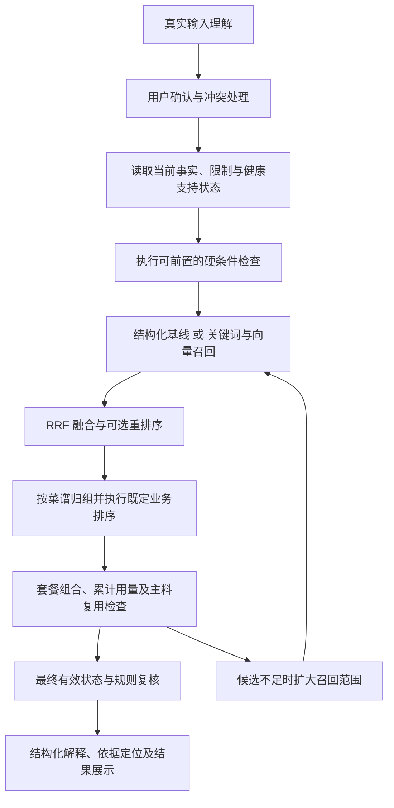

# 菜谱推荐检索架构设计

> 2026-10-19 实现补充：当前采用全目录结构化资格检查后排序/归组/分页的 A 基线，AR-M02 反例及范围见 [implementation-v0.1.md](implementation-v0.1.md)。排序新增用户确认见 D7-02；向量、RRF 与重排仍未启用或实测。

日期：2026-10-19
状态：架构方向已确认；实验尚未执行；上线性能与成本指标待实测。

## 1. 结论与继承约束

采用**结构化检索与规则检查作为基础，混合检索作为待验证的增强能力**：

- A：建立结构化检索基线。
- B：对照验证关键词与向量混合检索，采用 RRF 融合；基线完成后再验证重排序。
- C：保留 LightRAG／图检索的架构比较；出现明确的跨关系查询需求后再开展实验。
- 输出结构化推荐原因及可追溯的依据片段，首版不要求每次调用生成模型撰写解释。
- 混合检索没有稳定收益时，继续采用 A，不因已完成实验而强制上线 B。

本设计继承 [PRD](../PRD.md)、[需求基线](requirements-baseline.md)、[阶段 1 数据知识架构](data-knowledge-design.md)及[决策日志](decision-log.md)中的 D0／D1 决定：

1. 推荐限定在可核对的菜谱集合与口味变体内。
2. 过敏、明确忌口、健康规则、库存及补买条件由结构化事实和规则执行。
3. 数量未知允许推荐并标未核实；营养缺项不阻断普通推荐。
4. 健康模式用于规避有依据的饮食风险，不提供治疗结论或绝对安全保证。
5. 健康审核不阻塞研发；正式开放仍须审核。
6. 真实照片及健康／过敏资料境内处理，个人资料不进入公共知识索引。
7. 采用结构化检索，不取消真实图片识别和连续中文理解能力。

## 2. 架构方案比较

| 方案 | 收益与适用条件 | 代价与主要风险 | 本阶段决定 |
| --- | --- | --- | --- |
| A．关系型数据库＋规则过滤 | 适合有限目录、明确食材、库存及限制；结果便于解释和复核 | 对模糊描述依赖标签、别名与查询理解，表达覆盖需要维护 | 必建基线及故障降级路径 |
| B1．结构化数据库＋传统向量 RAG | 可处理语义表达，适合文档问答 | 纯向量容易漏掉精确名称；生成环节可能引入无依据内容 | 作为比较项，不采用“检索片段直接生成推荐”的默认路径 |
| B2．结构化数据库＋关键词／向量混合检索 | 同时覆盖准确名称与模糊表达，保持规则独立 | 增加模型、索引、评测及版本维护成本 | 主要实验方案 |
| C1．结构化数据库＋LightRAG | 可借助实体关系和文本检索处理跨主题关联 | 自动关系抽取需要核验；建库、更新和模型调用成本增加 | 暂不进入首轮实现实验 |
| C2．数据库＋人工治理知识图谱 | 关系语义可控，适合复杂路径查询 | 需要实体对齐、关系标注及图维护；当前明确需求不足 | 保留替代方案 |

LightRAG 结合图与向量检索，提供多种检索模式；它不必然要求独立图数据库，但仍增加关系抽取、合并和更新职责。框架宣称的效果不能作为本项目选型结论。[LightRAG 官方项目](https://github.com/HKUDS/LightRAG)

PostgreSQL、全文检索与 pgvector 可作为 A／B 的参考实现组合；本阶段不将其写成整个后端已经确定的技术栈。PostgreSQL 内置全文排序也不能直接称为 BM25。[PostgreSQL 全文检索说明](https://www.postgresql.org/docs/current/textsearch-intro.html)

## 3. 组件职责与最小接口边界

| 组件 | 输入与输出 | 职责边界 |
| --- | --- | --- |
| 查询理解与确认 | 图片／文字 → 分类信息及确认状态 | 识别食材、数量、人数、限制和偏好；不直接认定健康适用 |
| 规则与资格检查 | 已确认条件＋权威事实 → 可用范围、待补信息及排除原因 | 执行限制、支持状态和可核实条件，不使用相似度判断安全 |
| 检索表示构建 | 已发布菜谱变体 → 文本、关键词及向量记录 | 生成可重建的派生数据，不成为事实主库 |
| 召回与融合 | 查询、过滤范围、索引版本 → 有序变体候选 | 关键词与向量召回、RRF 融合、必要时扩展 |
| 可选重排序 | 相同候选集＋查询 → 相关性顺序 | 改善排序，不修改条件或事实 |
| 推荐与套餐组合 | 候选、人数、库存和模式 → 菜谱／套餐 | 执行业务排序、套餐累计用量及主料复用检查 |
| 依据与展示 | 最终判断＋事实／规则版本 → 原因和依据定位 | 只解释实际执行的判断，不补编依据 |
| 索引发布与观测 | 内容变更、构建结果、运行指标 | 版本管理、失效拦截、降级与评测 |

本阶段不新增对外 API。后续内部接口至少应能表达：

- 已确认条件与尚待确认条件，不能只传一段原始查询。
- 菜谱、变体、内容版本及索引版本。
- 召回来源、排名、候选范围及是否已穷尽。
- 排除、待补信息、技术失败、有效无结果等不同状态。
- 规则和证据版本、数量未核实状态及实际降级路径。

具体字段、协议及服务拆分留给后端专题；这些语义不能在实现时省略。

## 4. 结构化字段与文本切分

| 内容 | 保存与检索方式 | 理由 |
| --- | --- | --- |
| 菜谱／变体标识、类别、发布时间、有效状态 | 结构化字段 | 用于关联、筛选、去重和更新 |
| 食材、调味料、角色、用量、单位、可省标记 | 结构化主数据；可同步进入检索文本 | 文本有助召回，精确检查必须读取主数据 |
| 成分、过敏原、疾病支持及规则 | 结构化事实与规则 | 缺少记录不表示安全，不能依赖向量相似度 |
| 营养数值及来源 | 结构化记录和计算结果 | 保留单位、形态、缺失状态与来源版本 |
| 菜名、别名、口味、描述、做法特点 | 关键词与向量检索文本 | 同时支持精确名称和自然表达 |
| 完整步骤 | 原文按顺序保存；必要时生成检索表示 | 不把零散步骤当成独立菜谱 |
| 健康证据 | 有版本文档及定位，通过规则关联读取 | 首版不依赖语义搜索寻找健康依据 |

**每个口味变体作为一个独立检索单位。** 召回后按父菜谱归组，保留合格变体，避免同一道菜占满六张卡片。

切分采用以下规则：

- 短菜谱：保留完整变体表示，不机械按固定字数切碎。
- 较长菜谱：优先使用名称、配料、口味、做法特点组成的稳定检索表示；必要时按完整语义单元分段。
- 每个分段都绑定父菜谱、变体、内容版本和原文位置；不得跨变体拼接。
- 不以大面积重叠复制配料表，不因分段更多而提高菜谱累计得分。
- 健康知识按主题、适用条件、例外和证据定位组织文档；首版通过规则直接定位，不建设健康问答向量库。
- 超过模型输入上限时先调整表示或切分，不能静默截掉重要内容。

按菜谱切分便于保持上下文，但长文可能稀释重点；按步骤切分粒度细，却容易失去配料与条件；按主题切分适合知识文档。采用当前组合，是因为用户首先需要找到完整可做的菜。

## 5. Embedding 与中文关键词方案

### 5.1 模型候选

| 候选 | 收益 | 代价与适用边界 |
| --- | --- | --- |
| BGE-M3，自部署 | 支持中文和多语言，MIT 许可，原生 1024 维；部署与版本可控 | 需要计算资源、部署和运维；开源不等于运行免费 |
| text-embedding-v4，北京地域 API | 减少模型运维，支持可配置维度 | 有调用费用、网络依赖和服务条款约束；需核验实际处理及保留边界 |
| Qwen3-Embedding-0.6B | 保留另一种自部署候选，支持可配置维度 | 增加实验组合；首轮不同时扩展过多模型 |

首轮重点比较前两项；Qwen3-Embedding-0.6B 作为备用，不因模型公开基准成绩直接替换已选实验对象。模型能力与使用方式分别参考 [BGE-M3 模型卡](https://huggingface.co/BAAI/bge-m3)、[阿里云向量接口](https://help.aliyun.com/zh/model-studio/text-embedding-synchronous-api)和 [Qwen3 模型卡](https://huggingface.co/Qwen/Qwen3-Embedding-0.6B)。

### 5.2 参数与处理原则

| 项目 | 实验起点 | 选择理由及代价 |
| --- | --- | --- |
| 向量维度 | 1024 维基线；API 候选另测 512 维 | 512 维减少向量存储和距离计算量，但可能损失区分能力；效果必须实测 |
| BGE-M3 维度 | 保持原生 1024 维 | 不通过任意截断伪造受支持的降维方案 |
| 模型能力 | 首轮只测试稠密向量 | 便于定位收益；稀疏和多向量能力暂不引入 |
| 领域适配 | 先治理别名、词典和检索文本，不微调 | 数据准备成本较低，也避免用小样本过拟合 |
| 构建方式 | 离线批量编码，失败项单独重试 | 提高吞吐；批大小须遵守接口限制及本机资源 |
| 在线请求 | 查询实时编码，不持久缓存个人查询向量 | 降低保留范围；重复请求仍有计算成本 |

查询与文档采用对应模型要求的编码方式、归一化和距离度量，并记录版本。同为 1024 维不代表不同模型的向量可混用。

正式敏感请求接入前须核验境内处理和保留条款；不能只因服务名或接入点在北京就认定全部要求已经满足。实验优先使用公共菜谱和人工构造查询。

### 5.3 中文关键词

采用**精确分词＋受控菜谱词典**作为实验方向，jieba 作为实验工具。维护菜名、食材别名、复合调味料和常见做法词；词典修改进入版本管理。[jieba 官方项目](https://github.com/fxsjy/jieba)

精确分词较容易控制噪声；搜索模式能拆出更多词，但可能增加误匹配。生产分词库结合后端语言确定，必须复用同一套词典与回归样本。

否定和限制单独解析：“不要花生”不能被转换成对花生菜谱的正向偏好；分词结果不承担过敏判断。

## 6. 检索执行流程与规则顺序

具体执行要求：

1. **先解决输入是否可用。** 未知过敏、未知明确忌口及无法分类限制暂停推荐；未知数量继续保留未核实状态。
2. **先做能够可靠执行的过滤。** 包括已发布状态、可确认的成分限制、健康支持范围等。依赖具体变体、份量或组合的判断在相应阶段执行。
3. **检索只改善发现与排序。** 任何分数都不能覆盖硬限制；健康条件不交给向量相似度推断。
4. **最终展示前复核。** 读取实际变体及当前有效状态；若关键规则版本已变化，重新判断或要求重试。
5. **数量检查区分单菜与套餐。** 单菜分别可用，不等于整套累计用量可用。
6. **主料复用区分模式。** 接受补买时，候选模式要求每道复用现有主料；套餐要求整套至少复用一种，不能误把前者施加到套餐的每一道菜。
7. **家常优先、少补买及单菜口味覆盖继承 PRD。** 检索层输出相关性，不自行创设这些业务规则之间的新优先级。
8. **健康依据按实际执行规则定位。** 返回规则关联的来源版本与原文位置；不通过语义搜索拼接出新的健康结论。

健康规则无法核验时停止相关健康推荐，由用户主动选择修改或返回普通模式。普通模式仍执行过敏和明确忌口。

## 7. 召回、融合、去重与重排序

### 7.1 起始参数

| 参数 | 已确认实验起点 | 收益与限制 |
| --- | --- | --- |
| 向量搜索 | 精确搜索 | 排除近似索引漏召回这个变量；数据增大后计算成本上升 |
| 每路候选数量 | 30，不足时扩至 60，再扩大结构化候选范围 | 小池成本低，大池覆盖广；不是上线定值 |
| RRF | 两路等权，常数 `k=60` | 不必校准关键词与向量原始分数；可能忽略原始分数差距 |
| 页面数量 | 每页最多六道不同菜谱 | 继承 PRD，与召回数量独立 |
| 重排序 | 基线完成后，以相同候选集做开关对照 | 能隔离排序增益，不把召回变化误算成重排收益 |

RRF 按各路名次计算 `Σ 1/(rank + k)`。较小的常数更突出靠前名次；较大的常数减弱名次差距。这里的 `k=60` 与召回 60 个候选是不同参数。[RRF 说明](https://learn.microsoft.com/en-us/azure/search/hybrid-search-ranking)

精确搜索仅表示准确计算距离排名，不表示语义理解正确。HNSW 暂不引入；如果规模和延迟证明需要，再以精确结果为参照评估。近似索引与过滤组合可能返回不足，不能误判为全库没有结果。[pgvector 官方说明](https://github.com/pgvector/pgvector#filtering)

### 7.2 去重与扩展

- 以变体召回，以父菜谱归组；保留仍可用的其他变体。
- 不累加同菜多个变体或多个文本分段的分数来奖励内容数量。
- 套餐无法组成、候选归组后不足、翻页或换菜需要更多结果时，扩大候选范围。
- 扩展不会放宽限制、自动接受补买或引入目录外菜谱。
- 达到检索或组合计算预算时，返回本次未找到或处理未完成，不能声称已证明无解。
- 全量候选检索也不等于穷举所有套餐组合；组合求解的完成状态由推荐模块明确返回。

### 7.3 可选重排序

采用 `bge-reranker-v2-m3` 作为实验候选，在相同候选集上比较前六条相关性、延迟和成本。它支持中文场景，但项目效果必须实测。[官方模型卡](https://huggingface.co/BAAI/bge-reranker-v2-m3)

重排序只能调整已召回候选，不能恢复漏召回、改变配料或审核健康风险。无稳定收益时保持关闭；失败时退回融合排名与业务排序。

## 8. 评估与小规模验证

### 8.1 实验顺序

1. 核验内容包和结构化规则，建立 A 基线。
2. 固定内容版本、查询和规则，比较关键词、向量及混合召回。
3. 比较 BGE-M3 与 API 候选；仅对支持的候选增加 512 维实验。
4. 验证每路 30→60 的扩展效果、归组和套餐可行性。
5. 基线稳定后增加重排序开关对照。
6. 汇总质量、延迟和费用；证据不足时继续使用 A。

每轮尽量只改变一个因素。记录模型、词典、文本表示、索引和规则版本，使结果能够复现。

### 8.2 查询集与指标

首轮以 **200 条人工核对查询**为工作量起点，不作为样本充分性的保证。覆盖准确名称、别名、模糊表达、否定与限制、库存与套餐、变体、无结果和故障场景。

相近表达按模板分组，分配到调参集或保留测试集，避免改写泄漏。标注同时包含相关性、不可用原因和预期结果状态。小内容包尽量全量核对；较大内容包使用多方案候选合并并抽检遗漏，明确标注覆盖边界。

| 指标 | 口径 |
| --- | --- |
| Recall@30／@60 | 对已标注相关且可用结果的召回覆盖；分别记录变体与归组后菜谱 |
| nDCG@6 | 去重后前六道菜的分级相关性排序 |
| 约束违规 | 输出违反已确认限制、数量或模式规则的次数及场景 |
| 无依据内容 | 解释无法对应实际事实、规则或证据的次数 |
| 错误无结果 | 已知存在可行结果却被报告为无结果的次数 |
| 套餐可行性 | 累计用量、复用规则及组合约束是否成立 |
| 延迟 | 各组件和整体的 P50／P95，区分冷启动、热请求和降级 |
| 成本 | 每千次请求、离线建库及自部署资源成本分别记录 |

检索指标可参照通用评估方法，但必须使用本项目查询和内容。[BEIR 官方项目](https://github.com/beir-cellar/beir)

固定回归集要求约束违规和伪造依据为零；这不等于证明绝对安全。相关性提升还需检查不同查询类别，不能用平均提升掩盖关键场景退化。

上线延迟、并发和费用阈值在实测后收口。当前不填造准确率，也不根据一次小样本领先自动批准上线。

### 8.3 必须覆盖的样例

- “下饭的鸡丁”命中宫保鸡丁，但存在花生限制时仍被排除。
- 两道炒蛋分别满足库存，整套累计超过库存时不得通过。
- 用户库存数量未知，仍可展示标准配方参考营养，库存保持未核实。
- 单菜变体新增调料后重新执行成分限制。
- 同一道菜多个变体不能占满六张卡片。
- 前 30 个候选无法组成套餐，扩展后找到可行组合。
- 单病种已支持、疾病组合未支持时，不自动批准组合。
- 证据撤回、索引仍含旧内容时，最终检查拦截。
- 模型或维度不匹配时，不混用向量；可退回结构化路径。
- 规则服务失败时，不用旧“通过”结果继续推荐。

当前 Demo 仅有 24 道菜，部分配方、变体和健康信息为模拟。它可用于流程检查，不能证明真实检索质量，也不能验证 30 与 60 的规模差异。

## 9. 更新、缓存、降级与可观测性

### 9.1 版本发布

采用“构建候选版本 → 完整性和回归检查 → 切换生效版本”。

- 普通内容更新只重新编码受影响记录。
- 模型、维度或编码协议变化建立独立索引，查询编码同步切换。
- 发布清单记录内容版本、表示方式、分词词典、Embedding、维度及距离配置。
- 构建失败不发布半成品；仍有效的旧版可继续运行。
- 停用与撤回状态独立于索引构建执行；每次使用都必须遵守。
- 回滚只允许回到仍有效的版本，不能恢复已撤回内容。

这种方式增加临时存储和发布管理成本，但避免新旧向量混用。暂停服务原地重建保留为简单替代方案。

### 9.2 缓存

首版缓存公共菜谱表示、文档向量和版本化公共数据，不持久缓存个人查询向量及最终个性化结果。

缓存命中仍须检查内容有效状态，并重新执行当前个人限制、库存及健康规则。不能仅靠缓存过期时间处理安全撤回。

收益是状态边界清楚、减少混用风险；代价是重复请求仍有编码或规则计算成本。只有实测证明必要时，才重新讨论个人结果缓存。

### 9.3 降级

| 失败点 | 处理方式 |
| --- | --- |
| 重排序 | 返回 RRF 与既定业务排序 |
| 向量编码或检索 | 使用关键词及结构化检索 |
| 关键词检索 | 使用正常的其他召回分支与结构化检查 |
| 语义分支全部失败 | 使用结构化基线 |
| 健康必要规则或证据无法核验 | 停止依赖它的健康推荐 |
| 核心事实无法读取或限制无法执行 | 停止相关推荐，保留输入并允许重试 |

任何降级都不自动放宽限制、不自动接受补买、不自动切换健康模式。技术失败与真正无结果分别记录和反馈。

### 9.4 观测与诊断

记录随机请求标识、模型／索引版本、阶段耗时、候选数量、扩展次数、失败和降级类型。

通用日志不记录照片、完整输入、疾病名称、过敏清单、查询向量或可能暴露这些信息的详细排除记录。优先用人工构造或处理后的样例重放问题。

实时解释可以使用当前请求上下文；是否持久保存敏感诊断数据仍受权限、保留和删除边界约束，不因可观测性需要自动扩大保留范围。

## 10. 风险、暂不需要的能力与后续边界

首版暂不引入独立图数据库、健康文档语义问答、多向量检索、Embedding 微调和持久个人结果缓存。HNSW 与重排序均须证明必要性后启用。

主要风险及处理：

- **内容事实不完整：**不以检索命中补全成分或证明安全。
- **小样本过拟合：**保留独立测试集，分类型报告；不足时补样本。
- **向量或关键词漏召回：**候选扩展、结构化回退及错误无结果测试。
- **索引与事实不一致：**版本绑定、发布校验与最终有效状态检查。
- **外部 API 费用或可用性变化：**保留自部署及结构化替代路径。
- **日志泄露敏感信息：**最少记录、公共索引隔离，真实数据接入前收口治理要求。

以下属于正式发布或后续专题待落实事项，不影响本架构文档定稿：

- 正式内容清单、授权记录、数据规模及标注责任。
- 专业审核资源、疾病及组合支持范围。
- 实测质量增益、部署资源、延迟和成本上限。
- 后端产品选型、套餐配比与业务排序冲突的具体处理。
- 敏感数据保留、诊断权限及删除流程。

本阶段完成设计和验证计划，不表示模型已部署、实验已运行或健康能力已获准开放。

## 本地业务读取实施增量（2026-10-21）

本轮数据库内容快照已接入既有结构化过滤与业务排序，但仍为18道构造菜谱全量读取后在内存执行约束。文本词典使用该快照的食材/别名/类别，不等于SQL全文/BM25/语义检索已经接通。未写查询向量、未建模型索引或启用Embedding；既有向量空结构保持原状态。

类别范围及contains关系仅服务已确认限制，不让检索分数替代过敏、库存或固定配方计算。正式检索质量、较大目录召回/重排、性能和成本仍待实验。结果和边界见 [本地业务验收](../ACCEPTANCE-local-business.md)。
